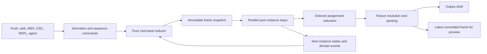

# Functional effect runtime

Status: proposed architecture, grounded in the checked-out code, with a small
experimental kernel implemented separately. Except for the explicitly identified
kernel API below, the contracts and examples are design targets, not APIs already
available to shows. Adopt them incrementally behind compatibility adapters and
characterization tests.

## What the current code does

The inspected baselines are tolglow `01146ece7731ec06aa1ee6409342373096c8e0dc`
and the afterglow fork `16b0b4cac70433e4118038dfbfd304e22d1d9018`. Source references:

| Source | Existing responsibility and migration implication |
| --- | --- |
| [afterglow.effects](https://github.com/tolgraven/afterglow/blob/16b0b4cac70433e4118038dfbfd304e22d1d9018/src/afterglow/effects.clj) | `IEffect` separates `still-active?`, `generate`, and `end`. `run-assigners` already folds the previous assignment through ordered functions. Preserve that useful value-passing behavior. `scene`, `code`, `fade`, `chase`, and fade-out behavior capture mutable state in atoms. |
| [afterglow.show](https://github.com/tolgraven/afterglow/blob/16b0b4cac70433e4118038dfbfd304e22d1d9018/src/afterglow/show.clj) | `send-frame` clears buffers, removes completed effects, gathers assigners, resolves kinds in order, sends output, then advances movement history. Effects and targets are already processed with Claypoole. State spans multiple atoms, and repeated reads do not constitute one coherent frame snapshot. |
| [afterglow.effects.params](https://github.com/tolgraven/afterglow/blob/16b0b4cac70433e4118038dfbfd304e22d1d9018/src/afterglow/effects/params.clj) | Parameters receive show, snapshot, and optional head; non-frame-dynamic parts can be resolved once. These are valuable existing specialization boundaries. Variable params can observe mutable show values. |
| [movement](https://github.com/tolgraven/afterglow/blob/16b0b4cac70433e4118038dfbfd304e22d1d9018/src/afterglow/effects/movement.clj), [channel](https://github.com/tolgraven/afterglow/blob/16b0b4cac70433e4118038dfbfd304e22d1d9018/src/afterglow/effects/channel.clj) | Resolvers write byte arrays. Movement resolvers also use dynamic `*show*` and update shared `:movement`; prior pan/tilt influences the next solution. Moving this history into explicit frame state is necessary for deterministic replay. |
| [tolglow.fx](../../src/tolglow/fx.clj), [param](../../src/tolglow/param.clj), [cue](../../src/tolglow/cue.clj), [config](../../src/tolglow/config.clj) | Tolglow builds on the existing Effect/Param protocols, implicit show context, configuration atoms, and closures. `get-fx-maker` and `fx-data` show early attempts at declarative effect metadata; these are not a complete registry or compiler. |

Changing a Var does not replace a function value already captured inside an Effect
record. `start!` restarts the render task but retains the existing show model and
active effect objects. These explain important reload/restart hazards; they are
not evidence that every observed stale cue comes from one specific mechanism.
Tolglow's `fx/pass-live-fn` and `fx/live` already experiment with calling through
a Var; `live.clj` explicitly notes recreating effects each frame. Preserve useful
live-edit behavior while replacing repeated construction with versioned plans.

The current assignment kind order is `[:color :pan-tilt :direction :aim :channel
:function]`. Later effects at equal priority run later; later assigners may override
or blend earlier values. These semantics must survive the migration. Extension
registration currently supplies additional kind orders; replace accidental map
iteration order with an explicit, validated extension order.

## Experimental kernel implemented in this foundation

The added `afterglow.runtime/render-frame` namespace is deliberately independent
of `afterglow.show`. It depends only on Clojure core and can be tested without
opening MIDI, OSC, OLA, web, or display resources. Its current API is:

```clojure
(render-frame
  {:frame {:elapsed-seconds 0.025 :epoch 1 :frame-id 1}
   :effects [{:id :instance-1 :priority 0 :order 0
              :state {:ticks 0}
              :step (fn [ctx]
                      (-> ctx
                          (update-in [:state :ticks] inc)
                          (update :assignments conj
                                  {:kind :dimmer :target-id :rear :value 0.5})))}]})
```

Each step receives `{:frame snapshot :effect-id id :state previous-state
:assignments [] :intents [] :done? false}` and returns updated state and vectors.
Here `:effect-id` identifies the running instance; it is not the proposed future
definition identity. Ordinary function composition supplies middleware. An
optional second argument `map-work` takes `[f instances]`, evaluates each once,
and returns unmodified results in any order; the caller owns its executor and
cancellation. The kernel validates instance/result shapes and detects duplicate,
missing, or foreign executor results before returning a new context.

The output collects contributions in ascending priority, launch order, and input
position, preserving each step's vector order. `:done? true` includes that step's
final contributions and then removes the instance. This is an explicit new
contract, not identical to legacy `still-active?` removing an effect before
generation. Remaining instances retain their original vector order with updated
state. Top-level assignment and intent vectors are fresh for each frame.

This proves a narrow seam for immutable state evolution and deterministic
collection. It does not implement assignment blending, DMX packing, legacy effect
adaptation, command dispatch, epoch validation, registry reload, rendering
deadlines, or output publication. Supplied `:frame` identity fields are opaque
data today. Purity and deep immutability remain caller obligations; shape checks
cannot prevent a supplied function from mutating a Java object or performing I/O.
The richer architecture below is the path from this seam to a usable show runtime.

## Goals and boundaries

An effect computes an updated context from data. Time, randomness, input events,
fixture geometry, parameter values, previous outputs, and lifecycle state are
explicit inputs. The same inputs produce the same result regardless of worker
count. This permits middleware composition, replay, testing, offline rendering,
and compiler optimizations.

The application still needs state and side effects. A small runtime shell owns
command queues, a published model reference, worker pools, clocks, device handles,
network connections, and output buffers. Atoms may be appropriate at these
boundaries. Effects and parameter evaluators must not reach into them. Replacing
every atom with a persistent map without defining ownership would merely relocate
races and could increase allocation dramatically.

Afterglow owns generic runtime, assignment semantics, fixture resolution, and
transport contracts. Tolglow owns show definitions, creative effect libraries,
registry authoring workflows, macro composition, and application policy. Both
must depend on the same control and definition schemas.

## Identity and revisions

| Field | Meaning |
| --- | --- |
| `:show-id` | Stable identity of a configured show. |
| `:epoch` | Runtime generation; changes when a show runtime is reset or rebuilt. |
| `:definition-id`, `:definition-version` | Stable effect definition identity and immutable revision; revisions pin executable code and schemas. |
| `:registry-revision` | Atomic collection revision for interdependent definition updates. |
| `:cue-id` | Stable launch configuration identity, independent of its grid location. |
| `:instance-id` | One launched effect instance, unique within its show epoch. |
| `:command-id`, `:source`, `:sequence` | Deduplication key, originating adapter, and authoritative command ordering. |
| `:frame-id`, `:model-revision` | Monotonic frame and the exact command-reduced model used to compute it. |
| `:rig-revision` | Fixture patch/geometry revision used for compilation and rendering. |

Grid positions and display names are presentation values, not identity. Every
release, scheduled callback, worker result, GPU readback, and completion event
carries enough identity to reject stale work. A held pad's release targets the
instance launched by that gesture; it cannot terminate a newer instance that
happens to occupy the same slot.

## Data flow and ownership



One coordinator owns model transitions. At each frame boundary it accepts a
bounded batch of sequenced commands, updates the model, selects the next logical
time and registry/rig revisions, and freezes the frame snapshot. Commands arriving
during calculation are queued for the next boundary. Workers read only this
snapshot and their assigned instance state. They never publish model changes.

After workers finish, the coordinator validates results against the epoch,
instance, and definition versions, reduces outputs in semantic order, and commits
new instance state once. Side effects are performed from accepted results only.
No arbitrary user function runs inside a retryable `swap!`/CAS updater. A repeated
pure calculation is harmless; repeating an external output operation may not be.

The normal first implementation allows one frame in flight. Later pipelining may
overlap independent output transfer or GPU work, but must retain ordered state
commit; frame N+1 cannot evolve stateful effects from an uncommitted N. Deadlines
and late-frame policy are explicit in [rendering.md](rendering.md).

## Proposed effect contract

This is illustrative Clojure data and pseudocode, not a compatibility promise:

```clojure
{:definition-id :tolglow/bloom
 :definition-version 3
 :state-version 1
 :parameters {:width {:type :number :unit :metre :default 1.0
                      :range [0.01 20.0]}}
 :init init-context
 :step step-context
 :migrate migrate-context}

{:input {:show-id :main
         :epoch 7
         :frame-id 1200
         :model-revision 84
         :time {:elapsed-seconds 30.0 :dt-seconds 0.025
                :beat 60.0 :bar 15.0}
         :rig-revision 9
         :rig rig-value
         :variables variables-value
         :events instance-events
         :previous-output previous-instance-output}
 :instance {:instance-id 42
            :cue-id :rear-bloom
            :definition-id :tolglow/bloom
            :definition-version 3
            :started-at {:elapsed-seconds 29.0 :beat 58.0}
            :params {:width 2.0}
            :state {:phase 0.2}
            :rng {:algorithm :versioned-algorithm :state rng-value}
            :lifecycle {:phase :running}}
 :output {:assignments [] :events []}}
```

`init`, `step`, and middleware take a context and return a context. `:input` is
read-only; `:instance` is that instance's next state; `:output` starts empty for
each step and accumulates ordered assignment intents and domain events. A
contract checker rejects changes to the input section, foreign instance IDs,
invalid values, and malformed outputs during development. Production uses
validated definitions and inexpensive boundary checks rather than deep copying
the entire rig on each call.

```clojure
(defn step [ctx]
  (let [phase (next-phase (get-in ctx [:instance :state :phase])
                          (get-in ctx [:input :time :dt-seconds]))]
    (-> ctx
        (assoc-in [:instance :state :phase] phase)
        (update-in [:output :assignments] conj
                   {:kind :dimmer :target-id :rear-left
                    :blend :replace :value phase}))))

;; Proposed composition; helpers are not yet implemented.
(def update-effect
  (comp validate-output apply-release-envelope step resolve-parameters))
```

Middleware order is intentional and testable. Parameter resolution precedes the
effect calculation; an envelope can then transform selected outgoing attributes.
Context helpers hide storage details, so the same creative effect can run in a
REPL and in a compiled frame plan. An effect may opt into an optimized batch
kernel later without exposing mutable arrays to ordinary user code.

Assignment descriptors retain kind, target, stable local order, and blend
operation. CPU-only code may use pure functions in an executable plan, while the
serializable definition uses named, versioned operators. Unknown functions are
not automatically shader code. Target-dependent operations such as HTP must see
the preceding value in the ordered fold, not a prematurely precomputed value.

## Multithreading and deterministic reduction

1. Evaluate independent effect instances in a bounded executor. Store each result
   at its preassigned index, regardless of completion order.
2. Sort instances by the existing priority and launch-order semantics. Flatten
   local assignment vectors in their original order.
3. Group by assignment kind and target. Run each target's chain sequentially,
   starting with the kind's defined absent value; different targets may run in
   parallel.
4. Resolve kinds in the established order. A later raw channel/function write
   must still override earlier color/movement resolution where that is current
   behavior.
5. Merge per-target movement histories and write intents deterministically. Pack
   channels only after ownership/conflict checks; do not let two workers race to
   write overlapping DMX indices.

Adding reducers or `pmap` indiscriminately does not make an operation parallel.
Blending, fades, and stateful chains are generally not associative or commutative.
Parallelize the independent outer dimensions and preserve their inner ordering.
For multiple kinds that affect one physical channel, the compiled plan defines
the winner. Fixture aliases or overlapping patches must be diagnosed, rejected,
or assigned a documented explicit precedence.

Global variables are snapshot values. An effect that produces a variable change
emits a command/event applied at the next boundary. If same-frame modulation is
required, express it as an explicit acyclic dependency graph with ordered stages;
do not communicate through hidden atom writes. Cycles need an explicit one-frame
delay node and initial value. Effects cannot read arbitrary neighboring instance
state from a concurrently evolving map.

Use an explicit, versioned random generator per instance. Splitting streams uses
stable instance/target identities, never task scheduling order. Sampling a tween
or envelope uses logical time, not wall time or the number of times a worker ran.
Record external beat/clock corrections as input events. Separate monotonic
scheduling time from musical time and define tempo-change/seek behavior.

## Lifecycle, one-shots, envelopes, and tweens

Lifecycle states are `:pending`, `:running`, `:releasing`, `:completed`, and
`:failed`. Launch may be quantized; init runs when launch becomes effective.
Graceful end becomes a release event; force end removes the instance at the next
accepted boundary. Preserve the existing second-end-forces-stop behavior in the
legacy adapter. The new command schema names graceful release and force stop
explicitly so clients need not infer intent from repeated input.

One-shot policy belongs to launch configuration, with duration in seconds, beats,
or one declared effect cycle. An indefinite effect needs a defined duration to
be launched as a one-shot. A completion and cleanup event is emitted once per
instance. Child effects in scenes/chases have state nested under stable child
IDs, replacing closure atoms and positional-only lifecycle bookkeeping.

ADSR response controls are transforms over selected parameters/attributes with
attack and release first-class. An envelope declares whether it affects the whole
show, a fixture selection, selected definitions, or explicit running instances.
Define behavior when scope membership changes, an attack is interrupted, release
is retriggered, or the end value is nonzero. Preserve release state after the cue
stops generating its main content where a tail is intended. Global blackout and
force stop still have explicit precedence.

Tween definitions declare duration, curve, repeat count, direction, endpoints,
and clock domain. Sample them at the requested time. Repeat, ping-pong, random
step order, and stepped fades use the same timeline primitives as the sequencer;
macros are unordered slot collections unless sequencing is enabled. Curve names
resolve to a registry of pure functions; exported declarative curves cannot embed
arbitrary executable reader forms. Endpoint, zero-duration, tempo change, seek,
and interruption semantics need fixtures before UI work relies on them.

## Registry and live code replacement

Compile and validate a new immutable definition version away from the render
thread. Check parameter schemas, typed expression graph, declared target
capabilities, child references, and bounded compilation resources. Publish the
whole registry revision at one frame boundary only after validation succeeds.
Cues resolve definition IDs through the registry; running instances record the
exact version used for their current frame.

Every stateful definition declares one reload policy:

| Policy | Behavior |
| --- | --- |
| `:migrate` | Pure old-state/old-schema/new-schema transformation preserves supported state, time origin, and compatible parameter values. |
| `:restart` | Initialize a replacement at the boundary with explicitly retained cue/parameter configuration; emit replacement events. |
| `:defer` | Existing instances finish on their pinned version; future launches use the new definition. |

An unsuccessful compile or migration keeps the current revision running and
returns structured diagnostics to the editor. A parameter rename needs an
explicit migration; deletion cannot silently preserve an inaccessible mutable
variable. Dependencies between compound definitions update atomically, avoiding a
frame that mixes incompatible parent and child revisions. A history of accepted
versions permits rollback using the same rules.

Distinguish pause/resume, transport seek, effect replacement, and runtime reset.
A runtime reset increments the epoch, invalidates queued old work, clears active
instances and transient variables, and reconstructs cue activity from committed
instances. Optional resume is a versioned saved-state migration, not accidental
retention of old closures. Device/web views are projections; they cannot retain a
separate authoritative active-cue set.

## Compatibility migration

Start with a pure CPU implementation and an adapter, not a simultaneous protocol
rewrite across every device and effect. The legacy `IEffect` API remains usable
while each effect family moves behind the new contract.

Legacy objects can capture atoms, mutate dynamic show state, return lazy work, or
perform arbitrary I/O. Wrapping them in a map does not make them pure. Keep an
explicit compatibility lane whose callbacks are serialized with respect to
legacy state. Bind the correct legacy show at the boundary, fully realize results
before leaving that boundary, and translate output into ordered intents. Record
that this lane cannot promise deterministic replay or rollback of arbitrary code.

A snapshot-backed read view can support legacy read-only variable/geometry access,
but arbitrary writes cannot be silently redirected into independent atom copies
and called equivalent. Classify legacy effects as read-only, stateful-adaptable,
or imperative. Migrate a whole interacting group if it relies on same-frame
mutation; use explicit dependencies where that behavior is intentional. Keep
`code` cues as shell commands with completion receipts, and prevent them from
running inside retryable frame calculations.

Recommended order: static/channel effects; oscillators and variable params;
colors; movement with previous-frame history; scenes/fades/chases; code and
extension effects. For each family, run old and new paths against the same inputs
with output transport disabled, compare outputs, then enable the new path. Do not
emit live DMX twice while shadow rendering.

## Acceptance gates

| Gate | Required evidence |
| --- | --- |
| Existing semantics | Characterization of assigner ordering, nil behavior, HTP, fade endpoints, lifecycle, coarse/fine channel packing, inversion, and movement continuity. |
| Pure core | Inputs unchanged; identical input yields identical value; serialized/replayed supported state reproduces output. No wall clock/random/device access in kernels. |
| Concurrency | One worker and many workers produce identical logical output, including delayed/reordered worker completion, overlapping assignments, and rejected stale work. |
| Lifecycle | Start/release/force-stop/one-shot completion and nested cleanup happen once; duplicate commands and old gesture releases cannot affect replacements. |
| Registry | Failed reload retains good version; successful migration is atomic; restart creates no stale active cue or variable; old epoch results are discarded. |
| Performance | Representative rig benchmarks satisfy the measured deadline and allocation budget without changing output semantics. See [rendering.md](rendering.md). |
| Integration | Existing cue/control paths can use adapters, and the dry-run output sink can capture all resulting events and frames without hardware. |

These gates describe work to add. A small passing unit baseline is not evidence
that hot reload, multithreaded equivalence, or full-show compatibility already
passes. Keep implementation status and exact test commands in the project tracker.

## Decisions still requiring experiments

The exact Clojure schema library, serializable RNG algorithm, executor, runtime
shell lifecycle library, and typed IR representation are open. Choose them after
the baseline can measure dependency cost and performance. JVM Vector API and GPU
backends are optional accelerators, not prerequisites for the pure model. The
contract should remain usable on a CPU without a display, browser, or GPU.
