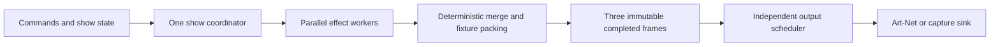

# Output deadlines and presentation policy

`afterglow.render.presentation` implements a pure policy after effect evaluation
and fixture packing. It does not advance effects, re-run intent handlers, change
show state, or own a scheduler/socket. The separate host publisher owns cadence,
completion admission and transport lifecycle. **Direct is the default**; selecting
a smoothing policy changes latency and fallback behavior explicitly.

## Clock and immutable packet contract

A completed frame has:

```clojure
{:epoch 4 :frame-id 126
 :time-ms 3150.0 :completed-at-ms 3177.4
 :universes {0 [;; exactly 512 unsigned byte integers
               ]}}
```

Both times use the same monotonic **physical scheduler clock**, independent of
paused musical transport or a show-time reset. `:time-ms` is the sample/scheduled
compute timestamp. A late completion retains it. `:completed-at-ms` records when
computation finished, and cannot precede the sample. We cannot send a frame into
the past: presentation records its own current physical time separately.

`freeze-frame` copies renderer-owned byte arrays into immutable vectors. Source
arrays must remain exclusively owned during this copy. `complete` admits only
frozen vectors with the matching epoch and universe set. Duplicate/reversed frame
IDs, non-increasing sample times, or a reversed completion clock are rejected.
History is bounded to three accepted frames. `materialize` returns fresh byte
arrays for one transport owner; another consumer needs its own materialization.
The policy never retains or publishes mutable renderer arrays.

Create a new state on epoch, physical clock-domain or patch changes. A backwards
presentation clock throws. A source completion cannot become available before
its completion timestamp. An overproducing worker can exhaust the three-frame
interpolation window; this is bounded storage, not an unlimited jitter buffer.

## Modes

| Mode | Timeline and fallback |
| --- | --- |
| `:direct` | Present the newest available sample; hold its bytes unchanged while waiting |
| `:hold-fade` | Present the newest available sample; after one nominal period without a new sample, linearly reduce eligible light output over `:fade-ms` |
| `:buffered-interpolation` | Present target time `now - latency`; interpolate bracketing available samples, otherwise hold and use the same fade after one period |

Default `:period-ms` is 25 (40 Hz), `:latency-ms` is one period and `:fade-ms` is
100. Latency must be between zero and two periods; fade duration must be positive.
These are physical timing controls, so milliseconds are deliberate here. Before
the first buffered sample is due, presentation returns no packet. There is no
prediction/extrapolation of motion into unknown future state.

Fade gain is `clamp(1 - max(0, target - sample - period) / fade, 0, 1)`.
It is computed from the original source frame each time, rather than repeatedly
multiplying an already faded frame. A late frame therefore does not reset its age
to zero. Repeated presentation at one timestamp is deterministic and cannot
apply effect state twice. A newly completed frame can recover brightness; that
is a deliberate response to available source state, not a second effect step.

The returned packet preserves lower source metadata and adds `:presentation`
with mode, presentation time, target time, lower/upper source times, interpolation
weight, fade gain and fallback flag. Shared model/output consumers must not
confuse that presentation projection with a new canonical effect result.

## Fixture-aware interpolation and darkness

`compile-plan` consumes the actual `frame/compile-patch` metadata or fixture data.
Known normalized linear dimmer, RGBW/amber/UV, pan, tilt, focus and zoom channels
may interpolate. Strobe, gobo, unknown controls, function/capability/range channels,
nonlinear transfer/curve metadata and partial inversions hold. A channel can opt
out with `:presentation :hold`. This is the new normalized fixture contract; it
does not infer arbitrary vendor photometry from a channel name.

A fixture with a supported linear hardware dimmer fades that dimmer **once**.
Its RGBW settings retain their ratios. A fixture without that supported dimmer
fades its supported emitter channels by the same gain. Master is already encoded
and is not applied again. Pan/tilt/focus/zoom, strobe and gobo are never faded
because they are not light intensity. If no supported linear emission channel
exists, the policy holds rather than inventing a safe darkness code.

Coarse/fine pairs are decoded and packed as one value using the renderer's
existing fractional-255 convention: `coarse + fine/255` in DMX-level units.
This is deliberately **not** a new `0..65535` mapping. Fine-first physical order,
universe crossings, and full inversion are supported. Independent byte
interpolation would break continuity across coarse boundaries and is not used.
Discrete bytes remain from the lower sample until the upper sample is due.
Zero/one interpolation endpoints preserve the original packet exactly.

Private invocation scratch uses transient vectors and final primitive channel
metadata to avoid a persistent-map update per byte. All returned packet data
remains immutable; no scratch escapes to state or another worker.

## API and host ownership

```clojure
(def plan (presentation/compile-plan compiled-patch))
(def state (presentation/new-state plan {:epoch epoch :mode :hold-fade}))
(def packet (presentation/freeze-frame
             {:epoch epoch :frame-id frame-id
              :time-ms scheduled-at :completed-at-ms finished-at}
             rendered-output))
(def admitted (presentation/complete state packet))
(def shown (presentation/present (:state admitted) physical-now))
;; The host owns state publication and sends a fresh transport copy if present.
(when-let [packet (:packet shown)] (presentation/materialize packet))
```

The host must serialize policy ownership, reject retired worker callbacks, and
keep output cadence independent of a slow computation worker. Commit each valid
engine result once; do not re-evaluate or rewind canonical effect state to fill
missing output frames. Presentation errors must not publish partially converted
universes. Real scheduler/transport integration has its own host tests and
measurements; these pure functions do not provide a realtime scheduling guarantee.

## Observed verification and costs

The focused policy suite passed **11 tests / 64 assertions** with reflection
warnings enabled, using the real fixture renderer. It covers late/reversed
completion, delayed interpolation, immutable buffer isolation, bounded history,
clock rejection, RGBW ratios, hardware dimmer/master behavior, blackout,
nonlinear/discrete holding, inverted/cross-universe/fine-first channels and the
coarse-boundary interpolation regression.

The retained [100-universe report](benchmarks/2026-11-21-presentation.edn) measures
12,800 RGBW fixtures / 51,200 bytes, 30 warmup and 100 samples on Java 21.0.13.
The [exact harness](benchmarks/presentation-bench.clj) runs from the Afterglow
classpath. Median/p95/p99 milliseconds were:

| Stage | Median | p95 | p99 |
| --- | ---: | ---: | ---: |
| Freeze owned buffers | 0.437 | 0.511 | 0.619 |
| Validate/admit completion | 0.573 | 1.112 | 1.327 |
| Direct presentation | 0.004 | 0.018 | 0.031 |
| Fade | 1.251 | 1.990 | 2.000 |
| Buffered interpolation | 1.720 | 2.635 | 3.457 |
| Fresh transport arrays | 1.666 | 3.187 | 5.826 |

Maximum interpolation was 13.65 ms and maximum materialization 8.97 ms. Allocation
is recorded per stage. These isolated costs exclude effects, worker scheduling,
network delivery and preview/UI contention; adding medians does not prove a
25 ms whole-show deadline. No physical fixture output was sent.

## Running the output scheduler

The host boundary is `tolglow.output.scheduler`. Its name describes its
job: send frames on a steady physical clock, even while a render is late. It is
not the effect evaluator or the 3D preview renderer.



The bounded effect worker pool remains parallel. A single coordinator commits
show state in launch/priority order; a separate output thread serializes packets
so they cannot overtake each other on the wire. Neither thread owns the other
thread's mutable buffers. The output thread never takes the show-owner lock.

`studio/start!` starts both schedules. `create-runtime` remains inert for tests;
`:independent-output? true` enables the same handover with manually driven ticks.
The sender consumes at most three completions per deadline. Excess pending
completions coalesce to the newest three. Epoch, fixture patch, policy or blackout
changes invalidate older completions; while waiting for the first valid frame of
that generation the scheduler sends darkness. Closing fences late completions
before the host sends its final zero frame and closes the transport.

Select the policy through the normal settings command, which is validated before
publication and persists in full show files:

```clojure
{:scope :output
 :values {:presentation {:mode :hold-fade :fade-ms 100}}}
```

The other modes are `:direct` and `:buffered-interpolation`; buffered latency
is `:latency-ms` (25 by default). Physical output timing deliberately uses
milliseconds. Musical cue durations and transitions continue to use beats,
bars and phrases. Status is exposed at `:status :output-scheduler`; it reports
pending/coalesced/published counts and the last source/target times and gain.

The host regression blocks a real effect worker while independently publishing
faded frames, proves show state advances only once after completion, and checks
that the late packet retains its original sample timestamp. Additional tests
cover immutable buffer ownership, bounded completion storage, epoch/blackout/close
fencing and saved settings. This establishes functional concurrency, not a
physical-device latency guarantee.
