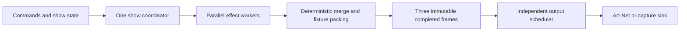

# Output deadlines and presentation policy

`afterglow.render.presentation` implements a pure policy after effect evaluation
and fixture packing. It does not advance effects, re-run intent handlers, change
show state, or own a scheduler/socket. The Afterglow output scheduler owns cadence, completion admission and transport lifecycle. **Direct is the default**; selecting
a smoothing policy changes latency and fallback behavior explicitly.

## Clock and immutable packet contract

A completed frame has:

```clojure
{:epoch 4 :frame-id 126
 :time-ms 3150.0 :completed-at-ms 3177.4
 :universes {0 [;; exactly 512 unsigned byte integers
               ]}}
```

Both times use the same monotonic **physical scheduler clock**, independent of
paused musical transport or a show-time reset. `:time-ms` is the sample/scheduled
output timestamp. A scheduled sample also carries `:started-at-ms`, so it can
finish early and wait for its slot. The host captures inputs after obtaining the
show lock and evaluates the musical position at the physical deadline. A late
completion retains its original target. Direct output discards it. Buffered
output may still admit it within the configured latency, including fractional
latencies that fall between physical slots. Presentation records the actual
time of the send independently.

`freeze-frame` copies renderer-owned byte arrays into immutable vectors. Source
arrays must remain exclusively owned during this copy. `complete` admits only
frozen vectors with the matching epoch and universe set. Duplicate/reversed frame
IDs, non-increasing sample times, or a reversed completion clock are rejected.
History is bounded to three accepted frames. `materialize` returns fresh byte
arrays for one transport owner; another consumer needs its own materialization.
The policy never retains or publishes mutable renderer arrays.

Create a new state on epoch, physical clock-domain or patch changes. A backwards
presentation clock throws. A source completion cannot become available before
its completion timestamp. An overproducing worker can exhaust the three-frame
interpolation window; this is bounded storage, not an unlimited jitter buffer.

## Modes

| Mode | Timeline and fallback |
| --- | --- |
| `:direct` | Present the newest available sample; hold its bytes unchanged while waiting |
| `:hold-fade` | Present the newest available sample; after one nominal period without a new sample, linearly reduce eligible light output over `:fade-ms` |
| `:buffered-interpolation` | Present target time `now - latency`; interpolate bracketing available samples, otherwise hold and use the same fade after one period |

Default `:period-ms` is 25 (40 Hz), `:latency-ms` is one period and `:fade-ms` is
100. Latency must be between zero and two periods; fade duration must be positive.
These are physical timing controls, so milliseconds are deliberate here. Before
the first buffered sample is due, presentation returns no packet. There is no
prediction/extrapolation of motion into unknown future state.

Fade gain is `clamp(1 - max(0, target - sample - period) / fade, 0, 1)`.
It is computed from the original source frame each time, rather than repeatedly
multiplying an already faded frame. A late frame therefore does not reset its age
to zero. Repeated presentation at one timestamp is deterministic and cannot
apply effect state twice. A newly completed frame can recover brightness; that
is a deliberate response to available source state, not a second effect step.

The returned packet preserves lower source metadata and adds `:presentation`
with mode, presentation time, target time, lower/upper source times, interpolation
weight, fade gain and fallback flag. Shared model/output consumers must not
confuse that presentation projection with a new canonical effect result.

## Fixture-aware interpolation and darkness

`compile-plan` consumes the actual `frame/compile-patch` metadata or fixture data.
Known normalized linear dimmer, RGBW/amber/UV, pan, tilt, focus and zoom channels
may interpolate. Strobe, gobo, unknown controls, function/capability/range channels,
nonlinear transfer/curve metadata and partial inversions hold. A channel can opt
out with `:presentation :hold`. This is the new normalized fixture contract; it
does not infer arbitrary vendor photometry from a channel name.

A fixture with a supported linear hardware dimmer fades that dimmer **once**.
Its RGBW settings retain their ratios. A fixture without that supported dimmer
fades its supported emitter channels by the same gain. Master is already encoded
and is not applied again. Pan/tilt/focus/zoom, strobe and gobo are never faded
because they are not light intensity. If no supported linear emission channel
exists, the policy holds rather than inventing a safe darkness code.

Coarse/fine pairs are decoded and packed as one value using the renderer's
existing fractional-255 convention: `coarse + fine/255` in DMX-level units.
This is deliberately **not** a new `0..65535` mapping. Fine-first physical order,
universe crossings, and full inversion are supported. Independent byte
interpolation would break continuity across coarse boundaries and is not used.
Discrete bytes remain from the lower sample until the upper sample is due.
Zero/one interpolation endpoints preserve the original packet exactly.

Private invocation scratch uses transient vectors and final primitive channel
metadata to avoid a persistent-map update per byte. All returned packet data
remains immutable; no scratch escapes to state or another worker.

## API and host ownership

```clojure
(def plan (presentation/compile-plan compiled-patch))
(def state (presentation/new-state plan {:epoch epoch :mode :hold-fade}))
(def packet (presentation/freeze-frame
             {:epoch epoch :frame-id frame-id
              :time-ms scheduled-at :completed-at-ms finished-at}
             rendered-output))
(def admitted (presentation/complete state packet))
(def shown (presentation/present (:state admitted) physical-now))
;; The host owns state publication and sends a fresh transport copy if present.
(when-let [packet (:packet shown)] (presentation/materialize packet))
```

The host must serialize policy ownership, reject retired worker callbacks, and
keep output cadence independent of a slow computation worker. Commit each valid
engine result once; do not re-evaluate or rewind canonical effect state to fill
missing output frames. Presentation errors must not publish partially converted
universes. Real scheduler/transport integration has its own host tests and
measurements; these pure functions do not provide a realtime scheduling guarantee.

## Observed verification and costs

The focused policy suite passed **11 tests / 64 assertions** with reflection
warnings enabled, using the real fixture renderer. It covers late/reversed
completion, delayed interpolation, immutable buffer isolation, bounded history,
clock rejection, RGBW ratios, hardware dimmer/master behavior, blackout,
nonlinear/discrete holding, inverted/cross-universe/fine-first channels and the
coarse-boundary interpolation regression.

The retained [100-universe report](benchmarks/2026-11-21-presentation.edn) measures
12,800 RGBW fixtures / 51,200 bytes, 30 warmup and 100 samples on Java 21.0.13.
The [exact harness](benchmarks/presentation-bench.clj) runs from the Afterglow
classpath. Median/p95/p99 milliseconds were:

| Stage | Median | p95 | p99 |
| --- | ---: | ---: | ---: |
| Freeze owned buffers | 0.437 | 0.511 | 0.619 |
| Validate/admit completion | 0.573 | 1.112 | 1.327 |
| Direct presentation | 0.004 | 0.018 | 0.031 |
| Fade | 1.251 | 1.990 | 2.000 |
| Buffered interpolation | 1.720 | 2.635 | 3.457 |
| Fresh transport arrays | 1.666 | 3.187 | 5.826 |

Maximum interpolation was 13.65 ms and maximum materialization 8.97 ms. Allocation
is recorded per stage. These isolated costs exclude effects, worker scheduling,
network delivery and preview/UI contention; adding medians does not prove a
25 ms whole-show deadline. No physical fixture output was sent.

## Running the output scheduler

The Afterglow publisher (`afterglow.output.scheduler`) sends frames on a steady physical clock, including when an effect is late. Tolglow supplies the show clock, patch, epoch and pause look.



The bounded effect worker pool remains parallel. A single coordinator commits
show state in launch/priority order; a separate output thread serializes packets
so they cannot overtake each other on the wire. Neither thread owns the other
thread's mutable buffers. The output thread never takes the show-owner lock.

`show/start!` gives the render callback and physical send worker a shared
monotonic origin. Afterglow reserves recently observed computation time and
wake-up jitter before each output deadline. Input changes between samples
can reach the next eligible output. A slow worker, sender, or missed wake
skips expired slots. A pause, resume or external clock rebase invalidates
pending output from the old transport position.
[Input timing and release replay](frame-input-timing.md)

`create-runtime` remains inert for tests;
`:independent-output? true` enables the same handover with manually driven ticks.
The sender consumes at most three completions per deadline. Excess pending
completions coalesce to the newest three. Epoch, fixture patch, policy or blackout
changes invalidate older completions; while waiting for the first valid frame of
that generation the scheduler sends darkness. Closing fences late completions
before the host sends the final idle frame. Profiled fog channels use their
physical off endpoints, including the fine byte, before other services finish closing.

Select the policy through the normal settings command, which is validated before
publication and persists in full show files:

```clojure
{:scope :output
 :values {:presentation {:mode :hold-fade :fade-ms 100}}}
```

The other modes are `:direct` and `:buffered-interpolation`; buffered latency
is `:latency-ms` (one physical frame period by default). Physical output timing deliberately uses
milliseconds. Musical cue durations and transitions continue to use beats,
bars and phrases. Status is exposed at `:status :output-scheduler`; it reports
pending/coalesced/published counts, render and publication timing, actual sink
entry and return, the lower sample’s age at sink entry, and the last gain.

The host regression blocks a real effect worker while independently publishing
faded frames, proves show state advances only once after completion, and checks
that the late packet retains its original sample timestamp. Additional tests
cover immutable buffer ownership, bounded completion storage, epoch/blackout/close
fencing and saved settings. This establishes functional concurrency, not a
physical-device latency guarantee.

## Preview and Studio consumers

No preview or Studio consumer can hold back the owner, the output scheduler or
the frame commit. Each one receives committed data through a bounded handoff
and does its own work on its own thread:

| Consumer | Handoff from the owner | When it stalls |
| --- | --- | --- |
| Studio state stream | Replace one latest-state reference and release a semaphore | Each client holds one unacknowledged view; its next view is the newest frame |
| Studio query surfaces | Sampled by the stream worker; graph lease listeners only store the value and wake it | A blocked sampler delays that server's Studio clients, not output |
| Debug stream | At most 16 pending event batches; older batches are dropped and their IDs leave a visible gap | One message per lane waits for its acknowledgement |
| Event-subscriber middleware | Two workers with a 32-job queue and a deadline | A full queue rejects the callback with an error; the run waits without the owner |
| Parameter frames, Room audition | Their own workers read committed snapshots; one audition frame in flight, skips counted | Mailbox drops and skips are counted |
| Distributed compute (Room GPU) peer | Non-blocking 4-packet queue per socket | One frame waits up to `:gpu-budget-ms` and renders locally; the peer stays busy and gets no more jobs until it answers |
| Push and browser displays, MIDI | Device sessions refresh on their own scheduler; a display transport keeps one pending view | Only that session waits |

A restore or epoch change retires every device session. Each retired session
closes off the render thread on a serial lane of its own, keyed by session ID
([#905](https://github.com/tolgraven/tolglow/issues/905)). A display or MIDI
write that never returns holds only that session's lane: other sessions close,
and a restored device reopens, without waiting for it. The restored device's
reopen joins its own ID's lane, so it waits only for the session it replaces.
A lane exists only while it has queued work and owns one daemon thread, which
ends when the queue is empty, so lanes never accumulate across epochs; at most
one lane exists per ID, because a closing ID cannot connect again. A session's
ID enters `:closing` in the same owner critical section that detaches it, and
stays there until its close returns. `connect-device!` refuses that ID with
`:code :device/closing`, so a new session cannot claim a port or display the
old one still holds. Two sessions with different IDs on the same transport are
not ordered against each other. `:status :device-retirement` reports
`:pending`, `:retired`, `:failed` (a close threw), `:reopen-failed`,
`:abandoned`, `:late`, `:closing`, the last error with its `:stage` (`:close`
or `:reopen`), `:refused` with the `:last-refusal`, and `:reconnectable`, the
retired IDs `show/reconnect-device!` can connect again with their last options.
`stop!` waits up to one second, on a monitor the lanes notify, for queued
closes. A close still blocked after that keeps its device claimed until the
write returns; `stop!` counts it as `:abandoned` and records a
`:cleanup-error`. A retirement that a tick commits as `stop!` runs still closes
on a lane thread and is counted as `:late`. Studio shows this map in
Connections → Device sessions
([#907](https://github.com/tolgraven/tolglow/issues/907),
[parity](repl-studio-parity.md#see-device-sessions-that-are-still-closing)).

`tolglow.studio.output-isolation-test` drives the real owner and scheduler with
an injected physical clock and a capture sink. Each frame changes the grand
master. The consumer stays blocked or unacknowledged for the whole run, and the
published packets must equal an unstalled run of the same commands: frame ID,
sample time, send time and bytes. Every owner call is bounded, and a stalled
consumer outlasts that bound, so an owner that waits fails the test. Covered:
Studio clients that never or slowly acknowledge, 31 acknowledging clients with
a silent one, a blocked query sampler with a graph lease, blocked event
middleware, the debug stream and a blocked parameter renderer, a stalled compute
peer on the real `/api/compute/stream` socket, and blocked Push display writes
(direct and through the display transport) across an import that changes the
epoch. Before the retirement worker, that import blocked the render thread until
the display write returned. The same namespace covers the `:device/closing`
refusal, including a connect that races the retiring tick, a stuck session
that holds only its own lane while another closes and a restored device
reopens, lanes and their threads ending over 120 epochs with one close still
blocked, the `stop!` bound, a late retirement after `stop!`, errors from a
close or reopen, and a Studio reconnect refused with the REPL's message and
ex-data. Only the display and retirement tests depend on the retirement
lanes; the other cases characterise boundaries that were already isolated.

## Reading the physical timing capture

At 40 Hz there is one opportunity to send light levels every 25 ms. Rendering
for a slot and getting the packet to the output driver have separate deadlines.
In the original six-second capture with 1,024 RGBW pixels and 128 moving heads,
the producer completed 169 renders for 240 slots. Of those 169, 141 took at
most 25 ms and 28 took longer. Starting early let 151 finish by their target.
Only 112 of those reached the sender in their own slot. For 37 of the other 39, there was no recorded publication
attempt for the slot. Two packets expired during preparation.

Slot 142 illustrates the distinction. Its render took 11.79 ms and finished
20.56 ms early. The sender woke 17.83 ms late and spent another 53.54 ms
selecting and preparing output before dropping the packet. Slot 143 had a
62.15 ms render. The original recording measured elapsed time. Identifying a
CPU-intensive calculation, a wait for CPU time, or a garbage collection
pause requires a trace from the same frame. [Timing chart and raw captures](https://github.com/tolgraven/afterglow/pull/89)

The release replay enables adaptive keyframes and records actual calls per
instance on each completed render. A direct sample evaluates the current
frame. An endpoint samples a future target and may also sample a new origin.
Interpolation reads an existing window and makes zero worker calls. In the
1,024-pixel scene the wash, aim and pulse effects all persist. The pulse keeps
direct sampling to preserve its narrow edges.

Surviving instances also report their cumulative evaluation count, active
window and next stride. A one-shot that runs and finishes in the same frame
appears as `:retired-sampled` with its actual call count for that render.
Ending an instance before its step runs adds no sample. These counters measure
invocations, including a call that throws. Packet delivery is recorded
separately at the sink. The summary counts outcomes per instance per completed
render after warmup. Skipped slots have no effect observations.
