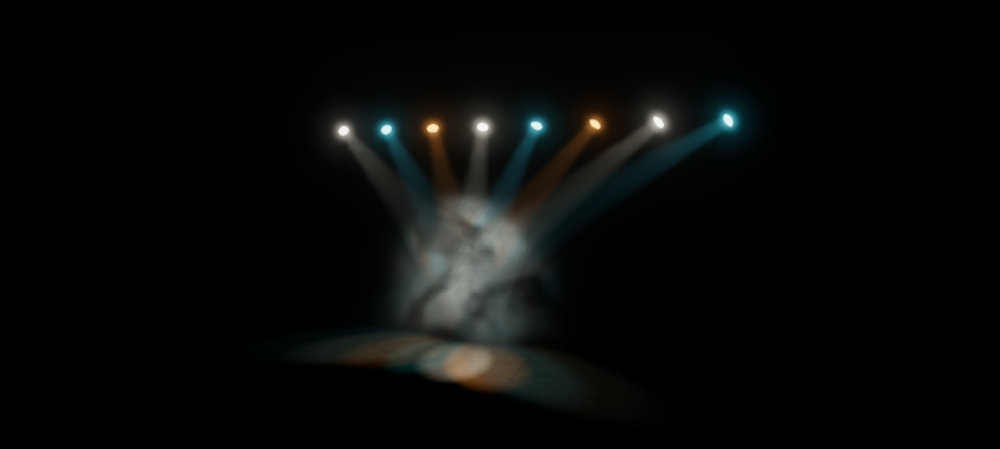

# Local Mac preview correction

The Studio renderer, lighting computation/keyframes and output publisher are
independent clocks. A Studio bitmap rate does not measure DMX publication.

On 2026-11-23 the eight-head Ember/Sweep demo's actual scheduled runtime published
401 captured frames over 10.005 seconds (40.080 Hz). Computation also completed at
40.080 Hz, with work p50/p95/max 1.567/2.885/5.919 ms. There were no runtime errors,
no publication intervals of 50 ms or longer, and the timestamp-only sink closed.
The independent direct/hold publisher repeated the latest source frame 54 times;
347 distinct source frame IDs were observed. No physical or network output ran.
This demonstrates that small scheduled show, not a 20,000-pixel production venue.

The earlier 20,000-pixel native benchmark deliberately called full computation
synchronously with a simulated clock, adaptive sampling disabled and a diagnostic
60-second GPU budget. Its approximately 61 ms median is a complete-work cost,
not an observation that the live 40 Hz publisher stopped working. Spatial volume
coverage dominated that workload outside its effect/keyframe sampling governor.

## Renderer changes

The worker previously used callback entry time to choose the next display deadline
and multiplied completed hardware work by 1.5. Either could skip the next refresh
even when drawing finished within its budget. The worker now keeps an intended
display phase, accounts for delivered callback timestamps and uses the selected
display interval. GPU completion and the matching bitmap acknowledgement still
gate every subsequent render; state and bitmap queues remain bounded.

A real timestamp trace found 225 callbacks rejected for arriving 0.5–2 ms before
the exact requested deadline. The clock tolerates bounded timestamp jitter while
advancing its intended phase, so tolerance does not accumulate into a higher rate.
Regression tests run the real worker/renderer lifecycle with controlled GPU and
clock boundaries at 60/120 Hz and cap jittered 144/240 Hz callbacks at 120 Hz.
Refresh detection normalizes missed intervals before taking the median; using the
fastest quartile alone had mislabeled the 60 Hz panel as 62 Hz.

Completion polling first yields cooperatively for at most 16 attempts and 4 ms
(also bounded to half the requested display interval), then returns to cancellable
2 ms timer polling. This avoids the timer wake-up floor on short hardware work.
It never uses a blocking `gl.finish`, and software drivers retain timer polling.
The fence, context-loss cancellation and 30-second failure timeout remain.

Auto quality budgets through bitmap acknowledgement, reserving delivery headroom.
Manual spatial tiers remain explicit. Software rendering retains its conservative
10 Hz low tier and completion-relative idle interval. Main-thread fallback retains
its existing backpressure; it does not inherit the worker's bounded fence pipeline.
Hardware Auto's low lighting tier now keeps the mobile raster budget, rather than
inheriting the software tier's 180,000-pixel limit. Descending between tiers with
the same raster budget preserves scale instead of increasing pixels by 69%.

Work light defaults to zero, with the explicit preview-only control retained.
The former uniform bounce approximation added light throughout fog without receiver
visibility, reflectance or distance; it is removed. Actual surface-reflection
lighting remains. Manual preview haze maintains density 0.15 before its visibility
multiplier while plume excess advects, diffuses and decays. Accepted show atmosphere
replaces this local field and retains its calibrated density/extinction.

The fog shader rejects rays that miss each light before its marching loop and avoids
ambient occlusion reads when ambient light is zero. Analytic narrow-beam intervals,
opaque depth, calibrated extinction, finite apertures and shadow sampling remain.
Light samples use the existing spatial jitter inside their analytically clipped
intervals. Previously, sampling each lit interval at its midpoint left visible
horizontal bands in a dense plume even though viewer transmission was jittered.
The change adds no shader noise evaluations or passes and preserves thin beams.
Shadow maps are reused across identical, emission-only and camera updates, and
invalidated by light optics or any caster change, including dark moving heads,
rig edits, rebuilds and graphics context restoration.
Without glass, fog composites directly into the postprocessing input, avoiding
one full HDR image copy. Glass retains its immutable source and existing copy path.

## Hardware evidence and limits

Measurements use the shared development Chrome 158 profile, ANGLE Metal on a
16 GB M4 MacBook Air (8 GPU cores), AC power, low-power mode off and a 60 Hz display.
The expanded canvas is 2806 × 1260 physical pixels at DPR 1.8. JVM show hosts run
through `tolgraven-cpu run --mode host`, with ActiveProcessorCount=1 and bounded JVM
workers. The configured host budget is not evidence of enforced CPU duty quota:
the temporary checkout was not enrolled in the host monitor. Browser timings are
separate from synthetic CPU probes. No physical 120 Hz display or iPad was tested.

The original fixed Desktop tier presented 12.39 Hz with fixed heads and 11.45 Hz
with moving heads at 2670 × 1199 internal pixels. Fixed Mobile presented about
23.5–23.9 Hz at 1828 × 821. These were eight fixtures, not a large effect graph.
Those captures also raised preview work light to 0.22 and used decaying local haze.
They must not be presented as a clean performance A/B against the darker maintained
haze and interpolation settings used during correction.

A pass-isolation run at fixed Mobile measured 33.99 Hz for complete rendering,
46.25 Hz replaying one cached image, and 45.80 Hz with the fog raymarch bypassed.
The cached frame still underwent the actual completion fence, bitmap export and
DOM submission. Its GPU blit took about 1.14 ms median while its fence wall wait
was 8.11 ms; this distinction motivated the clock diagnostics. Replaying cached
images is diagnostic only and never counts as production rendering acceptance.

The phase/jitter correction reached 56.89 Hz in that cached-frame control.
Bounded cooperative completion then reached 59.50/58.08 Hz for complete fixed/moving
scenes, but at an unacceptable 412 × 185 internal raster. Raising the hardware
raster floor to 914 × 410 initially measured 54.10/57.70 Hz. The final bounded-wait
and direct-input changes measured 58.44/57.65 Hz against 60 Hz window callbacks,
with 21.64/23.44 ms p95 presentation intervals. Both 20-second samples were within
the sampler's 5% cadence band, not an every-frame 16.7 ms guarantee. The fixed
scene retained the Mobile lighting tier; the moving scene used Low lighting.
Both retained 914 × 410 scene and 2806 × 1260 display dimensions. These full Studio
runs selected Smooth fixture updates and used a 20-second warmup. The final
light-jitter bundle repeated at 58.30/56.10 Hz: the moving case missed the 5% band.
An experiment allowing 64 cooperative attempts within the same 4 ms wall bound
measured 55.30/55.00 Hz and was reverted to 16. These results establish a large
improvement, not a sustained 60 Hz acceptance. Remaining delivery tails need
further profiling at this resolution; lower-resolution results do not close it.

GPU fog checks on the actual M4 passed empty-air preservation, blackout, opaque
occlusion, shadowing, finite/narrow shafts, halo scaling, maintained local haze and
host-calibrated atmosphere assertions. A controlled actual-room GPU check observed
71 initial shadow draws, zero on unchanged/color/camera updates and 71 after a dark
caster moved. Cached shadows exactly matched a forced refresh. Direct compositor
input exactly matched the former copy path, including when glass was enabled.

Eight controlled stills and a six-second real-clock clip cover clear surfaces,
crossing shafts, fresh fog and dispersed fog at Desktop and the actual Auto floor.
The clip is standalone SceneRenderer visual evidence, not worker throughput.
Light jitter visibly breaks up the coherent bands, but fine grain and softness
remain at 301 × 135 / 24-step Auto fog. The historical tolglow-web shaders remain
a useful reference for coherent wisps and local contrast; no visual-parity claim
has been established. Physical 120 Hz, iPad and the broader AAA-quality gate remain
open.



[Six-second real-clock scene capture](captures/mac-preview/auto-motion.webm).
These synthetic eight-fixture captures use the production SceneRenderer at the
914 × 410 Auto floor, 301 × 135 fog target, 24 steps, zero worklight and 0.7 fog.
They precede the integration rebase and contain no live show or user data.
Reproduce with `SHADOW_MEDIA_DIR=target/shadow-cache-visual` and the CDP shadow
browser test below; the fixture owns and closes its page, renderer and server.

## Validation

- `npm run preview:test`: 84 passed, 11 browser/GPU tests explicitly skipped,
  zero failures. Physical GPU checks were run separately through the shared CDP
  browser, not inferred from those skips.
- `CDP_ENDPOINT=http://127.0.0.1:9223 node --test test/js/preview/fog-gpu.test.mjs`:
  two physical M4 tests passed.
- The same CDP endpoint with `shadow-cache-browser.test.mjs`: one physical M4
  test passed, including shadow, direct-input and glass pixel comparisons.
- `npm run studio:test` through the required host build wrapper: 278 tests,
  1,451 assertions, zero failures/errors.
- The optimized Studio release was built through the same wrapper with zero
  warnings and exercised by the actual Room benchmark; preview bundles were
  regenerated with `npm run preview:build` after renderer changes.
- `JAVA_TOOL_OPTIONS=-Djava.io.tmpdir=/private/tmp` and the paired `AFTERGLOW_ROOT`,
  through `tolgraven-cpu run --mode host -- lein test-pure`: 854 tests / 7,345
  assertions, zero failures/errors. The first invocation used Java's default
  symlinked macOS temporary path and failed the workspace path guards; rerunning
  with the canonical path required no product or test changes.

Integration onto Tolglow master `2f0131e6a12e510da396d25d355ab202a855099f`
retains its newer controls, `observedFrame` callbacks and presented show-frame
identity. Its backend needs Afterglow's newer `cadence/maximum-stride`; the old
measured companion cannot load that version. With paired Afterglow master
`2b89cfa1eb6696325014e8c470b0ed94e8f520ac`, the integrated suite passed 882 tests /
7,629 assertions. Integrated Studio passed 291 tests / 1,540 assertions; the
Node preview lane again passed 84 with 11 explicit browser skips. Studio and
compute-worker production targets built sequentially with zero warnings.
Tracking validation passed 223 work items and 149 request entries through R94.
The integrated scheduled eight-head runtime independently published 401 frames
over 10.003 seconds (40.088 Hz), with computation p50/p95/max
1.612/2.843/4.430 ms, zero runtime errors and zero publication gaps of 50 ms or
longer. Its in-memory sink closed cleanly; no network or physical output ran.

One integrated browser attempt changed camera, worklight and quality during the
sample (Auto became fixed High). That report is retained as uncontrolled and
excluded from cadence acceptance. The harness now records requested settings,
checks controls at both boundaries and rejects a changed camera.
The guarded integrated release measured 57.748 Hz fixed and 54.899 Hz moving,
with p95 presentation intervals of 23.735 and 29.445 ms respectively. Both used
914 × 410 scene and 2806 × 1260 display pixels; Auto, Smooth updates, zero work
light and camera position remained unchanged. The moving scene remains below
the 60 Hz target. Its worker bundle SHA-256 is
`cd489595ef288030f87d92722a2893c6d7c758fa590cf65b7d40d30fb2123685`.

A final experiment registered the next hardware display callback immediately after
GPU submission and retained it through bitmap acknowledgement. It preserved the
single-frame guards and passed 17 focused lifecycle tests, but measured 55.346 Hz
fixed / 58.147 Hz moving at the same raster with valid controls. The mixed result
does not establish an improvement over the integrated baseline, so the additional
recurring wakeup was reverted. Its patch and raw report are retained locally.

The remaining smooth dispersed appearance also has a specific source: procedural
billows operate only on density above the mixed background. Their branch starts
around total density 0.261 for the manual 0.15 background; the controlled moving
sample's maximum density fell from 0.20346 to 0.18346. Consequently that entire
sample skipped procedural billow detail. The uniform background cannot acquire
wisps through uniform transport alone. This is separate from forward scattering,
exposure and resolution, and is not corrected by increasing ambient light.

Halving the procedural spatial frequency was also tested on the actual M4 with
the same deterministic fresh/dispersed capture fixture. All three GPU checks
passed, but the resulting plume had softer bright blobs and less internal
definition at both Desktop and Auto resolutions. That visual candidate was
rejected and reverted; it did not address the absent dispersed-haze structure.

To reproduce the corrected dark-show configuration using the built release:

```sh
AFTERGLOW_ROOT=/absolute/path/to/afterglow \
ROOM_QUALITY=auto ROOM_WORK_LIGHT=0 ROOM_LIGHTING_MODE=interpolate \
ROOM_WARMUP_MS=20000 tolgraven-cpu run --mode host -- \
  node dev/preview/measure-room.mjs http://127.0.0.1:9223 target/room-device
```

Run CPU tests separately from browser timing, and leave the shared development
Chrome running. The harness closes only its own tab and preview-only show host.
