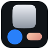
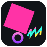

# Track-feel personalities

A personality is a compact description of how the lighting should behave for the music playing now. It is plain versioned data: a palette, concurrency limits, a weighted geometry vocabulary and a motion character. The show keeps one active personality, or a blend of up to four, and draws each one as a small icon. [Issue #647](https://github.com/tolgraven/tolglow/issues/647) · [Source](../src/tolglow/personalities.clj)

      

Every show starts with seven built-ins: **Squares and rectangles** (`:squares`), **Apple-hardware-level corner obsession** (`:squircle`), **Spiralling in general** (`:spirals`), **Zig to the zag but shaky** (`:zigzag-shaky`), **So random lol WITH PINK** (`:random-pink`), **Still water** (`:still-water`) and **Slow sunset** (`:slow-sunset`).

## Choose the feel

In Studio, open **Perform** and find **Track feel** above **In the mix**. On a narrow screen select **Live** first. The closed row shows the active icon, name and palette. Open it to pick a personality by its icon, blend a second one in with **Blend with** and **Share**, draw new shapes with **Reshuffle shapes**, or return to the authored looks with **Clear feel**.

From a running REPL, submit the same operation to the show owner. Studio follows the committed result.

```clojure
(require '[tolglow.show :as show])

@(show/submit! runtime :personality {:op :select :id :squircle})
@(show/submit! runtime :personality {:op :blend :mix [{:id :squircle :weight 0.7} {:id :spirals :weight 0.3}]})
@(show/submit! runtime :personality {:op :select :id :squares :seed 12})
@(show/submit! runtime :personality {:op :clear})

(get-in (show/snapshot runtime) [:personalities :active])
```

`POST /api/personality` takes the same map. A JSON client may send IDs as text. An unknown ID, a bad weight or an invalid definition is rejected with the same message and details on both paths, and the committed selection stays.

A blend scales its weights to sum to one. It mixes the motion character, the concurrency limits and the form weights in proportion, and deals palette slots to each part by its share. The `:seed` is an integer the operator or an agent changes to draw different shapes from the same personality. A selection keeps the current seed unless it names a new one.

## What a personality holds

```clojure
{:id :studio/neon-alley            ; keyword or text, stable
 :version 1                        ; raise it when the content changes
 :schema 1                         ; the personality format this build reads
 :name "Neon alley"                ; at most 80 characters
 :description "…"                  ; optional, at most 400 characters
 :tags [:urban]                    ; optional keywords, for matching a track's feel
 :palette [[0.0 1.0 0.6]
           {:gradient [{:position 0.0 :color [1.0 0.0 0.4]} {:position 1.0 :color [0.2 0.0 1.0]}] :angle-deg 135.0}
           {:split [[1.0 1.0 1.0] [0.0 0.0 0.0]]}]
 :concurrency {:fixture-fraction 0.25 :max-fixtures 6 :max-groups 2
               :fixture-mix {:strip 2.0 :wash 1.0}}
 :geometry {:forms {:bar 3.0 :zigzag 1.0}}
 :motion {:speed 0.9 :smoothness 0.2 :jitter 0.3 :symmetry 0.6}}
```

- **Palette.** One to eight ordered entries. A colour is three components in 0 to 1, the same value a `:color` parameter takes. A `:gradient` is a typed gradient parameter value with two to eight stops. A `:split` is two to four colours shown as hard-edged bands. `:angle-deg` turns a gradient or split; 0 runs left to right and 90 runs top to bottom.
- **Concurrency.** `:fixture-fraction` is the share of eligible fixtures to light at once and `:max-fixtures` an optional cap. `(personalities/fixture-limit personality eligible)` combines them. `:max-groups` limits simultaneous groups. `:fixture-mix` weights fixture types by an ID the reader matches against its own rig, such as a patch group or a fixture type.
- **Geometry.** `:forms` weights entries of the form catalogue below. Weights are preferences from 0 to 1000 and at least one is positive.
- **Motion.** `:speed`, `:smoothness`, `:jitter` and `:symmetry`, each from 0 to 1.

Unknown fields are rejected. Put private additions under `:extensions`. `(personalities/errors p)` returns each problem with its path.

## The form catalogue

A form names the existing input it stands for in each family. A family skips the forms it has no input for, so a personality never forces a shape an effect cannot take. [Catalogue source](../src/tolglow/personalities/forms.clj)

| Form | Sculpt morph and spatial volume | Aim-path figure | Waveform |
| --- | --- | --- | --- |
| `:square` | rounded box, rounding 0, equal sides | closed square | pulse, duty 0.5 |
| `:rectangle` | rounded box, rounding 0, 1 × 0.62 × 0.62 | closed rectangle | pulse, duty 0.25 |
| `:bar` | rounded box, rounding 0, 1 × 0.24 × 0.24 | open line | pulse, duty 0.125 |
| `:squircle` | rounded box, rounding 0.6, equal sides | closed superellipse | sine |
| `:pill` | rounded box, rounding 1, 1 × 0.5 × 0.5 | closed stadium | sine |
| `:circle` | sphere | closed circle | sine |
| `:ring` | volume only: a disc with its centre removed | none | sine |
| `:spiral` | none | open two-turn spiral | saw |
| `:zigzag` | none | the triangle waveform over three cycles | triangle |
| `:sawtooth` | none | the saw waveform over three cycles | saw |
| `:triangle` | none | closed triangle | triangle |

`(personalities/vocabulary personality :waveform)` returns the personality's normalized weights over one family's inputs. `(personalities/choose-form personality family coordinate)` makes a seeded draw: the coordinate, a vector of IDs and integers, fixes a position in the cumulative weights taken in catalogue order. `forms/volume-spec`, `forms/sculpt-values` and `forms/aim-points` turn an input into a venue shape, volume cue parameters or world-space path points. The zigzag and sawtooth figures are traced from the engine's registered waveform definitions.

## Let a volume cue follow the feel

A static sphere or rounded-box volume cue can declare the personality as an input when it is spawned. Add `:personality {:seed 7}` to the spawn request; the seed is optional.

```clojure
@(show/submit! runtime :spatial-cue
   {:op :spawn :id :feel-wall :page-id :main
    :volume {:shape :rounded-box :position [0.0 1.5 0.0] :size [2.0 2.0 2.0] :rounding 0.0
             :selection #{:position} :falloff {:inner-m 0.0 :outer-m 0.3 :curve :linear}}
    :paint {:color [1.0 0.3 0.1]}
    :personality {:seed 7}})
```

While a personality is active, the cue draws one sculpt form from its weights and morphs to it. It keeps its live size: a sphere's diameter or a box's longest side, including the operator's changes. Position, falloff, strength and scale stay with the operator. The draw depends on the cue's seed, the active seed and the cue ID, so the same show renders the same bytes after a save and load. The chosen form appears as `:personality-form` on the cue's entry under `(:spatial (show/snapshot runtime))`.

With no active personality, or one that weights no sculpt form, the cue renders its authored shape exactly as before. A cue without the declaration is never reshaped. A bouncing ball or a cylinder cannot declare this input. [Captured-output test](../test/tolglow/personalities_host_test.clj)

A Room audition (`:scene-draft/stage`) renders under the live show's active feel, also when it changes after staging, because applying the draft runs under that feel. The audition never changes the selection.

## Author, share and save

Publish a definition from the REPL, or post it to `/api/personality` as Transit so keywords such as `:tags` keep their type. A changed definition needs a higher `:version`. A show definition with a built-in's ID replaces that built-in in this show, and removing it restores the built-in. A running selection keeps the revision it captured until it is selected again. The projection reports `:current? false` whenever selecting the same mix now would give a different personality, including after a definition is removed and put back with other content under the same version.

```clojure
@(show/submit! runtime :personality {:op :put :personality neon-alley})
@(show/submit! runtime :personality {:op :remove :id :studio/neon-alley})
```

A full show file keeps every show definition and the active selection with its captured personality, and the file is validated before it loads. A show restart keeps the selection.

Sharing is a separate, explicit selection. `export-package` returns only the named definitions with their schema versions and origin. It leaves out the active selection, the rest of the library, all other show data and each definition's `:extensions`. Pass `{:extensions? true}` as a third argument to send the extensions too. Another show admits the package through the owner, all or nothing.

```clojure
(require '[tolglow.personalities :as personalities])

(def package
  (personalities/export-package (:model (show/export-show runtime)) [:studio/neon-alley :squircle]))

@(show/submit! other-runtime :personality {:op :import :package package})
```

The repository has no general sharing export or publication service yet. This function is the personality part such a flow would call.

## Icons

`(tolglow.personalities.icon/svg personality)` draws three forms from the vocabulary, heaviest first, filled from the palette in order. A gradient or split fills one shape. Symmetry arranges the shapes, jitter turns and shakes them, and smoothness rounds or sharpens line joins. The name is the image's title. Concurrency limits are not drawn.

The picture depends on the data alone. The same personality gives the same bytes after a Transit or EDN round trip, and the built-ins are compared with checked-in snapshots. Studio shows the SVG text the show projected. The Push display page receives it as a data URI and its capture worker rasterizes it into the 960 × 160 frame.

```sh
lein run -m tolglow.qa.personality-icons golden                     # rewrite the snapshots on purpose
CHROMIUM_PATH=… lein run -m tolglow.qa.personality-icons target/personality-icons
```

The second command writes a contact sheet of every built-in at 24, 48 and 96 px.

## What other views read

`(:personalities (show/snapshot runtime))`, Studio's state stream and `GET /api/state` carry one projection. A timeline meter, a cue page or an agent reads it and needs no other call.

```clojure
{:version 1
 :active {:id :squircle                      ; :tolglow.personalities/blend for a blend
          :name "Apple-hardware-level corner obsession"
          :version 1
          :mix [{:id :squircle :version 1 :weight 1.0}]
          :seed 0
          :current? true                     ; false once the library would give a different feel
          :palette [...] :motion {...} :concurrency {...}
          :forms [{:form :squircle :weight 0.666667} ...]   ; normalized, heaviest first
          :icon "<svg …>"}                   ; nil :active when no feel is chosen
 :library [{:id … :name … :version … :builtin? true :description … :tags […]
            :palette […] :motion {…} :concurrency {…} :forms […] :icon "<svg …>"} …]}
```

In Studio, `tolglow.studio.personality` exposes the `::active` and `::library` subscriptions, an `icon` component and `paint-css` for palette swatches. An agent's `inspect_show` returns the same projection without the `:icon` text.

## Checks and limits

```sh
lein test tolglow.personalities-test tolglow.personalities.icon-test tolglow.personalities-host-test
npm run studio:test
npm run studio:build
CHROMIUM_PATH=… lein run -m tolglow.qa.personality-browser 4180 target/personality-picker
```

The browser check drives the optimized Studio in headless Chrome against a show with no output. Headless Chrome is not evidence for a foreground display, iPad Safari or a physical Push.

- Studio selects, blends, reshuffles and clears. It has no editor for authoring a personality, removing one or importing a package; use the REPL.
- Studio's sculpt tool does not offer the personality input on a volume cue; spawn the cue from the REPL or `POST /api/spatial/cues`.
- Only the static volume cue reads the active personality. The palette, concurrency limits, motion character and the aim-path and waveform families are data other effects and the autopilot can read, and nothing consumes them yet.
- Nothing selects a personality from the track analysis yet. A section-driven event or an agent submits the same `:personality` operation when it does.
- The [beat-clock scheduler](scheduler.md) has no personality action, so a change of feel cannot be posted ahead of time on the beat clock.
- The Push icon appears on the browser display page. The native display path draws no SVG.
