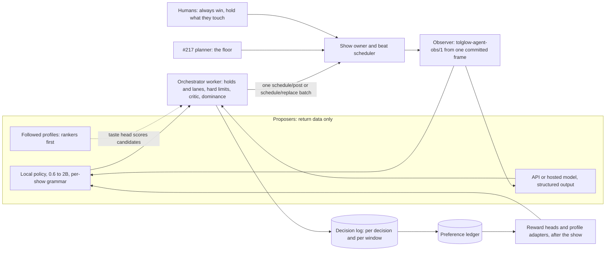

# Native show-control agent: research index

**Status: research and proposal. Nothing here is implemented or measured on this machine.**
Umbrella issue [#821](https://github.com/tolgraven/tolglow/issues/821). Repository facts in the
reports were read at `bce22156` (origin/master, 2026-11-28). This index reconciles the five
planning reports into one set: it gives the architecture, one phased plan, the issue map, one
list of operator decisions and a list of engineering defaults. The reports keep the detail and
the evidence.

| Report | Owns |
| --- | --- |
| [model.md](model.md) | Which models, at which sizes, trained and decoded how, served on what, at what cost, in which phases |
| [interface.md](interface.md) with [schemas](schemas/) and [examples](examples/) | The observation, the look, the action, effect authoring tiers, the per-decision log and replay |
| [orchestration.md](orchestration.md) | Proposers, the proposal contract, arbitration and dominance, horizons and cancellation, budgets, backends, safety |
| [learning.md](learning.md) | Preference signals, reward heads, profile training, profiles and following, global evidence, repository and governance |
| [cross-rig.md](cross-rig.md) | Translating shows and recordings between rigs: the intent record, the deterministic rule table `xrig-rules/1`, capability substitution, the missing-signal ladder and signal tracks, the translation record `tolglow-xrig/1` and its replays, and the evaluation rig pairs |

Cross-rig translation is umbrella [#861](https://github.com/tolgraven/tolglow/issues/861) with
slices #882 to #890. The [local model lab](../../model-lab/README.md) (#323) is the existing
groundwork the model report builds on.

## Architecture at a glance

- **The show owner stays the authority.** Every backend returns a proposal. One local
  orchestrator posts ordinary scheduler commands under one agent session, and the owner
  validates them as it does for a human surface. Master, blackout and output arming stay
  human. The owner enforces a flash guard and fixture-safety denials on every agent source,
  outside every learned component.
- **Musical time throughout.** Requests carry a deadline in beats; positions, horizons, holds,
  dominance windows and rate limits are bars and phrases. Milliseconds appear only at the
  engine boundary and in latency records.
- **Models split by horizon.** The deterministic #217 planner is the floor on every frame. A
  small fine-tuned local policy plans one bar to one phrase ahead. API or 7 to 14B local models
  plan further ahead, teach and write effects off the clock. Vision models judge after the
  fact; the policy reads structured state.
- **Plans withdraw themselves.** A posted group carries intent tags, guards and an expiry. The
  owner cancels it when the music turns; the orchestrator cancels on triggers no single
  predicate covers. Only the firm horizon (one phrase) is posted.
- **Learning is local first.** Every decision is logged with what it saw and replays without a
  model, given its logged replies. The ledger trains per-role reward heads, then per-profile
  adapters, gated on blind win rate with stated sample sizes. Followed profiles are capped at two thirds of agent influence; the global base moves
  only on consented, clustered evidence.
- **Shows move between rigs by intent.** A translation reads a show into a rig-independent
  intent record and lowers it onto the target through rules, then lets the model choose among
  validated candidates. The result is a record that applies without a model.

## Phased plan

Merged from the model report's phases 0 to 4 and vision track, the learning report's stages A
to C, the orchestration and interface slice orders, and the cross-rig slice order. A phase
starts when its predecessor's gate passes and the operator decisions marked as blocking it are
made. Thresholds are starting values. Win-rate gates state the decisive comparisons they need
(two-sided 5%, 80% power, from [learning.md](learning.md#preference-win-rate)); one operator
supplies a few dozen careful comparisons a session, and a sequential test (Wald's sequential
probability ratio test or an always-valid confidence sequence) may stop a clear result early.

| Phase | What is built | Gate to leave the phase |
| --- | --- | --- |
| **P0. Contracts, safety and recording** (no model) | Observation (#849, #850, #857), action envelope (#853), scheduler groups, guards and atomic replace (#645 extension), human holds (#854), proposal contract and the structured-output adapter (#826, #230 extension), per-decision log and replay (#856), preference ledger (#677) | Every action example lowers to commands the real owner accepts with captured output. A #670 rehearsal take replays byte-identical from its log with no model backend, the logged replies standing in for the model. The worst-case guard cost (256 events, four predicates, continuous) is measured on the owner tick and fits the agent's 5 ms share, or continuous checks move to the orchestrator. A hold refuses and cancels agent writes as specified. Ledger events can be reviewed and removed |
| **P1. One orchestrated API proposer** (model phase 0) | Arbitration (#827), dominance (#828), horizons and cancellation (#829), budgets (#830), rate limits (#831), failover (#832), controls, lanes and the per-window record (#835), owner-side flash guard, fixture-safety denials and output interlock (#836), rehearsal with recorded proposers (#837), preference signals (#838), model bench (#862), wire schema and constrained output (#863), several backends and spend caps (#230), planner as the rules source (#217) | **Validity:** the wire-schema conformance test passes against Claude structured output and `validate-arguments` (#863); schema-valid 100%; owner-accepted at least 95%. **Deadlines:** on time at least 99% two phrases ahead (#862). **Cancellation:** no agent event fires in the wrong section, lock-horizon events still fire and cancelled ramps hold (#829). **Guards:** a guarded group is cancelled on the frame its variable crosses (`continuous`) and on its due frame (`due`), with reason and observed value (#645). **Dominance:** shares within 0.05 of the sliders, followed share at or under 2/3 in every window (#828). **Safety:** the owner trims an agent strobe over the limit both from the orchestrator and from a direct Studio-chat post, in captured tests (#836). Owner frame time within noise of the agent-off run; shadow posts nothing (#835). **Review:** an operator rehearsal review of the #670 passages (lateness, novelty, contrast, carry-over) with no blocking finding. No win-rate gate: the clip comparison it needs is built in P3 |
| **P2. Local models, untuned** (model phase 1, vision V0) | Local sidecar (#833), base bake-off (#864), rendered look views and their cost (#851), encoder choice (#852), device measurements (#323) | Schema-valid 100%; owner-accepted at least 80% for one model at each policy size; p95 inside the horizon for its size with Room open; lighting frame p99 and Room frame rate not degraded beyond #833's limits. Encoder chosen on licence and measured latency |
| **P3. Distilled policy and preference baseline** (model phase 2, learning stages A and B, vision V1) | Teacher corpus and distillation (#865), blind clip comparison (#840), evaluation gates and degenerate-policy suite (#843), look-feature reward heads (#841, tier 1), vision-language critic (#867), authoring routed by tier (#866), sandboxed generators (#855, if granted) | Owner-accepted at least 98%; on time at least 99% phrase-ahead at 180 BPM and 95% bar-ahead at 128 BPM; zero unvalidated output commands and zero new deadline misses. **Win rate** at least 60% against the planner (about 194 decisive comparisons, five to eight review sessions for one operator) and non-inferior to the teacher within 10 points (about 155). The retrieval and ranking baseline beats seeded generation on held-out data (#677). Every reward head scores the degenerate policies below baseline. Critic labels enter only after they agree with held-out operator pairs |
| **P4. Profiles and preference adapters** (model phase 3, learning stage C, vision V2) | Profile training with shadow rollout (#842), profile package (#844), adapter portability (#868), following with rankers and absorption limits (#845), vision reward tier (#841, tier 2), canonical rigs for learning (#858, second slice), DJ and audience input (#839) | On one operator's held-out pairs, win rate at least 65% against the P3 distilled policy with the Wilson lower bound above 50% (about 85 decisive comparisons, two to four sessions). A 55% gain needs about 783 and is claimed only from pooled community pairs in P5. Degenerate suite passes; validity and deadline gates not regressed; the adapter survives conversion to the serving format. The vision tier ships only if it beats the look-feature tier on held-out operator pairs. Followed hashes unchanged and absorption within `D` after a replayed session |
| **P5. Sharing and global evidence** | Repository listing (#846), global evidence and base releases (#847), governance (#848), profiles and translation provenance in the sharing catalogue (#270), hosted backend (#834) | Publish gates: flash guard never trims on the benchmark, activity distributions inside the band, leak check passes. A base release only from buckets that pass the consensus test. Moderation, jurisdiction and licence decided and legally reviewed |
| **P6. Compression and reflex** (model phase 4, vision V3) | Phone-class policy (#869), from-scratch bar-level reflex policy (#870), look tokens on the policy if they earn it | On an 8 GB phone: under 1 GB resident, on time at least 95% phrase-ahead, non-inferior to the P4 preference-adapted policy within 10 points (about 155 decisive comparisons). Reflex: on time at least 99% bar-ahead at 180 BPM and a win rate above the rules floor. Look tokens must raise the policy's win rate over the same policy without them |

Cross-rig translation runs as a parallel track. It needs no model until T2, so it does not wait
for P4. The parts of #858 it needs (the fixture-role vocabulary, the frames and the assignment)
move into an early slice in T1; the canonical rigs and the retargeting of logged decisions for
learning stay in P4.

| Track | What is built | Starts after | Gate |
| --- | --- | --- | --- |
| **T1. Rules-only translation** | #858 early slice (fixture roles, frames, assignment), intent record (#882), deterministic pass (#883), capability substitution (#884), signal tracks (#885), missing-signal strategies (#886), translation record and pure apply (#887), review in Studio and the REPL (#889), evaluation measures and baselines B0 and B1 (#890) | P0 (#849, #850, #856, #857) | On RP0 the translation is the identity. Every reference pair yields a document that validates and compiles with no source address, fixture ID or position in it. Applying a record twice gives identical digests. Every loss is a listed decision. Flash-guard and budget counts no worse than B0 |
| **T2. Model pass** | Model choice among validated candidates, logged (#888); fidelity preference test (#890) | P1 (#863, #826) and P3 (#840) | B2 beats B1 on the fidelity test with the Wilson lower bound above one half, pooled over the reference pairs: about 85 decisive comparisons at a true 65%, about 194 at 60%. No worse validity or safety counts |

P0 and P1 need no training, but P1 already pays API costs for the proposer and the #862
baseline (about $0.42 an hour on Haiku 5.5 at one request a phrase with six-event wire plans,
[model.md section 6](model.md#running-costs)). P3 is the first training spend (a pilot teacher
corpus capped at $20, [model.md section 6](model.md#6-hardware-and-cost)).

## Issue map

All child issues are in milestone "Roadmap later". "Depends on" lists prerequisites; `D` numbers
are the [operator decisions and engineering defaults](#operator-decisions) the issue needs, and
match the engineering list's "Needed by" column.

| Issue | Slice | Phase | Depends on | Report |
| --- | --- | --- | --- | --- |
| [#849](https://github.com/tolgraven/tolglow/issues/849) | Observation projection, snapshots and deltas, measured token budgets | P0 | #850, #857, PR #823 names; D7 | interface |
| [#850](https://github.com/tolgraven/tolglow/issues/850) | Structured look layers L0 to L3 and the look of a candidate | P0 | `automation.prediction` (exists) | interface |
| [#853](https://github.com/tolgraven/tolglow/issues/853) | Action envelope lowered to owner messages, scopes, quotas, stale basis | P0 | #645 extension, PR #823; D9 | interface |
| [#854](https://github.com/tolgraven/tolglow/issues/854) | Human holds on a destination; order of agent writes on one line | P0 | #645 extension; D8 | interface |
| [#856](https://github.com/tolgraven/tolglow/issues/856) | Per-decision log record (live and offline variants), replay without a model, training export | P0 | #853, #670; D6 | interface |
| [#857](https://github.com/tolgraven/tolglow/issues/857) | Operator goals as show data | P0 | none | interface |
| [#826](https://github.com/tolgraven/tolglow/issues/826) | Proposal contract and backend interface, structured-output adapter | P0 | #853, #230 extension (adapter part) | orchestration |
| [#827](https://github.com/tolgraven/tolglow/issues/827) | Arbitration on claims; reads holds and lanes as input data | P1 | #826, #854; D17 | orchestration |
| [#828](https://github.com/tolgraven/tolglow/issues/828) | Dominance ledger, hard followed cap, ranker attribution | P1 | #827; D15, D16 | orchestration |
| [#829](https://github.com/tolgraven/tolglow/issues/829) | Horizons, assumption-tagged events, cancellation on direction change | P1 | #826, #827, #645 extension (guard cost gate); D10 | orchestration |
| [#830](https://github.com/tolgraven/tolglow/issues/830) | Resource forecast and admission, including guard cost | P1 | #827, #829; D18 | orchestration |
| [#831](https://github.com/tolgraven/tolglow/issues/831) | Musical rate limits | P1 | #827; D18 | orchestration |
| [#832](https://github.com/tolgraven/tolglow/issues/832) | Backend health, beat deadlines, fallback ladder | P1 | #826 | orchestration |
| [#835](https://github.com/tolgraven/tolglow/issues/835) | Arm, shadow, veto, weights, lanes (overlap: most restrictive wins), per-window record and review | P1 | #827, #828, #829, #856; D8 | orchestration |
| [#836](https://github.com/tolgraven/tolglow/issues/836) | Owner-side flash guard and fixture-safety denials for every agent source; output interlock | P1 | #853, #645; D12, D13, D14 | orchestration |
| [#837](https://github.com/tolgraven/tolglow/issues/837) | Rehearse the orchestrator with recorded proposers | P1 | #826, #827, #828 | orchestration |
| [#838](https://github.com/tolgraven/tolglow/issues/838) | Preference signals from Studio, Push and the REPL | P1 | #677, #670, #706, #856, #835 | learning |
| [#862](https://github.com/tolgraven/tolglow/issues/862) | Model bench and API baseline (model phase 0) | P1 | #826, #849, #853, #670; D20 | model |
| [#863](https://github.com/tolgraven/tolglow/issues/863) | Wire schema, its conformance test, and constrained output with the show's identifiers | P1 | #853, #849, #826, #230 | model |
| [#833](https://github.com/tolgraven/tolglow/issues/833) | Local sidecar on Apple Silicon | P2 | #826, #832; D3 | orchestration, model |
| [#851](https://github.com/tolgraven/tolglow/issues/851) | Rendered look views and clips, measured beside Room | P2 | #850, #782; D4, D5, D6 | interface |
| [#852](https://github.com/tolgraven/tolglow/issues/852) | Compare frame encoders (Apache-2.0 candidates) | P2 | #851, #323; D4 | interface, model |
| [#864](https://github.com/tolgraven/tolglow/issues/864) | Policy base bake-off (model phase 1) | P2 | #862, #863, #833, #323; D2 | model |
| [#840](https://github.com/tolgraven/tolglow/issues/840) | Blind A/B on paired Room render clips | P3 | #670, #677, #851 | learning |
| [#841](https://github.com/tolgraven/tolglow/issues/841) | Per-role reward heads; tier 1 in P3, vision tier 2 in P4 | P3, P4 | #677, #840, #850, #852 | learning |
| [#843](https://github.com/tolgraven/tolglow/issues/843) | Benchmark, win rate with stated sample sizes, degenerate-policy suite, release gates | P3 | #670, #217, #836, #856, #835, #840 | learning |
| [#855](https://github.com/tolgraven/tolglow/issues/855) | Sandboxed generators that return effect DSL data | P3 | #853, #322; D11 | interface |
| [#865](https://github.com/tolgraven/tolglow/issues/865) | Teacher corpus and distillation (model phase 2) | P3 | #862, #863, #864, #856; D19, D21 | model |
| [#866](https://github.com/tolgraven/tolglow/issues/866) | Route effect authoring by tier to a model that can write it | P3 | #855, #853, #322, #323, #863; D11 | model |
| [#867](https://github.com/tolgraven/tolglow/issues/867) | Offline vision-language critic, used only when it agrees with operators | P3 | #851, #840, #841, #852, #833; D20 | model |
| [#839](https://github.com/tolgraven/tolglow/issues/839) | DJ intent and audience votes, consented and aggregated | P4 | #300, #677, #836; D25, D26 | learning |
| [#842](https://github.com/tolgraven/tolglow/issues/842) | Local profile training with shadow rollout | P4 | #677, #841, #843, #865, #835 | learning |
| [#844](https://github.com/tolgraven/tolglow/issues/844) | Profile package and local profile manager | P4 | #270, #323, #843, #868 | learning |
| [#845](https://github.com/tolgraven/tolglow/issues/845) | Follow a public profile: rankers first, immutability, absorption | P4 | #844, #842, #828, #270; D16, D27 | learning |
| [#858](https://github.com/tolgraven/tolglow/issues/858) | Fixture roles, frames and assignment (T1 slice); canonical rigs and retargeting of decisions (P4 slice) | T1, P4 | #849; D43 | interface, cross-rig |
| [#868](https://github.com/tolgraven/tolglow/issues/868) | Adapters valid across runtimes and base upgrades | P4 | #833, #842, #844, #841, #864 | model |
| [#834](https://github.com/tolgraven/tolglow/issues/834) | Tolglow-hosted backend | P5 | #826, #832; D20 | orchestration |
| [#846](https://github.com/tolgraven/tolglow/issues/846) | Repository listing by verified quality, relevance and novelty | P5 | #270, #844, #843; D30, D35 | learning |
| [#847](https://github.com/tolgraven/tolglow/issues/847) | Global evidence, consent tiers and base-release rules | P5 | #677, #858, #270; D20, D29 | learning |
| [#848](https://github.com/tolgraven/tolglow/issues/848) | Profile governance: licences, signing, leak check, takedown | P5 | #270, #844; D31 to D34 | learning |
| [#869](https://github.com/tolgraven/tolglow/issues/869) | Shrink the policy for phone-class devices (model phase 4) | P6 | #865, #864, #868, #843; D22 | model |
| [#870](https://github.com/tolgraven/tolglow/issues/870) | From-scratch bar-level reflex policy | P6 | #856, #841, #843, #826, #862 | model |
| [#882](https://github.com/tolgraven/tolglow/issues/882) | Intent record for a show, cue set or recording | T1 | #858 (fixture roles), #850, #857 | cross-rig |
| [#883](https://github.com/tolgraven/tolglow/issues/883) | Deterministic pass: geometry, fixture roles, targets and timing | T1 | #882, #858; D7, D40, D41, D42, D44 | cross-rig |
| [#884](https://github.com/tolgraven/tolglow/issues/884) | Capability substitution table and transforms | T1 | #883, #850, #836; D39 | cross-rig |
| [#885](https://github.com/tolgraven/tolglow/issues/885) | Signal tracks recorded with a performance | T1 | #670, #856 | cross-rig |
| [#886](https://github.com/tolgraven/tolglow/issues/886) | Missing-signal strategies: substitute, grid, warp, stand-in | T1 | #885, #675, #676; D37, D38, D48 | cross-rig |
| [#887](https://github.com/tolgraven/tolglow/issues/887) | Translation record, pure apply and staleness | T1 | #883, #856; D47 | cross-rig |
| [#889](https://github.com/tolgraven/tolglow/issues/889) | Review, audition and edit in Studio and the REPL | T1 | #887, #835, #643; D46 | cross-rig |
| [#890](https://github.com/tolgraven/tolglow/issues/890) | Evaluation: reference pairs, measures, baselines, preference tests | T1, T2 | #883, #840, #843, #851, #852; D44, D45 | cross-rig |
| [#888](https://github.com/tolgraven/tolglow/issues/888) | Model pass over validated candidates, logged | T2 | #887, #856 (offline record), #863, #826, #853; D20, D44 | cross-rig |

Existing issues extended rather than duplicated:

| Issue | Extension | Phase |
| --- | --- | --- |
| [#645](https://github.com/tolgraven/tolglow/issues/645) | Intent tags, groups, guards with a measured frame-cost gate, `:schedule/replace`, event metadata for proposer and assumptions | P0 |
| [#677](https://github.com/tolgraven/tolglow/issues/677) | Preference ledger with provenance, review and removal; retrieval and ranking baseline | P0, P3 |
| PR [#823](https://github.com/tolgraven/tolglow/pull/823) | `basis` and `until` names for stale suggestions, disconnected-agent rehearsal | P0 prerequisite |
| [#670](https://github.com/tolgraven/tolglow/issues/670) | Rehearsal harness as the bench for every phase | P0 onward |
| [#230](https://github.com/tolgraven/tolglow/issues/230) | The structured-output proposal adapter (P0); several backends, per-backend credentials and spend caps (P1) | P0, P1 |
| [#217](https://github.com/tolgraven/tolglow/issues/217) | The planner as the rules source: attribution, lanes | P1 |
| [#706](https://github.com/tolgraven/tolglow/issues/706) | Like, dislike and correction gestures in the uniform surface layer | P1 |
| [#323](https://github.com/tolgraven/tolglow/issues/323) | Licence filter, new policy-size candidates, warm-cache latency, contention with Room, adapter swap cost | P2 |
| [#322](https://github.com/tolgraven/tolglow/issues/322) | Authoring tier model; recipes and shaders for agents | P3 |
| [#858](https://github.com/tolgraven/tolglow/issues/858) | A fixture-role vocabulary (zone.function) and frames and assignment shared with translation, split early into T1 | T1, P4 |
| [#270](https://github.com/tolgraven/tolglow/issues/270) | Profiles as an artifact type; packages that carry declared intent, canonical look fingerprints and translation provenance | P5 |
| [#861](https://github.com/tolgraven/tolglow/issues/861) | Cross-rig translation umbrella; its slices are #882 to #890 | T1, T2 |

## Operator decisions

Deduplicated across the five reports. Decision numbers are stable: an item that moved to the
engineering list or was merged keeps its number. "Blocks" names the phase or track that cannot
start without the decision; "Default" means building proceeds on the recommendation and the
decision only confirms it. "From" names the report and its own decision number.

| # | Decision | Recommended default | Blocks | From |
| --- | --- | --- | --- | --- |
| D1 | Public profile repository and following other VJs | **Given by the operator's goals in #821**: global profiles and following require redistributable parts, so only Apache-2.0 or MIT bases and encoders (no Gemma Terms, Llama, LFM, MobileCLIP) | Answered | model 1 |
| D6 | Look thumbnails in the log: retention and export | Keep locally with a show-folder retention limit; never in a sharing export unless selected | P2 | interface 7 |
| D8 | Human hold time | While touched, then a grace that ends on the first bar line at least one bar after release; settable 0 to 16 bars; the hold while touched cannot be switched off | Default | interface 3, orchestration |
| D9 | May an agent launch immediately? | No: scheduled launches only, `now` for sets and ends, `immediate` as a per-session grant | Default | interface 4 |
| D11 | Code from agents | Never for followed profiles; off by default for local and remote sources with a per-session grant; source runs only in the local sandbox; Clojure through SCI first, JavaScript and TypeScript second, Python only on evidence | P3 | interface 5, orchestration 7 |
| D12 | What may an agent do to the lighting budget? | Tighten only | Default | orchestration 8 |
| D13 | Flash guard scope and limits | Enforced by the show owner on every agent-attributed command, with a whole-show switch; 4 Hz general, 3 Hz saturated red, a quarter of visible output as the area threshold; faster only by grant with a maximum burst; no profile or backend can raise it | P1 | orchestration 4 and 5, learning |
| D14 | Confirmation before arming the agent on physical output | Yes, every session; off after restart | P1 | orchestration 6 |
| D15 | Followed cap: value, scope and window | Two thirds as a hard cap with no tolerance above it, across all followed profiles, over 4 phrases (settable 2 to 16) | Default | orchestration 1 to 3, learning |
| D19 | May a paid API model teach weights that are shared? | Open-weight teacher for anything redistributed, unless the provider's terms clearly allow it | P3 | model 2 |
| D20 | What leaves the machine | (a) Nothing by default. (b) Remote backends (API proposer, critic, teacher, translation model): per-show opt-in with a minimised context, IDs kept and free-text names removed. (c) Contribution: thresholded counts and explicit donation, each opt-in; no differential-privacy claim until the population supports it. (d) Cloud training of ledger slices: opt-in, deleted after training. (e) Hosted service: native model only at first, minimised context the only accepted form | P1 for (b); P5 for (c) to (e) | model 6, orchestration 9, learning, cross-rig 8; absorbs D23, D24, D36 |
| D21 | Phase-2 spend | A pilot capped at $20 (Haiku 5.5 teacher, about $6.70 for 5,000 decisions with re-asks), then decide on the full corpus with its gate results | P3 | model 7 |
| D22 | Is the phone a target for the first local release? | No; the phone uses API or hosted backends until P6 | P6 | model 8 |
| D25 | Individual audience data | Never stored; aggregates above quorum only | P4 | learning |
| D26 | Role weights and the DJ role | Operator 1.0, DJ 0.5, audience 0.25; DJ is a paired role; operator overrides are constraints | P4 | learning |
| D27 | Absorption of followed styles | Cap followed-origin training mass at `D` (rankers by attribution); attribution required above one third from one lineage | P4 | learning |
| D28 | Exploration on live shows | A small seeded rate (one window in twenty) among candidates within 0.05 of the winner, after every hold, lane and hard limit, probabilities logged. Alternative: off. Off means every live pick has probability 1, so live operator, DJ and audience feedback cannot be corrected for the policy's own selection and only refines what it already prefers | Default | learning, orchestration |
| D29 | Consensus thresholds for base moves | As listed in learning.md section 4; revisit with real counts | P5 | learning |
| D30 | Show follower counts? | Hidden in listings; never a sort key | P5 | learning |
| D31 | Licence menu | CC0, CC BY 4.0, CC BY-SA 4.0, CC BY-NC 4.0 and a follow-only licence; legal review first | P5 | learning |
| D32 | Profiles named after a real artist | Not without that artist's account | P5 | learning |
| D33 | Moderation, hosting entity and jurisdiction | No default; needed before any public repository | P5 | learning |
| D34 | Delisting forks of a revoked profile | Always for privacy and impersonation; case by case for licence | P5 | learning |
| D35 | Music for public preview clips | Commission or select a small cleared set | P5 | learning |
| D37 | A live show's missing signal | Substitute a signal of the same meaning, then a labelled stand-in; the alternative leaves the destination at its base and reports | T1 | cross-rig 1 |
| D39 | No pan and tilt on the target | "Travel to level" by default; the alternative drops motion unless chosen | Default | cross-rig 3 |
| D43 | Fixture roles | Must a rig have operator-confirmed roles before anything is translated to or from it? Proposed: yes, confirmed once per rig; the vocabulary itself is #858's engineering default | T1 | cross-rig 7 |
| D46 | Learning from translation review | Review edits enter the preference ledger (#838) under a `translation` context label, local only | Default | cross-rig 11 |
| D47 | Link to the source | A translated show keeps a provenance link to its source and record, so a later source edit can be translated again; apply never edits the source | T1 | cross-rig 12 |
| D48 | Structural stand-ins | A faked signal only modulates parameters; it never launches or ends cues | Default | cross-rig 13 |

Merged: D23 (privacy defaults and claims), D24 (cloud training) and D36 (hosted service scope)
are parts (c), (d) and (e) of D20, and cross-rig decision 8 (which model, and where) is part (b).

### Engineering defaults (operator may override)

The implementer may change these on evidence and records the change on the issue. None blocks
a phase.

| # | Default | Needed by | From |
| --- | --- | --- | --- |
| D2 | Several models, split by musical horizon | #864 | model 3 |
| D3 | Serve with llama.cpp's server first (per-request schema and adapters); train with MLX; re-check each quarter | #833 | model 5 |
| D4 | The policy does not see rendered views live: structured layers for control, views for reward and critic; look tokens are a P6 experiment | #851, #852 | model 4, interface 1 |
| D5 | Live views render in an application-owned hidden page after host evaluation; JVM maps always; Studio Room as fallback | #851 | interface 2 |
| D7 | An optional `:unit` on parameter schemas, with inference rules and `null` when unknown | #849, #883 | interface 8 |
| D10 | Guards may check continuously if the measured cost fits the agent's share; otherwise due-time only | #829, #645 | interface 6 |
| D16 | Followed profiles rank first; at most one followed adapter proposes per phrase tick until #833 measures more | #828, #845 | reconciliation |
| D17 | The planner and autopilot are not arbitrated like proposers; they stay the floor | #827 | orchestration 11 |
| D18 | Rate limits and budgets start from the orchestration tables and are tuned in rehearsal | #830, #831 | orchestration 10 |
| D38 | Recordings sample on the grid with groove offsets by default; the grid is the coarsest of 1/8 to 1/32 within the error bound; warp only within a tempo ratio of 0.85 to 1.18 | #886 | cross-rig 2 |
| D40 | Spatial scale keeps a pattern's proportion to its frame, not its size in metres | #883 | cross-rig 4 |
| D41 | A bigger target fills matched fixture roles and leaves new roles dark | #883 | cross-rig 5 |
| D42 | Brightness keeps authored levels and reports each role's ratio | #883 | cross-rig 6 |
| D44 | Translation thresholds: to judgement above a look distance of 0.25; to the operator above 0.45 or under confidence 0.6 | #883, #888, #890 | cross-rig 9 |
| D45 | Look weights palette 0.35, rhythm 0.3, coverage 0.2, level 0.15, overridable per cue; following the active profile is later work | #890 | cross-rig 10 |

## Reconciliation record

Each item names the conflict, the evidence and what changed in the reports, schemas and issues.

1. **MobileCLIP licence.** The interface report, its observation example and #852 named
   MobileCLIP-S0 as the look encoder. Apple's Machine Learning Research Model License grants use
   "exclusively for Research Purposes" ([LICENSE_MODELS](https://github.com/apple/ml-mobileclip/blob/main/LICENSE_MODELS)),
   and a profile's taste head is trained on the shared frozen encoder, so a public repository
   (D1) needs a redistributable one. Now: SigLIP 2 B/16 (Apache-2.0, 86 M image parameters, text
   tower for goal matching) is the default for live views and reward; DINOv2 ViT-S/14
   (Apache-2.0, 21 M) is the cheaper live fallback; MobileCLIP is a research comparison at most.
   The cost estimate per look sample rose from 15 to 35 ms to 15 to 50 ms a beat (unmeasured).
   Changed: [interface.md](interface.md#encoding-the-frames), the snapshot example, #852.
2. **Forced `propose` tool.** Orchestration planned a forced tool for API models. Current Claude
   models (Opus 5.5, Sonnet 5.5, Fable 5.1 and 5.2) return a 400 for `tool_choice` of type `any`
   or `tool` and reject non-default `temperature`, `top_p` and `top_k`; Haiku 5.5 rejects the
   sampling parameters too (Anthropic API reference, cached 2026-11-03; model.md section 2). Now:
   the adapter uses structured output (`output_config.format`, or `response_format` of type
   `json_schema` on OpenAI-compatible endpoints), or one `strict` `propose` tool with `auto`, and
   asks for up to three alternative proposals in one reply instead of sampling for diversity.
   The schema it sends is the lowered wire form (item 11). Changed: [orchestration.md](orchestration.md#the-proposal-contract-proposed), #826, #230.
3. **Arbitration rank.** The interface draft compared a group's `rank` across agent sources;
   orchestration limits it to one source's own groups so a followed profile cannot declare the
   top rank. The orchestration rule is adopted. Across sessions that post directly, admission
   order decides and the later write records `:superseded`. Changed:
   [interface.md](interface.md#priorities-and-conflicts), `schemas/action.schema.json`, #854, #827.
4. **Human hold time.** Interface said four bars from the touch; orchestration said release plus
   one bar. One default is proposed (D8): the hold lasts while the control is held, then a grace
   ending on the first bar line at least one bar after release. A fixed time from the touch
   either expires under a hand still on the encoder or keeps the agent off after a quick nudge;
   standing lanes cover longer exclusion. The human-side term is now "hold" everywhere
   (`humans.holds`, reason `:human-held`); "claim" means only the orchestrator's resource claims.
   Changed: interface.md, the snapshot example, #854, #835.
5. **Guard frame cost.** Guards run on the owner tick; the interface estimate ("a few thousand
   comparisons a frame") was never measured. Now both reports require the worst case to be
   measured and counted in the agent's 5 ms share before guards are adopted, with continuous
   checks falling back to the orchestrator if it does not fit. Changed: interface.md,
   orchestration.md, acceptance added on the #645 extension; #829 already carried it; #830 counts it.
6. **One prompt cache per adapter, and dominance.** Each adapter needs its own cache and
   requests with different adapters do not batch (model.md section 4), so followed profiles rank
   first and generate only where the budget allows (D16). The dominance ledger now credits a
   ranker with its share of each accepted proposal's critic score, the critic weight of followed
   rankers is bounded by `D`, deficit steering applies to proposer-mode sources, and absorption
   counts ranker-shaped examples by the same attribution. The log records `actor.rankers`.
   Changed: [orchestration.md](orchestration.md#followed-profiles-as-rankers-first), learning.md,
   `schemas/decision-log.schema.json`, #828, #845, #833.
7. **Decision log ownership.** One JSON Lines file holds two record kinds: the per-decision
   record `tolglow-agent-log/1` with replay and export (#856), and the per-window arbitration
   record `tolglow-agent-window/1` with the review (#835), joined by the decision's `window`.
   Rejected proposals live in the window record. For holds and lanes: the show keeps and enforces
   holds (#854), lanes and the grace setting are operator controls (#835), and arbitration reads
   both before posting (#827). Cross-references added on #856, #835, #854 and #827.
8. **Choice probabilities.** Learning requires the probability each candidate was chosen with;
   orchestration's selection was deterministic and left this open. Now: probability 1 outside
   exploration, and a seeded softmax among candidates within 0.05 of the winner in exploration
   slots (D28), logged and replayable. Rehearsal and review explore in every window; live shows
   at a small seeded rate by default.
9. **Code capability.** Orchestration turned code off for every remote backend; interface and
   model let an API author model write tier-3 source under an operator grant. Now (D11): never
   for followed profiles, a per-session grant for any other source, run only in the local sandbox.
10. **Smaller fixes.** The tool loop declares sixteen tools, not seventeen. The canonical form
    keeps the action schema's declared key order with `note` first, so a decoder commits to its
    direction before the parts; digests still use the order-independent `replay/digest`. The
    proposal contract's wire reply lowers each proposal to one `tolglow-agent-act/1` decision;
    optional events are groups with `optional: true`. Sibling-status notes now point here.
11. **Review of #879 (20 findings).** The independent review's fixes are applied:
    - **Wire schema.** The domain action schema was outside both Claude structured output and
      `validate-arguments`. A lowered wire form became normative; item 13 replaces its first
      version, which broke Claude's complexity limits. The domain schema stays as documentation.
    - **P1 gate.** It is now testable in P1 (validity, deadlines, cancellation, guards,
      dominance, owner-side safety, an operator rehearsal review); the win rate moved to P3.
    - **Hard cap.** The 0.05 tolerance above two thirds is gone; any band sits below the cap,
      and the worked example stays at or under 2/3 throughout.
    - **Safety enforcement.** The flash guard and fixture-safety denials are enforced by the
      show owner for every `:adapter :agent` source, including direct posts and the Studio
      chat; the orchestrator's check is an early filter.
    - **Reachable gates.** Every win-rate gate states its decisive comparisons; the local P4 gate
      is 65% (about 85), and smaller gains need pooled community pairs.
    - **Replay.** Show replay is byte-identical for #670 rehearsal passages; decision replay is
      byte-identical given the logged replies, and re-running a model is not claimed
      deterministic.
    - **Decisions.** Engineering calls moved to their own list, D1 is recorded as given, D20
      absorbs D23, D24 and D36, and D28 defaults to a small seeded live exploration rate.
    - **Smaller fixes.** Issue-map cycle (#827 reads holds and lanes as data) and #230's phase;
      model sizes updated to the measured examples, with the latency rows labelled as upper
      bounds; encoder memory split by tower; a most-restrictive rule for overlapping lanes;
      stale "claim" wording and superseded PR citations; D11 named in the model report; the
      decision-log example's backend and `window`, and a stub `tolglow-agent-window/1` schema;
      `humans.holds` typed in the observation schema and the goal `rank` renamed `order`; the
      `budget.frame_ms` predicate replaced by `frame_share`; a followed profile's scope settled
      as `control` and `author-data`; P1's API spend and the derived $20 pilot; the 8B rate
      reconciled to the conservative 50 tokens a second; `D` in the terms table.
12. **Cross-rig report (#894) merged.** Its IDs are re-prefixed so they no longer collide with the
    index: rules XR1 to XR16, judgement XJ1 to XJ11, per-translation operator answers XO1 to XO10,
    intent parts IR0 to IR6, reference rig pairs RP0 to RP8. Its "hold" substitution candidate
    is now `static`, and "claim" in its prose is an assertion. A translator decision now
    validates: `tolglow-agent-log/1` gains an offline variant (`session.offline`, no `clock` or
    `commands`, an `outcome` with the verify result) and the actor roles `translator` and
    `human`, and the observation schema gains `kind: translation` with a `decision` section
    (#856, #888). #858's fixture roles, frames and assignment move into the T1 track so
    translation does not wait for P4. A `null` unit escalates to judgement; API backends record
    `agree: null` and ask for up to three alternatives in one reply; #886 and #890 have starting
    thresholds; the view measure names the encoder (#852); offline taste is bounded by `D`, not
    the light-beat cap; its 13 decisions became D37 to D48 (one merged into D20).

13. **Delta review of #879.** The first wire form used only accepted keywords but had 148
    optional properties against Claude's cap of 24 per request
    ([structured outputs](https://platform.claude.com/docs/en/build-with-claude/structured-outputs#schema-complexity-limits),
    read 2026-11-28). It is replaced by small schemas in [`schemas/wire/`](schemas/wire/) with
    every property required and empty values where unused: the on-clock
    [proposer reply](schemas/wire/proposal.wire.schema.json) (up to three alternatives with
    `id` and `confidence`, group headers, events with a required `timing`, depth 8), authoring,
    configure, move and inspect schemas usable as strict tools, and the #888
    [translation-choice reply](schemas/wire/translation-choice.wire.schema.json). Static count:
    0 optional, 0 union-typed parameters, at most 6 strict tools per request. The internal
    grammar limit is checked by one live compile per provider at #862. API backends get the
    generic schema with IDs as strings; local grammars may specialise per show. Enum values are
    lowercase and lowercased before validation. Also: #863 split into P1 and P2 parts, #857 uses
    `order`, the offline log variant forbids `clock` and `commands`, goal items are closed, the
    window record has a separate `followed_total`, the worked example runs without the anti-flap
    band, P-phase gates name "the P3 distilled policy" and "the P4 preference-adapted policy",
    and the issue map lists the engineering defaults each issue needs.

## Terms used across the set

| Term | Meaning | Not to be confused with |
| --- | --- | --- |
| Proposal | What a backend returns: one `tolglow-agent-act/1` decision plus envelope fields (confidence, usage) | A decision record, which is what the log keeps once a decision is admitted |
| Wire form | The small all-required schemas in `schemas/wire/` that a model emits; normative. Statically within Claude's explicit limits and `validate-arguments`' keywords; one live compile per provider is recorded at #862 | The domain form, which documents a decision after lowering |
| `assumes` | Orchestration's word for what a proposal depends on; on the wire, its groups' `intent`, `guard`, `until` and `check` | `intent`, which is only the tags |
| `intent` | Up to four tags on a group; cancellation and learning key on them | `note`, the short explanation that leads a decision; the intent record |
| Intent record | Cross-rig: a rig-independent statement of what a show means (parts IR0 to IR6) | A group's `intent` tags |
| `until` | An expiry position; pending members are cancelled as `expired`. Same meaning as PR #823's suggestion `until` | A hold's end |
| Hold | A human's temporary exclusion of the agent from a destination they touched | Lane (a standing assignment), claim (below) and the `static` substitution candidate |
| Claim | A resource and beat span an event occupies, used only in arbitration | A human hold |
| `rank` | One source's order among its own groups | `priority`, the render layer priority; a goal's `order` |
| `order` | The operator's order among active goals | `rank` |
| Dominance | A source's share of agent-attributed light-beats over a trailing window, steered toward its slider | A quota of decisions |
| `D` | The operator's total followed setting, at most 2/3; bounds followed proposals, followed critic weight and followed-origin training mass | Decision numbers D1 to D48 |
| Fixture role | Cross-rig and #858: a fixture's zone and function, for example `back.beam` | A human role (operator, DJ, audience), a role's reward head, a log `actor.role` |
| Translation record | `tolglow-xrig/1`: one per translation, every decision with its inputs digest, candidates and choice; it points at log records by ID | The decision log |
| XR, XJ, XO, IR, RP | Cross-rig rule, judgement, per-translation operator and intent-part IDs, and reference rig pairs | D (decisions here) and P (phases here) |

## Not established

No latency, memory or render cost in this set was measured on this machine. No model was
trained, no reward head fitted, no clip rated and no translation run. Thresholds, weights and
windows are starting values. Each report closes with its own list.
