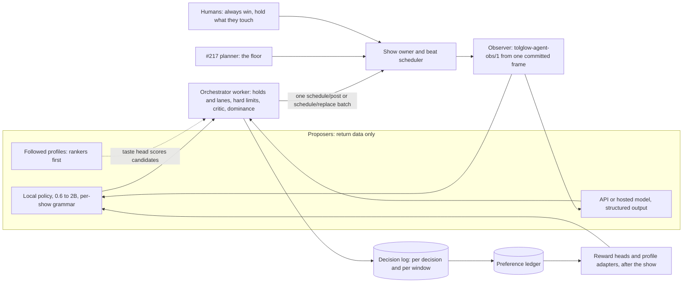

# Native show-control agent: research index

**Status: research and proposal. Nothing here is implemented or measured on this machine.**
Umbrella issue [#821](https://github.com/tolgraven/tolglow/issues/821). Repository facts in the
reports were read at `bce22156` (origin/master, 2026-11-28). This index reconciles the four
planning reports into one set: it gives the architecture, one phased plan, the issue map and
one list of operator decisions. The reports keep the detail and the evidence.

| Report | Owns |
| --- | --- |
| [model.md](model.md) | Which models, at which sizes, trained and decoded how, served on what, at what cost, in which phases |
| [interface.md](interface.md) with [schemas](schemas/) and [examples](examples/) | The observation, the look, the action, effect authoring tiers, the per-decision log and replay |
| [orchestration.md](orchestration.md) | Proposers, the proposal contract, arbitration and dominance, horizons and cancellation, budgets, backends, safety |
| [learning.md](learning.md) | Preference signals, reward heads, profile training, profiles and following, global evidence, repository and governance |

A fifth lane, cross-rig translation ([#861](https://github.com/tolgraven/tolglow/issues/861)),
is still running and is not reconciled here. The [local model lab](../../model-lab/README.md)
(#323) is the existing groundwork the model report builds on.

## Architecture at a glance

- **The show owner stays the authority.** Every backend returns a proposal. One local
  orchestrator posts ordinary scheduler commands under one agent session, and the owner
  validates them as it does for a human surface. Master, blackout and output arming stay
  human. A flash guard sits outside every learned component.
- **Musical time throughout.** Requests carry a deadline in beats; positions, horizons, holds,
  dominance windows and rate limits are bars and phrases. Milliseconds appear only at the
  engine boundary and in latency records.
- **Models split by horizon.** The deterministic #217 planner is the floor on every frame. A
  small fine-tuned local policy plans one bar to one phrase ahead. API or 7 to 14B local models
  plan further ahead, teach and write effects off the clock. Vision models judge after the
  fact; the policy reads structured state.
- **Plans withdraw themselves.** A posted group carries intent tags, guards and an expiry. The
  owner cancels it when the music turns; the orchestrator cancels on triggers no single
  predicate covers. Only the firm horizon (one phrase) is posted.
- **Learning is local first.** Every decision is logged with what it saw and replays without a
  model. The ledger trains per-role reward heads, then per-profile adapters, gated on blind win
  rate. Followed profiles are capped at two thirds of agent influence; the global base moves
  only on consented, clustered evidence.

## Phased plan

Merged from the model report's phases 0 to 4 and vision track, the learning report's stages A
to C, and the orchestration and interface slice orders. A phase starts when its predecessor's
gate passes and the decisions marked as blocking it are made. Thresholds are starting values.

| Phase | What is built | Gate to leave the phase |
| --- | --- | --- |
| **P0. Contracts, safety and recording** (no model) | Observation (#849, #850, #857), action envelope (#853), scheduler groups, guards and atomic replace (#645 extension), human holds (#854), proposal contract (#826), per-decision log and replay (#856), preference ledger (#677) | Every action example lowers to commands the real owner accepts with captured output. A take replays byte-identical from the log with no model backend. The worst-case guard cost (256 events, four predicates, continuous) is measured on the owner tick and fits the agent's 5 ms share, or continuous checks move to the orchestrator. A hold refuses and cancels agent writes as specified. Ledger events can be reviewed and removed |
| **P1. One orchestrated API proposer** (model phase 0) | Arbitration (#827), dominance (#828), horizons and cancellation (#829), budgets (#830), rate limits (#831), failover (#832), controls, lanes and the per-window record (#835), flash guard and output interlock (#836), rehearsal with recorded proposers (#837), preference signals (#838), model bench (#862), constrained output (#863), structured-output adapter (#230), planner as the rules source (#217) | Model phase 0: schema-valid 100%, owner-accepted at least 95%, on time at least 99% two phrases ahead, blind win rate at least 60% against the planner alone with the interval above 50%. Shares within 0.05 of the sliders and the followed cap held in every window (#828). No agent event fires in the wrong section and owner frame time is within noise of the agent-off run (#829). Shadow posts nothing (#835). The flash guard trims or refuses in captured tests before any armed run on physical output (#836) |
| **P2. Local models, untuned** (model phase 1, vision V0) | Local sidecar (#833), base bake-off (#864), rendered look views and their cost (#851), encoder choice (#852), device measurements (#323) | Schema-valid 100%; owner-accepted at least 80% for one model at each policy size; p95 inside the horizon for its size with Room open; lighting frame p99 and Room frame rate not degraded beyond #833's limits. Encoder chosen on licence and measured latency |
| **P3. Distilled policy and preference baseline** (model phase 2, learning stages A and B, vision V1) | Teacher corpus and distillation (#865), blind clip comparison (#840), evaluation gates and degenerate-policy suite (#843), look-feature reward heads (#841, tier 1), vision-language critic (#867), authoring routed by tier (#866), sandboxed generators (#855, if granted) | Model phase 2: owner-accepted at least 98%; on time at least 99% phrase-ahead at 180 BPM and 95% bar-ahead at 128 BPM; win rate at least 45% against the teacher and 60% against the planner; zero unvalidated output commands and zero new deadline misses. The retrieval and ranking baseline beats seeded generation on held-out data (#677). Every reward head scores the degenerate policies below baseline. Critic labels enter only after they agree with held-out operator pairs |
| **P4. Profiles and preference adapters** (model phase 3, learning stage C, vision V2) | Profile training with shadow rollout (#842), profile package (#844), adapter portability (#868), following with rankers and absorption limits (#845), vision reward tier (#841, tier 2), reference rigs (#858), DJ and audience input (#839) | Win rate at least 55% against the phase-2 policy on held-out operator pairs, lower bound above 50%; degenerate suite passes; validity and deadline gates not regressed; the adapter survives conversion to the serving format. The vision tier ships only if it beats the look-feature tier on held-out operator pairs. Followed hashes unchanged and absorption within `D` after a replayed session |
| **P5. Sharing and global evidence** | Repository listing (#846), global evidence and base releases (#847), governance (#848), profiles in the sharing catalogue (#270), hosted backend (#834) | Publish gates: flash guard never trims on the benchmark, activity distributions inside the band, leak check passes. A base release only from buckets that pass the consensus test. Moderation, jurisdiction and licence decided and legally reviewed |
| **P6. Compression and reflex** (model phase 4, vision V3) | Phone-class policy (#869), from-scratch bar-level reflex policy (#870), look tokens on the policy if they earn it | On an 8 GB phone: under 1 GB resident, on time at least 95% phrase-ahead, win rate at least 47% against the phase-3 policy. Reflex: on time at least 99% bar-ahead at 180 BPM and a win rate above the rules floor. Look tokens must raise the policy's win rate over the same policy without them |

P0 and P1 need no training. P3 is the first phase that spends money (about $20 for a pilot
teacher corpus, [model.md section 6](model.md#6-hardware-and-cost)).

## Issue map

All child issues are in milestone "Roadmap later". "Depends on" lists prerequisites; `D` numbers
are the [operator decisions](#operator-decisions) the issue needs.

| Issue | Slice | Phase | Depends on | Report |
| --- | --- | --- | --- | --- |
| [#849](https://github.com/tolgraven/tolglow/issues/849) | Observation projection, snapshots and deltas, measured token budgets | P0 | #850, #857, PR #823 names; D7 | interface |
| [#850](https://github.com/tolgraven/tolglow/issues/850) | Structured look layers L0 to L3 and the look of a candidate | P0 | `automation.prediction` (exists) | interface |
| [#853](https://github.com/tolgraven/tolglow/issues/853) | Action envelope lowered to owner messages, scopes, quotas, stale basis | P0 | #645 extension, PR #823; D9 | interface |
| [#854](https://github.com/tolgraven/tolglow/issues/854) | Human holds on a destination; order of agent writes on one line | P0 | #645 extension; D8 | interface |
| [#856](https://github.com/tolgraven/tolglow/issues/856) | Per-decision log record, replay without a model, training export | P0 | #853, #670; D6 | interface |
| [#857](https://github.com/tolgraven/tolglow/issues/857) | Operator goals as show data | P0 | none | interface |
| [#826](https://github.com/tolgraven/tolglow/issues/826) | Proposal contract and backend interface, structured-output adapter | P0 | #853, #230 extension | orchestration |
| [#827](https://github.com/tolgraven/tolglow/issues/827) | Arbitration on claims, with holds and lanes filtered first | P1 | #826, #854, #835 | orchestration |
| [#828](https://github.com/tolgraven/tolglow/issues/828) | Dominance ledger, followed cap, ranker attribution | P1 | #827; D15, D16 | orchestration |
| [#829](https://github.com/tolgraven/tolglow/issues/829) | Horizons, assumption-tagged events, cancellation on direction change | P1 | #826, #827, #645 extension (guard cost gate); D10 | orchestration |
| [#830](https://github.com/tolgraven/tolglow/issues/830) | Resource forecast and admission, including guard cost | P1 | #827, #829 | orchestration |
| [#831](https://github.com/tolgraven/tolglow/issues/831) | Musical rate limits | P1 | #827; D18 | orchestration |
| [#832](https://github.com/tolgraven/tolglow/issues/832) | Backend health, beat deadlines, fallback ladder | P1 | #826 | orchestration |
| [#835](https://github.com/tolgraven/tolglow/issues/835) | Arm, shadow, veto, weights, lanes, per-window record and review | P1 | #827, #828, #829, #856; D8 | orchestration |
| [#836](https://github.com/tolgraven/tolglow/issues/836) | Flash guard, fixture-safety denials, output interlock | P1 | #827; D12, D13, D14 | orchestration |
| [#837](https://github.com/tolgraven/tolglow/issues/837) | Rehearse the orchestrator with recorded proposers | P1 | #826, #827, #828 | orchestration |
| [#838](https://github.com/tolgraven/tolglow/issues/838) | Preference signals from Studio, Push and the REPL | P1 | #677, #670, #706, #856, #835 | learning |
| [#862](https://github.com/tolgraven/tolglow/issues/862) | Model bench and API baseline (model phase 0) | P1 | #826, #849, #853, #670; D20 | model |
| [#863](https://github.com/tolgraven/tolglow/issues/863) | One action-schema subset for every backend, show identifiers baked in | P1 | #853, #849, #826, #230 | model |
| [#833](https://github.com/tolgraven/tolglow/issues/833) | Local sidecar on Apple Silicon | P2 | #826, #832; D3 | orchestration, model |
| [#851](https://github.com/tolgraven/tolglow/issues/851) | Rendered look views and clips, measured beside Room | P2 | #850, #782; D5, D6 | interface |
| [#852](https://github.com/tolgraven/tolglow/issues/852) | Compare frame encoders (Apache-2.0 candidates) | P2 | #851, #323; D1 | interface, model |
| [#864](https://github.com/tolgraven/tolglow/issues/864) | Policy base bake-off (model phase 1) | P2 | #862, #863, #833, #323; D1, D2 | model |
| [#840](https://github.com/tolgraven/tolglow/issues/840) | Blind A/B on paired Room render clips | P3 | #670, #677, #851 | learning |
| [#841](https://github.com/tolgraven/tolglow/issues/841) | Per-role reward heads; tier 1 in P3, vision tier 2 in P4 | P3, P4 | #677, #840, #850, #852 | learning |
| [#843](https://github.com/tolgraven/tolglow/issues/843) | Benchmark, win rate, degenerate-policy suite, release gates | P3 | #670, #217, #836, #856, #835, #840 | learning |
| [#855](https://github.com/tolgraven/tolglow/issues/855) | Sandboxed generators that return effect DSL data | P3 | #853, #322; D11 | interface |
| [#865](https://github.com/tolgraven/tolglow/issues/865) | Teacher corpus and distillation (model phase 2) | P3 | #862, #863, #864, #856; D19, D21 | model |
| [#866](https://github.com/tolgraven/tolglow/issues/866) | Route effect authoring by tier to a model that can write it | P3 | #855, #853, #322, #323, #863; D11 | model |
| [#867](https://github.com/tolgraven/tolglow/issues/867) | Offline vision-language critic, used only when it agrees with operators | P3 | #851, #840, #841, #852, #833; D20 | model |
| [#839](https://github.com/tolgraven/tolglow/issues/839) | DJ intent and audience votes, consented and aggregated | P4 | #300, #677, #836; D25, D26 | learning |
| [#842](https://github.com/tolgraven/tolglow/issues/842) | Local profile training with shadow rollout | P4 | #677, #841, #843, #865, #835 | learning |
| [#844](https://github.com/tolgraven/tolglow/issues/844) | Profile package and local profile manager | P4 | #270, #323, #843, #868 | learning |
| [#845](https://github.com/tolgraven/tolglow/issues/845) | Follow a public profile: rankers first, immutability, absorption | P4 | #844, #842, #828, #270; D16, D27 | learning |
| [#858](https://github.com/tolgraven/tolglow/issues/858) | Canonical reference rigs and retargeting | P4 | #849; coordinate with #861 | interface |
| [#868](https://github.com/tolgraven/tolglow/issues/868) | Adapters valid across runtimes and base upgrades | P4 | #833, #842, #844, #841, #864 | model |
| [#834](https://github.com/tolgraven/tolglow/issues/834) | Tolglow-hosted backend | P5 | #826, #832; D20, D36 | orchestration |
| [#846](https://github.com/tolgraven/tolglow/issues/846) | Repository listing by verified quality, relevance and novelty | P5 | #270, #844, #843; D30, D35 | learning |
| [#847](https://github.com/tolgraven/tolglow/issues/847) | Global evidence, consent tiers and base-release rules | P5 | #677, #858, #270; D23, D24, D29 | learning |
| [#848](https://github.com/tolgraven/tolglow/issues/848) | Profile governance: licences, signing, leak check, takedown | P5 | #270, #844; D31 to D34 | learning |
| [#869](https://github.com/tolgraven/tolglow/issues/869) | Shrink the policy for phone-class devices (model phase 4) | P6 | #865, #864, #868, #843; D22 | model |
| [#870](https://github.com/tolgraven/tolglow/issues/870) | From-scratch bar-level reflex policy | P6 | #856, #841, #843, #826, #862 | model |
| [#861](https://github.com/tolgraven/tolglow/issues/861) | Cross-rig translation with the native agent | Separate lane | Its own report, still running | cross-rig |

Existing issues extended rather than duplicated:

| Issue | Extension | Phase |
| --- | --- | --- |
| [#645](https://github.com/tolgraven/tolglow/issues/645) | Intent tags, groups, guards with a measured frame-cost gate, `:schedule/replace`, event metadata for proposer and assumptions | P0 |
| [#677](https://github.com/tolgraven/tolglow/issues/677) | Preference ledger with provenance, review and removal; retrieval and ranking baseline | P0, P3 |
| PR [#823](https://github.com/tolgraven/tolglow/pull/823) | `basis` and `until` names for stale suggestions, disconnected-agent rehearsal | P0 prerequisite |
| [#670](https://github.com/tolgraven/tolglow/issues/670) | Rehearsal harness as the bench for every phase | P0 onward |
| [#230](https://github.com/tolgraven/tolglow/issues/230) | Several backends, per-backend credentials, structured-output proposal adapter, spend caps | P1 |
| [#217](https://github.com/tolgraven/tolglow/issues/217) | The planner as the rules source: attribution, lanes | P1 |
| [#706](https://github.com/tolgraven/tolglow/issues/706) | Like, dislike and correction gestures in the uniform surface layer | P1 |
| [#323](https://github.com/tolgraven/tolglow/issues/323) | Licence filter, new policy-size candidates, warm-cache latency, contention with Room, adapter swap cost | P2 |
| [#322](https://github.com/tolgraven/tolglow/issues/322) | Authoring tier model; recipes and shaders for agents | P3 |
| [#270](https://github.com/tolgraven/tolglow/issues/270) | Profiles as an artifact type in the sharing catalogue | P5 |

## Operator decisions

Deduplicated across the four reports. "Blocks" names the phase that cannot start without the
decision; "default" means building can proceed on the recommended default and the decision only
confirms it. Source letters: M model, I interface, O orchestration, L learning.

| # | Decision | Recommended default | Blocks | From |
| --- | --- | --- | --- | --- |
| D1 | Is a public profile repository a firm goal? | Yes: only Apache-2.0 or MIT bases and encoders (no Gemma Terms, Llama, LFM, MobileCLIP) | P2 | M1 |
| D2 | One model or several? | Several, split by musical horizon | P2 | M3 |
| D3 | Serving runtime | llama.cpp's server first (per-request schema and adapters); MLX for training; re-check each quarter | P2 | M5 |
| D4 | Does the policy see rendered views live? | No for now: structured layers for control, views for reward and critic; look tokens are a P6 experiment | Default | M4, I1 |
| D5 | Where live views render | An application-owned hidden page after host evaluation; JVM maps always; Studio Room as fallback | P2 | I2 |
| D6 | Look thumbnails in the log: retention and export | Keep locally with a show-folder retention limit; never in a sharing export unless selected | P2 | I7 |
| D7 | Optional `:unit` on parameter schemas | Yes, with inference rules and `null` when unknown | P0 | I8 |
| D8 | Human hold time | While touched, then a grace that ends on the first bar line at least one bar after release; settable 0 to 16 bars; the hold while touched cannot be switched off | Default | I3, O (hold) |
| D9 | May an agent launch immediately? | No: scheduled launches only, `now` for sets and ends, `immediate` as a per-session grant | Default | I4 |
| D10 | May guards check continuously? | Yes if the measured guard cost fits the agent's share; otherwise due-time only | Default | I6 |
| D11 | Code from agents | Never for followed profiles; off by default for local and remote sources with a per-session grant; source runs only in the local sandbox; Clojure through SCI first, JavaScript and TypeScript second, Python only on evidence | P3 | I5, O7 |
| D12 | What may an agent do to the lighting budget? | Tighten only | Default | O8 |
| D13 | Flash guard scope and limits | Agent-attributed light by default with a whole-show switch; 4 Hz general, 3 Hz saturated red, a quarter of visible output as the area threshold; faster only by grant with a maximum burst; no profile or backend can raise it | P1 | O4, O5, L |
| D14 | Confirmation before arming the agent on physical output | Yes, every session; off after restart | P1 | O6 |
| D15 | Followed cap: value, scope and window | Two thirds, absolute, across all followed profiles, over 4 phrases (settable 2 to 16) | Default | O1 to O3, L |
| D16 | Followed profiles as rankers first | Yes: taste head ranks by default; at most one followed adapter proposes per phrase tick until #833 measures more | P4 | Reconciliation |
| D17 | Should the planner and autopilot be arbitrated like proposers? | No: they stay the floor the orchestrator steers and accounts for | Default | O11 |
| D18 | Rate-limit and budget defaults | The orchestration tables as starting points, tuned in rehearsal | Default | O10 |
| D19 | May a paid API model teach weights that are shared? | Open-weight teacher for anything redistributed, unless the provider's terms clearly allow it | P3 | M2 |
| D20 | May observations, rig data and performances go to remote backends (API proposer, critic, teacher, hosted)? | Local by default; per-show opt-in with a minimised context (IDs kept, free-text names removed) | P1 | M6, O |
| D21 | Phase-2 spend | A pilot of about $20, then decide on the full corpus with its gate results | P3 | M7 |
| D22 | Is the phone a target for the first local release? | No; the phone uses API or hosted backends until P6 | P6 | M8 |
| D23 | Privacy defaults and claims | Nothing sent by default; no differential-privacy claim until the population supports it; promise thresholds and explicit donation | P5 | L |
| D24 | Cloud training of ledger slices | Opt-in only; delete after training | P5 | L |
| D25 | Individual audience data | Never stored; aggregates above quorum only | P4 | L |
| D26 | Role weights and the DJ role | Operator 1.0, DJ 0.5, audience 0.25; DJ is a paired role; operator overrides are constraints | P4 | L |
| D27 | Absorption of followed styles | Cap followed-origin training mass at `D` (rankers by attribution); attribution required above one third from one lineage | P4 | L |
| D28 | Exploration on live shows | Off by default, on in rehearsal and review; seeded draw among candidates within 0.05 of the winner, probabilities logged | Default | L, reconciliation |
| D29 | Consensus thresholds for base moves | As listed in learning.md section 4; revisit with real counts | P5 | L |
| D30 | Show follower counts? | Hidden in listings; never a sort key | P5 | L |
| D31 | Licence menu | CC0, CC BY 4.0, CC BY-SA 4.0, CC BY-NC 4.0 and a follow-only licence; legal review first | P5 | L |
| D32 | Profiles named after a real artist | Not without that artist's account | P5 | L |
| D33 | Moderation, hosting entity and jurisdiction | No default; needed before any public repository | P5 | L |
| D34 | Delisting forks of a revoked profile | Always for privacy and impersonation; case by case for licence | P5 | L |
| D35 | Music for public preview clips | Commission or select a small cleared set | P5 | L |
| D36 | Hosted service scope | Native model only at first; minimised context the only accepted form | P5 | O9 |

## Reconciliation record

Each item names the conflict, the evidence and what changed in the reports, schemas and issues.

1. **MobileCLIP licence.** The interface report, its observation example and #852 named
   MobileCLIP-S0 as the look encoder. Apple's Machine Learning Research Model License grants use
   "exclusively for Research Purposes" ([LICENSE_MODELS](https://github.com/apple/ml-mobileclip/blob/main/LICENSE_MODELS)),
   and a profile's taste head is trained on the shared frozen encoder, so a public repository
   (D1) needs a redistributable one. Now: SigLIP 2 B/16 (Apache-2.0, 86 M image parameters, text
   tower for goal matching) is the default for live views and reward; DINOv2 ViT-S/14
   (Apache-2.0, 21 M) is the cheaper live fallback; MobileCLIP is a research comparison at most.
   The cost estimate per look sample rose from 15 to 35 ms to 15 to 50 ms a beat (unmeasured).
   Changed: [interface.md](interface.md#encoding-the-frames), the snapshot example, #852.
2. **Forced `propose` tool.** Orchestration planned a forced tool for API models. Current Claude
   models (Opus 5.5, Sonnet 5.5, Fable 5.1 and 5.2) return a 400 for `tool_choice` of type `any`
   or `tool` and reject non-default `temperature`, `top_p` and `top_k`; Haiku 5.5 rejects the
   sampling parameters too (Anthropic API reference, cached 2026-11-03; model.md section 2). Now:
   the adapter uses structured output (`output_config.format`, or `response_format` of type
   `json_schema` on OpenAI-compatible endpoints), or one `strict` `propose` tool with `auto`, and
   asks for up to three alternative proposals in one reply instead of sampling for diversity.
   Changed: [orchestration.md](orchestration.md#the-proposal-contract-proposed), #826, #230.
3. **Arbitration rank.** The interface draft compared a group's `rank` across agent sources;
   orchestration limits it to one source's own groups so a followed profile cannot declare the
   top rank. The orchestration rule is adopted. Across sessions that post directly, admission
   order decides and the later write records `:superseded`. Changed:
   [interface.md](interface.md#priorities-and-conflicts), `schemas/action.schema.json`, #854, #827.
4. **Human hold time.** Interface said four bars from the touch; orchestration said release plus
   one bar. One default is proposed (D8): the hold lasts while the control is held, then a grace
   ending on the first bar line at least one bar after release. A fixed time from the touch
   either expires under a hand still on the encoder or keeps the agent off after a quick nudge;
   standing lanes cover longer exclusion. The human-side term is now "hold" everywhere
   (`humans.holds`, reason `:human-held`); "claim" means only the orchestrator's resource claims.
   Changed: interface.md, the snapshot example, #854, #835.
5. **Guard frame cost.** Guards run on the owner tick; the interface estimate ("a few thousand
   comparisons a frame") was never measured. Now both reports require the worst case to be
   measured and counted in the agent's 5 ms share before guards are adopted, with continuous
   checks falling back to the orchestrator if it does not fit. Changed: interface.md,
   orchestration.md, acceptance added on the #645 extension; #829 already carried it; #830 counts it.
6. **One prompt cache per adapter, and dominance.** Each adapter needs its own cache and
   requests with different adapters do not batch (model.md section 4), so followed profiles rank
   first and generate only where the budget allows (D16). The dominance ledger now credits a
   ranker with its share of each accepted proposal's critic score, the critic weight of followed
   rankers is bounded by `D`, deficit steering applies to proposer-mode sources, and absorption
   counts ranker-shaped examples by the same attribution. The log records `actor.rankers`.
   Changed: [orchestration.md](orchestration.md#followed-profiles-as-rankers-first), learning.md,
   `schemas/decision-log.schema.json`, #828, #845, #833.
7. **Decision log ownership.** One JSON Lines file holds two record kinds: the per-decision
   record `tolglow-agent-log/1` with replay and export (#856), and the per-window arbitration
   record `tolglow-agent-window/1` with the review (#835), joined by the decision's `window`.
   Rejected proposals live in the window record. For holds and lanes: the show keeps and enforces
   holds (#854), lanes and the grace setting are operator controls (#835), and arbitration reads
   both before posting (#827). Cross-references added on #856, #835, #854 and #827.
8. **Choice probabilities.** Learning requires the probability each candidate was chosen with;
   orchestration's selection was deterministic and left this open. Now: probability 1 outside
   exploration, and a seeded softmax among candidates within 0.05 of the winner in exploration
   slots (D28), logged and replayable.
9. **Code capability.** Orchestration turned code off for every remote backend; interface and
   model let an API author model write tier-3 source under an operator grant. Now (D11): never
   for followed profiles, a per-session grant for any other source, run only in the local sandbox.
10. **Smaller fixes.** The tool loop declares sixteen tools, not seventeen. The canonical form
    keeps the action schema's declared key order with `note` first, so a decoder commits to its
    direction before the parts; digests still use the order-independent `replay/digest`. The
    proposal contract's wire form is one `tolglow-agent-act/1` decision with snake_case keys;
    optional events are groups with `optional: true`. Sibling-status notes now point here.

## Terms used across the set

| Term | Meaning | Not to be confused with |
| --- | --- | --- |
| Proposal | What a backend returns: one `tolglow-agent-act/1` decision plus envelope fields (confidence, usage) | A decision record, which is what the log keeps once a decision is admitted |
| `assumes` | Orchestration's word for what a proposal depends on; on the wire, its groups' `intent`, `guard`, `until` and `check` | `intent`, which is only the tags |
| `intent` | Up to four tags on a group; cancellation and learning key on them | `note`, the short explanation that leads a decision |
| `until` | An expiry position; pending members are cancelled as `expired`. Same meaning as PR #823's suggestion `until` | A hold's end |
| Hold | A human's temporary exclusion of the agent from a destination they touched | Lane (a standing assignment) and claim (below) |
| Claim | A resource and beat span an event occupies, used only in arbitration | A human hold |
| `rank` | One source's order among its own groups | `priority`, the render layer priority |
| Dominance | A source's share of agent-attributed light-beats over a trailing window, steered toward its slider | A quota of decisions |

## Not established

No latency, memory or render cost in this set was measured on this machine. No model was
trained, no reward head fitted and no clip rated. Thresholds, weights and windows are starting
values. Each report closes with its own list.
