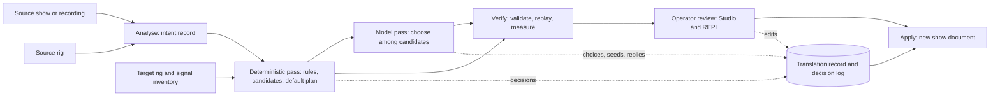

# Native show-control agent: cross-rig show translation

Research and proposal for [#861](https://github.com/tolgraven/tolglow/issues/861),
part of the native-agent umbrella [#821](https://github.com/tolgraven/tolglow/issues/821).
**Nothing in this document is implemented and nothing was measured.** Sections
headed **Today** describe code read at `1bc5ac78` (Tolglow master, 2026-11-28)
with the paired Afterglow fork at `ef539be0`. External sources were opened on
2026-11-28 and are linked where used.

The task: take a show that was made on one rig (a saved show, a cue page, a
macro, or a recorded performance) and make it play on a different rig, with
the look and feel kept and the native agent making the judgement calls. The
result must be reviewable, editable and reproducible from a log.

Sibling reports. They are not on master yet, so the relative links resolve
once their pull requests merge.

| Lane | Document | What this report takes from it |
| --- | --- | --- |
| Interface | [interface.md](interface.md) (PR #860) | Observation and action schemas, the look layers L0 to L5, the look of a candidate, normalised coordinates, `rig.sig`, the decision log (#856), reference rigs (#858) |
| Learning | [learning.md](learning.md) (PR #825) | Blind A/B on clip pairs (#840), the benchmark and gates (#843), rig classes, the preference ledger (#838) |
| Orchestration | [orchestration.md](orchestration.md) (PR #824) | The proposal contract (#826), the flash guard (#836), operator review (#835) |
| Model | [model.md](model.md) (PR #859) | Which model does off-the-clock work, constrained output (#863), API sampling limits |

## Recommendation

1. **Translate intent and render it again. Never translate channel values.**
   A translation reads the source show into a rig-independent *intent record*
   (roles, normalised geometry, look targets, motion constraints, signal
   meaning), then lowers that onto the target rig through the ordinary
   registry, compiler and capability narrowing. DMX bytes, pan and tilt angles
   and fixture addresses are never mapped.
2. **Three kinds of decision, in a fixed order.** A versioned rule table
   decides what it can and records a reason. The model decides only where the
   rules left more than one valid candidate. The operator decides what data
   cannot answer. A decision moves up a class when a rule's precondition fails
   or the predicted loss passes a threshold.
3. **The deterministic pass alone must give a complete, valid show.** It is
   the floor, as the #217 planner is the floor for the live agent. The model
   pass can only improve on it, and every model choice can be reverted to the
   rule's default.
4. **The model chooses among validated candidates.** Each candidate was built
   by a rule or proposed as effect DSL data, compiled, admitted against the
   target rig and given a predicted look. The model's reply is a candidate ID,
   a short reason and a confidence. This is what makes a non-deterministic
   pass reviewable and replayable.
5. **The product of a translation is a record, not only a show.** The
   *translation record* lists every decision with its inputs digest, its
   candidates, the choice, who made it and the seed. Applying the record to
   the source and the target rig is a pure function with a stable digest.
   Replay never calls a model.
6. **Missing signals follow a ladder, not one answer.** For a show meant to
   run live: rebind, then substitute a signal of the same meaning, then a
   labelled stand-in generator. For a recording: sample on the show grid by
   default, warp the raw recording through the tempo map only for expressive
   gestures at similar tempo. Alternatives stay in the record so the operator
   can switch without a new run.
7. **Evaluate on the look, then on preference.** Compare the simulated look of
   source and target in the rig-independent look layers, on a fixed set of
   reference rig pairs, against three baselines. The model pass ships only if
   people prefer its translations to the deterministic ones in a blind test.
8. **Canonical rigs are a reference, not a pivot.** The source is translated
   directly to the target. The look on a canonical rig (#858) is the
   venue-free statement of what the show should look like, used for
   comparison and for sharing (#270).

Decisions that need the operator are [at the end](#decisions-for-the-operator).

## Today

What a translation would read and write. Each row is implemented at the
surveyed revision.

| Piece | Where | Relevant facts |
| --- | --- | --- |
| Saved show | [`persistence.clj`](../../../src/tolglow/persistence.clj), [show files](../../show-files.md) | Schema 2 holds the whole portable model: effect, cue and fixture definitions with history, pages, variables, the rig (fixtures, room, trusses), compositions, running instances, the signal patch and integration data. Explicit `:extensions` are preserved; unknown top-level keys are refused. A show file carries its own rig |
| Command and frame recording | [runtime replay](../../runtime-replay.md) (`afterglow.runtime.replay`) | An initial model plus ordered `:command` and `:frame` inputs, with a model digest and an output digest per step. It does not capture audio features, sensors, reactive writes or planner input |
| Run record | [`live_runs.clj`](../../../src/tolglow/integrations/live_runs.clj), [Live routing](../../live-routing.md) | One *take* per activation: start, release and end beats as exact rationals on the 1/960 beat grid, the validated launch (mode, targets, duration, values), cue version, effect revision, group placement and parameter moves (512 by default) |
| Phrase capture | [`phrase_capture.clj`](../../../src/tolglow/integrations/phrase_capture.clj) | The last bars of launches, releases and parameter writes as a phrase on the beat grid (a sixteenth by default), one lane of points per cue parameter |
| Rehearsal passage | [`rehearsal/passage.clj`](../../../src/tolglow/rehearsal/passage.clj), [rehearsal](../../rehearsal.md) | Tempo, section map, stem onsets and levels, Push gestures and transport stops as data on transport beats, replayed through the real show owner with a seed |
| Timeline | [timeline](../../timeline.md) | A projection of events, ramps, sections and captured audio columns on the beat clock. It is a view, not a recording |
| Rig | [patch groups](../../fixture-patch-groups.md), [rig editor](../../rig-editor.md) | `[:rig :fixtures]` is a vector of heads with `:id`, `:position` in metres, rotation, universe, address, `:channels`, group tags in `:groups`, optional `:bounds-m`, beam and zoom angles, `:calibration` and brightness inputs. Pixel layouts are paths, grids and helices in world metres. Groups are tags; there is no role vocabulary |
| Target selection | [`spatial/targets.clj`](../../../src/tolglow/spatial/targets.clj), [spatial show](../../spatial-show.md) | A selector is `:all`, `{:fixture-ids […]}`, `{:group-id …}` or `{:volume-id …}`. A cue may carry a `:selector`; an effect, an output and a launch may carry `:targets` as fixture IDs |
| Capability narrowing | [`compiler/capability.clj`](../../../src/tolglow/compiler/capability.clj), [mixed rigs](../../effect-recipes.md#mixed-rigs-heads-without-the-attribute) | An untargeted output writes only to heads that implement its attribute. `:color` needs red, green and blue; `:aim` and `:direction` need pan and tilt; every head takes `:dimmer`. Skipped heads are reported in `:target-resolution`. An explicit target that cannot take the attribute is refused as `:incapable-target`. Nothing is substituted |
| Spatial units | [`effects.clj`](../../../src/tolglow/effects.clj) | `fx/position` reads world metres. `position-wave` takes a `:wavelength` in metres (default 4). Aim points, volumes, radii and velocities are metres |
| Signal patch | [`integrations/patch.clj`](../../../src/tolglow/integrations/patch.clj), [`routing.clj`](../../../src/tolglow/routing.clj), [routing host](../../routing-host.md) | Sources have a `:kind` (`:midi`, `:automation`, `:audio`, `:control`), a calibrated `:range`, a `:timeout` (four beats by default) and a `:min-confidence`. Destinations name a cue parameter with a `:base` and a `:combine` rule. Routes carry a curve, envelope and smoothing. With no live contribution a destination rests at its `:base`. The show keeps an inventory of up to 128 observed source ports |
| Other signals | [signals](../../signals.md), [modulation](../../modulation.md), [audio-shaped LFO](../../audio-shaped-lfo.md), [stems](../../stems.md), [sensors](../../sensors.md) | Registered waveforms and per-instance parameter sources are portable, seeded data on the beat clock. Stem onsets arrive as `:audio/onset` events and stem levels through the patch. Sensor observations use one normalised contract |
| Synchronised moves | [aim paths](../../aim-paths.md#calibrated-paired-arrival) | A `:sync-arrival?` path is solved against each head's mount and calibrated motor rates, records a `:rig-fingerprint`, and is solved again on republish. A launch is never refused for tempo; it stretches and reports `:arrival-stretch` |
| Transport stop | [clock domains](../../clock-domains.md#transport-stop) | A stop holds every change over time, including millisecond state through `tolglow.clock/hold`, and resumes without catching up |
| Look measurement | [`lighting_activity.clj`](../../../src/tolglow/lighting_activity.clj), [`automation/prediction.clj`](../../../src/tolglow/automation/prediction.clj), [`show/preview.clj`](../../../src/tolglow/show/preview.clj) | Brightness, coverage, flashing, movement and strobe from the committed frame; a hypothetical frame for proposed launches through the real compiler and patch; per-fixture rows with pose and beam footprint |
| Audition | [`show/scene_draft.clj`](../../../src/tolglow/show/scene_draft.clj) | A scene draft renders in the Room without touching the live show |

Gaps a translation has to fill:

- **No roles.** Groups are venue-specific tags. Nothing says that `:moving` on
  one rig and `:spots` on another do the same job.
- **No normalised frame.** Positions, wavelengths and aim points are metres in
  one venue.
- **No substitution.** A head that lacks an attribute is skipped. That keeps a
  show running; it does not keep a look.
- **Signals are not recorded.** No recording keeps the values an audio
  feature, a stem, a sensor or a controller delivered. The replay recorder
  says so itself, and the decision log notes the same limit for show replay.
- **No tempo map object.** The transport has a tempo and the interface report
  proposes `clock.tempo_map` as a list of segments. A warp needs that list for
  both the recording and the replay.
- **No look comparison across rigs.** The meters describe one frame on one rig.

## Operator rules that bind a translation

These come from root `AGENTS.md`, the clock and aim-path documents, and the
operator's standing instructions. They are constraints on every rule below.

- **Musical units.** Translated timing stays in beats, bars and phrases.
  Milliseconds appear only where they already are a device or physical
  boundary (a calibrated motor rate, a physical envelope time). The design
  range is 70 to 180 BPM.
- **Arrive together stretches, never refuses.** A synchronised move is solved
  again on the target rig. If the target needs longer than the musical
  duration, the move stretches and the stretch is reported.
- **Motion is never clamped.** A translation does not slow, limit or drop a
  move because the target heads are slower than the source heads. Expected lag
  is reported as information. An aim point the head cannot reach is reported
  with the existing reachability result, not moved.
- **Transport stop pauses everything.** A recorded signal track, a warped
  signal and a stand-in generator all advance on the transport, so a stop
  holds them and a resume does not catch up.
- **No physical output.** Everything here is measured on captured output and
  the simulated look. Nothing claims how a translation looks in a real room.
- **Sharing is explicit.** A translation writes a new show document. It does
  not overwrite, publish or export anything (#270).

## Scope: what is translated

| Source | Contains | Translation produces |
| --- | --- | --- |
| Saved show, cue page, macro or composition | Definitions that will be played live | The same definitions for the target rig, with a translated signal patch |
| Run record, phrase or rehearsal passage | Definitions plus a performance: launches, releases, parameter moves and gestures on beats | Translated definitions, the same events addressed to the target, and a plan for each signal the performance depended on |
| Command and frame recording | An initial model and every command and frame | The command stream translated as above and rendered again. Recorded output frames are discarded, because they are the source rig's bytes |
| Agent decision log (#856) | Decisions in canonical form | The #858 retargeting, which is this pipeline with rules only and no substitution |

Two cases differ in one way that matters throughout. A **live show** has no
recorded signal values to fall back on and must react to tonight's input. A
**recording** is tied to one musical passage and can carry the values it was
performed with. The signal section treats them separately.

Running instances in a saved show hold resolved fixture IDs and private state
from the source rig. A translation does not carry them: it lists them, and the
translated show starts with nothing running.

## 1. Decision taxonomy

A *decision point* is one place where the source refers to something the
target does not have in the same form. Each has a class:

- **Deterministic (D).** One rule gives one answer from the data. Logged with
  the rule name and inputs digest.
- **Judgement (J).** Several valid answers exist and they differ in look. A
  rule supplies a default; the model may pick another candidate.
- **Operator (O).** The answer is not in the data, or the loss is large, or it
  cannot be undone.

### Deterministic

| ID | Decision | Rule |
| --- | --- | --- |
| D1 | Coordinate frames | Compute three frames per rig: the rig box (`npos`, −1…1 per axis, as in the observation), the room box when the rig has a room, and a group-local frame (arc length `u` in 0…1 along a group's principal axis, plus `v` for a matrix). Map a world point by the frame it was authored in: a point on a room surface keeps its surface coordinates, a point in the air keeps its room-box coordinates |
| D2 | Spatial scale | A wavelength, radius, velocity or path size in metres scales by the extent ratio of the frame it belongs to, so "one cycle across the group" stays one cycle. Shapes scale uniformly by the geometric mean of the horizontal ratios so a circle stays a circle |
| D3 | Fixture assignment inside a matched role | Minimum-cost assignment between source and target heads of the role, with cost equal to normalised distance plus a capability mismatch penalty, ties broken by patch order. For unequal counts, the source's behaviour is a function of `u`, sampled at each target head. Declared `:bounds-m` extents (#484) give a head its width along `u` |
| D4 | Explicit fixture targets | `:targets` and `{:fixture-ids …}` map through the D3 assignment. One source head may map to several target heads and the reverse |
| D5 | Group and volume selectors | `{:group-id …}` maps through the role map. A volume is translated as geometry (D1, D2) and its membership is computed again on the target |
| D6 | Colour | `:color` is linear RGB and is rendered again by the target's emitters; nothing to map. A direct `:white` write on a head without white becomes an equal-energy RGB addition scaled by the white-to-RGB response ratio in Afterglow's photometry table. A direct amber write becomes the RGB mix of the amber emitter in the same table. Ultraviolet has no visible substitute and is dropped with a report |
| D7 | Zoom | Convert the source's normalised zoom to degrees through its `:zoom-range-deg`, then to the target's normalised zoom through its range, saturating at the ends with a report. When the aim point is known, the alternative keeps the footprint size in normalised room units |
| D8 | Strobe | A shutter strobe at a rate in Hz becomes a dimmer pulse at the same rate on a head without a strobe channel, inside the flash guard (#836) |
| D9 | Density down | A spatial pattern is limited to wavelengths of at least two target neighbour spacings, so it does not alias into flicker. The strip level-of-detail research (#822) covers the same sampling question inside one rig |
| D10 | Index-based order | A chase by head index or patch order is converted to the group-local coordinate `u`, so order follows position on both rigs |
| D11 | Strip to matrix | The strip's `u` maps to the matrix's principal axis; every row shows the same value. Matrix to strip samples the matrix along its principal axis at `v` = 0.5 |
| D12 | Beat-anchored timing | Positions and durations in beats, bars and phrases are unchanged. Explicit millisecond durations are kept and listed |
| D13 | Synchronised moves | Republish each `:sync-arrival?` path on the target so it is solved against the target's mounts and rates. Report the stretch |
| D14 | Typed parameters | A parameter whose unit is metres scales as D2; degrees, normalised levels and musical periods are unchanged. This needs the parameter `:unit` the interface report proposes |
| D15 | Identity and provenance | New show ID and epoch, no source address, fixture ID or position in the result, and a provenance link to the translation record |
| D16 | Same rig | When source and target rig fingerprints are equal, translation is the identity |

D3 follows the common formulation of assignment as a linear sum problem
(Kuhn 1955, [doi:10.1002/nav.3800020109](https://doi.org/10.1002/nav.3800020109)).
A recent lighting system retargets retrieved cues the same way, with a cost of
normalised spatial distance plus hardware and attribute mismatch
(AuraLuxMuse, section 6).

### Judgement

| ID | Decision | Default from the rules | What the model weighs |
| --- | --- | --- | --- |
| J1 | Role assignment on an ambiguous target | Roles proposed from fixture kind, capabilities and normalised position | Two groups could both be "back beams"; the target's own group names; the show's use of each role |
| J2 | A role is absent on the target | Leave it dark and report | Which other role should carry the look, or whether two source roles merge into one |
| J3 | Capability substitution | The first valid row of the [substitution table](#capability-substitution-table) | Which transform keeps this cue's point: travel, colour, rhythm or nothing |
| J4 | Look trade-off | Weighted look distance with default weights | When palette, contrast, coverage and level cannot all be kept, which matters for this cue (the operator's goals and notes say) |
| J5 | Step count against traversal time | Keep the traversal period on musical lines; group target heads into blocks when the new step count is not a musical subdivision | A chase of 8 pars on 12 pars: keep the step rate, or keep one pass per bar |
| J6 | Density up | Group dense heads into as many blocks as the source had fixtures, so a "one fixture per beat" pattern stays legible | Whether the cue reads better smooth on the denser rig |
| J7 | Spatial scale meaning | D2 (relative) | Whether a size was physical on purpose, for example matched to a set piece |
| J8 | Extra capacity | Fill within matched roles; leave unmatched target roles dark and list them | Whether to extend a look onto fixtures the source never had |
| J9 | Shedding | Keep everything; let the lighting budget and `max-lit` act as they do today | On a small rig, which layers of a dense scene to drop so the rest reads |
| J10 | Signal substitute and stand-in shape | The [signal ladder](#decision-ladder) | Ranking candidates across kinds; the generator's shape and gating |
| J11 | Brightness balance between roles | Keep authored levels and report each role's relative brightness ratio | Whether to trim a role that is now far brighter or dimmer than its partner |

### Operator

| ID | Decision | Why it is the operator's |
| --- | --- | --- |
| O1 | Confirm roles the first time a rig is tagged | Roles are a statement about the venue. The proposal can be wrong in ways data cannot show |
| O2 | A cue or look is lost with no substitute | A dropped moment may be the point of the song |
| O3 | Which signals the target venue will really have | Stems, Link, a controller or a sensor are facts about the night, not the rig file |
| O4 | Missing calibration on the target | Without mount orientation and pan and tilt home a head cannot be aimed; without motor rates a synchronised move cannot be solved |
| O5 | Venue safety and manners | Beams or blinders into the audience's eye line, haze availability, power. The flash guard and budgets apply regardless |
| O6 | Collisions on apply | Replacing or merging into an existing show |
| O7 | Low agreement or large distance | The best candidate is still far from the source look, or seeded runs of the model disagree |
| O8 | Pins | "Keep exactly", "may drop", "this cue is the centre of the set". #270 asks for an intentional partial match |
| O9 | Sharing, licence and provenance | #270 and the sharing rules |
| O10 | Sending show content to a remote model | Privacy and cost; the deterministic pass needs no model |

### Escalation

- **D to J:** a rule's precondition fails (no room on one rig, no calibrated
  zoom range, fewer than two heads per wavelength after D9) or the predicted
  look distance for the rule's answer passes the judgement threshold.
- **J to O:** the best candidate's look distance passes the operator
  threshold, the model's seeded runs disagree, the model's confidence is under
  a floor, or the decision's kind is in the operator table.
- **Never down:** a pinned or operator-made decision is not changed by a later
  pass.

Starting thresholds are operator decisions and are listed at the end.

### Capability substitution table

Each gap has an ordered list of candidate transforms. The rules apply the
first valid one as the default; choosing another is J3. The table is versioned
data (`xrig-rules/1`), editable by the operator and reused per pair of fixture
types, as a console's exchange mapping is.

| Source writes | Target lacks | Candidates, in default order |
| --- | --- | --- |
| `:white` | White emitter | RGB addition (D6) |
| `:color` | Any colour (dimmer-only head) | Skip, as today. Luminance to `:dimmer` only when the whole role has no colour head |
| `:aim`, `:direction`, pan or tilt | Pan and tilt, role has static heads | **Travel to level**: each static head's level follows how close the source's aim point passes to the spot that head lights, in normalised room coordinates. **Travel to colour**: the aim's normalised position offsets a gradient across the group. **Hold**: no motion, the role stays lit. **Drop** |
| `:aim` to a point | Reach (the head cannot point there) | Aim as authored and report reachability. Never clamp |
| `:zoom` | Zoom | Drop and report the fixed beam angle against the intended one |
| Shutter strobe | Strobe channel | Dimmer pulse (D8) |
| Per-pixel pattern | Pixels (role has single heads) | Sample the pattern at each head's `u` (D3). Block average when the heads are wide |
| Single-head pattern | Role has pixels | Blocks (J6), or the pattern as a function of `u` |
| Strip pattern | Matrix in that role | Extrude (D11). Alternative: unroll the strip along a serpentine path |
| Matrix pattern | Strip in that role | Sample a row (D11). Alternative: project the matrix's dominant axis of change |
| Beam look | Haze | Operator (O5): a beam does not read without haze |

"Travel to level" is the direct answer to "no pan and tilt becomes intensity
or colour motion". It preserves where the light is on each beat, which is the
motion's constraint, and gives up the beam itself.

## 2. Missing signals

### Kinds of signal and what "missing" means

| Signal | Depends on | Missing when |
| --- | --- | --- |
| Registered waveforms, parameter sources, audio-shaped LFO definitions | The beat clock and saved data | Never. They travel with the show |
| Mix features: `audio/rms`, `peak`, `kick-rms`, `energy`, band levels, bass pitch, sections | An audio input on the target | No capture at the venue, or a replay with no audio |
| Stems: onsets and levels per instrument | The engineer sending separate channels | Usually. Most venues give a stereo mix or nothing |
| Controller gestures: MIDI, MPE, Push, X-Touch | That device being present | The performer does not bring it |
| Live automation and clip envelopes | A matching Live Set | A different Set, or no Live |
| Sensors and audience aggregates | Paired devices and consent | Not set up at the venue |
| Spatial volumes and contact events | The room and fixture positions | Never missing, but different: membership is computed again (D5) |
| Show variables | Whatever wrote them | Their writer is missing |

The target's signal inventory comes from the target show document: its audio
connection and stems, its paired devices, and the patch's observed ports. It
is a claim about the venue, so the operator confirms it (O3).

### Four strategies

**A. Record the signal and warp it to the new tempo through the tempo map.**
Keep the value stream as it arrived, with its beat, its capture time and its
confidence. On replay, place each sample by its recorded beat; the target
tempo map turns beats into time.

- For: keeps micro-timing and expression (a hand on a pad, a vocal swell,
  swing). Exact for a replay at the recorded tempo. Deterministic and cheap.
- Against: a recording is only right for the passage it was recorded with.
  Physical time inside the signal stretches with the warp: a kick's 150 ms
  decay becomes 300 ms at half tempo and reads as sluggish, and at double
  tempo it pulses faster and can meet the flash guard. Route smoothing and
  envelopes then act on an already-shaped signal. Storage grows with channel
  count and rate. It cannot react to anything.
- Refinement: split events from envelopes, as time-scale modification of audio
  keeps transients apart from sustained sound (Driedger and Müller 2016,
  [doi:10.3390/app6020057](https://doi.org/10.3390/app6020057)). Onsets are
  moved by beat. Their attack and decay are generated again in physical time
  by the route's own envelope.
- Choose when: replaying a specific recorded performance or a fixed song; the
  signal is an expressive human gesture or another non-periodic shape; the
  tempo ratio is modest. A starting bound is a ratio between 0.85 and 1.18;
  outside it, use B or split events from envelopes.

**B. Sample it quantised to the show grid.** Reduce the signal to one value
per grid cell in beat space (a level, a peak, or an onset flag), giving a step
lane.

- For: tempo independence is free, because the lane is defined on beats. It is
  compact, loops, and is editable. It is the shape phrase capture already
  produces for parameter writes, and the 1/960 grid of the run record holds it
  exactly, so it can round-trip into a Live clip envelope.
- Against: loses timing finer than the grid (swing, flams, pushes), aliases
  content faster than the grid, and turns a continuous curve into steps unless
  an interpolation is declared. The grid is a choice.
- Refinements: pick the grid by rule as the coarsest of 1/8, 1/12, 1/16, 1/24
  and 1/32 whose quantisation error is under a bound. Keep a per-cell offset
  for onsets ("groove"), which restores swing at little cost. Declare hold or
  linear interpolation per lane. Beat-synchronous features are a standard
  reduction in music analysis (Ellis 2007,
  [doi:10.1080/09298210701653344](https://doi.org/10.1080/09298210701653344)).
- Choose when: the signal's job is rhythmic (a kick-driven dimmer, pumping
  band levels); the tempo will differ a lot; the operator wants to edit the
  result; a performance is being turned into a reusable pattern. It is the
  default for recordings.

**C. Find a substitute candidate signal on the target.** Bind the destination
to a target signal with the same meaning.

- For: the only strategy that stays live and reacts to tonight's music. No
  stored data. Honest about what drives the light.
- Against: different statistics (range, noise, latency, false onsets), so the
  route's `:source-range`, `:min-confidence` and smoothing need calibrating
  again. Semantic mismatch: a kick band on a full mix bleeds; an isolated kick
  does not. It cannot be checked without audio from the target. A candidate
  may not exist.
- Rules: a compatibility table by kind and feature (below); recalibration by
  matching the source signal's recorded percentiles to the target signal's
  once the target has been observed, and to the documented calibrated range
  until then.
- Choose when: a saved show will run live on the target and a same-meaning
  signal exists. It is the first choice for live shows.

| Source signal | Substitute candidates, in order |
| --- | --- |
| Stem kick onsets | Mix kick-band onsets; beat-grid pulses gated by `audio/energy` |
| Stem snare onsets | Mix onsets above the mid band; backbeat pulses gated by energy |
| Stem bass level | `audio/low-rms` |
| Stem vocal or guitar level | `audio/mid-rms`; none |
| Bass pitch | None of the same meaning; a stand-in |
| Link or host clock | Any other clock source the transport accepts |
| Pad pressure, MPE, fader | Another continuous control on a present device; a Studio control |
| Live automation lane | The same lane sampled on the grid (B) |
| Sensor motion | Another paired sensor of the same axis; none |

**D. Synthesise a stand-in generator that fakes the signal.** Fit a seeded,
deterministic generator to the signal's statistics: its period in beats, duty,
envelope shape, range, phase against the bar and its variation. Publish it as
a registered waveform and bind it as a parameter source.

- For: always available, on the beat clock by construction, portable data,
  seeded and so replayable, editable. The audio-shaped LFO is a precedent for
  a waveform derived from a signal.
- Against: it does not react. A fake kick pulses through a breakdown. It can
  read as mechanical. Fitting it is a judgement. It hides that the real signal
  is gone unless the interface says so.
- Refinements: gate or scale the generator with whatever coarse live signal
  exists (`audio/energy`, a section label), so it rests when the music does.
  Use band-limited seeded noise for slow, irregular signals (Perlin 1985,
  [doi:10.1145/325165.325247](https://doi.org/10.1145/325165.325247)). Label
  every stand-in in Studio, on Push and in the REPL projection.
- Choose when: a live show needs the signal and the target has nothing of the
  same meaning; or as a fallback when a substituted source goes stale, in
  place of the destination's `:base`.

### Decision ladder

The rules walk this ladder and log the step taken. Every lower step that was
valid stays in the record as an alternative.

1. The signal is clock-derived or saved data: carry it unchanged.
2. The source ID and kind exist in the target's inventory: rebind.
3. The artefact is a **live show**:
   1. a same-meaning candidate exists: substitute (C) and recalibrate;
   2. otherwise: a stand-in (D), gated by a coarse live signal when one exists;
   3. if the signal launches or ends cues, not only modulates a parameter:
      ask the operator (O2, O3), because a faked trigger changes the show's
      structure.
4. The artefact is a **recording**:
   1. values were recorded and the signal is rhythmic: grid sampling with
      groove offsets (B);
   2. values were recorded, the signal is an expressive gesture and the tempo
      ratio is inside the bound: warp (A); outside the bound: events by beat,
      envelopes regenerated;
   3. values were not recorded but the replay has the same audio: substitute
      (C) against that audio;
   4. otherwise: a stand-in (D).

### What has to be recorded

Strategies A and B need what no recording keeps today: a **signal track**. Per
source: its ID, kind, unit and calibrated range, then rows of beat, capture
time, value and confidence, taken from the value the frame already resolved
(never a second sample), bounded in length, stored beside the recording by
content hash. The per-grid summary for B is derived from it. The same track
closes the gap the decision log names for show replay, which "needs the other
inputs recorded too".

## 3. Pipeline



### Stages

1. **Analyse.** Deterministic. Build the [intent record](#4-representing-intent)
   from the source: the roles each cue uses, the frame each spatial quantity
   belongs to, look fingerprints on the source rig and on the canonical rig of
   its class, motion constraints, and the graph of signals to destinations.
2. **Deterministic pass.** Apply the rule table. Each decision point ends as
   *resolved* (a rule and its reason), *open* (a default plus other candidates)
   or *blocked* (operator). Every candidate is built and checked here:
   `registry/validate-definition`, `compiler/definition-errors`, launch
   admission against the target rig, and a predicted look from the
   hypothetical frame sampled at four positions across a bar. The pass ends
   with a complete target show built from defaults.
3. **Model pass.** For each open decision, the model receives the intent
   slice, the candidate table with look distances, the operator's goals and
   pins, and returns one candidate ID, a reason and a confidence. It may also
   propose a new candidate as effect DSL data. A proposal goes through the
   same checks and joins the table before it can be chosen.
4. **Verify.** Deterministic. Apply the chosen plan, validate the whole
   document as a save does, replay it through the real show owner with
   captured output, compute the evaluation measures, and check the flash guard
   and budgets. A choice that fails is reverted to its default and flagged.
5. **Operator review.** Studio and the REPL show the same decision list. Each
   edit is logged as a decision by a human actor.
6. **Apply.** Write a new show document with provenance. Nothing is replaced
   without the operator's answer to O6.

### The model pass in detail

- **Closed choice.** The reply is constrained to the candidate IDs for that
  decision, with the grammar or structured-output route the model report
  specifies (#863). A proposal is a separate, bounded reply (two per decision
  is a starting limit).
- **Temperature and seed.** A local model runs greedy or at a low temperature
  with a seed derived from the translation seed and the decision ID. The
  model report found that current Claude API models reject non-default
  sampling parameters, so on those backends "low temperature" is not
  available. Reproducibility there comes from the logged reply, as it does for
  the live agent.
- **Agreement.** A local model answers each open decision under several
  seeds (five is a starting value). Unanimous choices stand. A split is
  recorded and escalates to the operator (O7). An API backend gets the same
  effect from one request that asks for a ranked list.
- **Which model.** This is off-the-clock work with no musical deadline, so it
  belongs to the planner or author role in the model report, not to the
  bar-level policy. An API model may be used only with the operator's consent
  to send show content (O10).
- **Scope.** A translation session holds `author-data` at most. It has no
  `control` scope and cannot write to a running show.
- **Order.** Decisions form a small dependency graph: roles, then fixture
  assignment, then per-cue substitutions and signals, then balance. The model
  is asked in that order, and a changed decision invalidates only what
  depends on it.

### The translation record

`tolglow-xrig/1` is one document per translation. An abridged example:

```json
{"schema": "tolglow-xrig/1",
 "id": "xr-7c1e",
 "source": {"artifact": "show", "digest": "sha256:1f0c…", "rig": {"digest": "sha256:9f2c…", "class": "movers-pars-pixels"}},
 "target": {"rig": {"digest": "sha256:4be1…", "class": "pars-strip"}, "signals": "sha256:07aa…"},
 "translator": {"rules": "xrig-rules/1", "look": 1, "build": "1bc5ac78"},
 "policy": {"seed": 861001,
            "weights": {"palette": 0.35, "rhythm": 0.3, "coverage": 0.2, "level": 0.15},
            "pins": [{"cue": "drop-blind", "keep": "exact"}]},
 "roles": {"front.wash": "front.wash", "floor.wash": "front.wash", "back.beam": null},
 "decisions": [
  {"id": "d-role-back-beam", "kind": "role/absent", "class": "judgement",
   "inputs": "sha256:aa10…", "default": "dark",
   "candidates": [{"id": "dark", "distance": 0.52},
                  {"id": "to:front.wash", "distance": 0.31},
                  {"id": "to:back.strip", "distance": 0.27}],
   "chosen": "to:back.strip", "by": "model", "log": "dec-000412",
   "seed": 3120447, "agree": [5, 5], "confidence": 0.8,
   "note": "The sweeps carry the chorus; the strip is the only thing behind the band."},
  {"id": "d-sub-sweep-aim", "kind": "capability/aim", "class": "judgement",
   "subject": ["effects", "sweep", "outputs", 1], "depends": ["d-role-back-beam"],
   "inputs": "sha256:c41b…", "default": "travel-to-level",
   "candidates": [{"id": "travel-to-level", "distance": 0.27},
                  {"id": "travel-to-colour", "distance": 0.4},
                  {"id": "hold", "distance": 0.46}],
   "chosen": "travel-to-level", "by": "rule", "rule": "sub/aim/1"},
  {"id": "d-sig-kick", "kind": "signal/missing", "class": "judgement",
   "subject": ["routing", "sources", "stem/kick"], "inputs": "sha256:5e77…",
   "default": "substitute:audio/kick-rms",
   "candidates": [{"id": "substitute:audio/kick-rms"}, {"id": "stand-in:pulse-beats-gated"}],
   "chosen": "substitute:audio/kick-rms", "by": "human", "at": "2026-11-28T19:02:11Z"}],
 "report": {"skipped": [], "stretched": [{"cue": "paired-arrival", "by_beats": 0.67}],
            "lost": [{"cue": "uv-wash", "reason": "no-ultraviolet"}], "stand_ins": []},
 "result": {"digest": "sha256:e2d9…"}}
```

Properties the record must have:

- **Stable decision IDs.** An ID is derived from the decision's kind and
  subject, so two runs over the same inputs produce the same IDs.
- **Inputs digest per decision.** The canonical digest (`replay/digest`) of
  exactly what the decision read: the intent slice, the relevant part of the
  target rig and the rule version.
- **Pure apply.** `apply(source, target rig, record)` yields the same document
  digest every time. It calls no model and reads no clock.
- **Staleness, not invalidation.** When the target rig is edited (#226), each
  decision whose inputs digest changed is marked stale and derived again;
  the others stand. This is the same idea as the aim path's
  `:rig-fingerprint`. Load-in changes a rig; a translation should survive it.
- **Alternatives kept.** Candidates the rules built stay in the record with
  their distances, so the operator can switch without a new run.

### Replay

Three replays, matching the decision log's three:

| Replay | Input | Proves |
| --- | --- | --- |
| Apply | The record, the source and the target rig | The translation is reproducible: the same result digest, without a model |
| Decision | The logged observation and seed into the same local model build | The model's choice is reproducible. An API backend's logged reply is the record |
| Counterfactual | The same decision points into another rule version, model or profile | What would change. Valid per decision, given the decisions it depends on |

### Use of the agent's interfaces

- **Observation.** A translation request reuses the `tolglow-agent-obs/1`
  sections that fit: `rig` twice (source and target, as content-addressed
  blocks), `catalog`, `goals`, and `look` for each candidate, computed by the
  path the interface report calls "looks of options not yet taken". It adds
  one section, `decision`, with the candidate table. It is a snapshot in the
  `full` profile; there is no clock, queue or budget section because nothing
  is live.
- **Action.** The reply is a choice, not a scheduled action. A proposed
  candidate uses the `author[]` part of `tolglow-agent-act/1` at the DSL or
  recipe tier and passes the interface report's safety stages one to seven.
  When the artefact is a recording, the translated event stream is written in
  the canonical command form the interface report defines.
- **Decision log (#856).** Each model decision is one `tolglow-agent-log/1`
  record with an actor role of `translator`: the observation digest, the raw
  reply, the parsed choice, validation, and as its outcome the verify stage's
  result. The translation record points at these by ID and does not repeat
  them. An operator edit is logged in the same form with a human actor, and
  appears as feedback on the decision it replaced. Whether that feedback
  enters the preference ledger (#838) is an operator decision.
- **Proposal contract (#826).** One proposer, no arbitration and no deadline.
  A followed profile could later offer its own candidates; that is not needed
  for a first version.
- **Retargeting (#858).** Retargeting a logged decision onto a canonical rig
  is this pipeline with stages 1, 2 and 4 only and a policy of "report, do not
  substitute". The two should share the role map, the frames and the
  assignment (D1 to D5) so there is one implementation.

### Review in Studio and the REPL

Both surfaces use one set of commands and one projection (root `AGENTS.md`,
[REPL and Studio parity](../../repl-studio-parity.md)).

| Operation | Does |
| --- | --- |
| `:translation/plan` | Run analyse, the deterministic pass and verify for a source and a target rig. Returns the record |
| `:translation/decide` | Run the model pass over open decisions, or set one decision by hand |
| `:translation/audition` | Stage one cue, or a recorded passage, of the translated show as a Room draft |
| `:translation/apply` | Write the new show document |

The review lists decisions by cue and role with their class, the choice, who
made it, the alternatives and the look distance. For a selected cue it shows
the source look and the target look side by side from the same fixed cameras,
and plays both against the same bars. The operator can pick another candidate,
edit the translated cue as any cue, pin it, or mark it lost on purpose.
Planning and the model pass run on a worker, never on the lighting deadline.

## 4. Representing intent

A translation keeps what the show *means*, so the meaning has to be written
down in a form no rig owns. The intent record has seven parts. Most are
derived by the analyse stage; a small part is declared by the operator and
saved with the show.

| Part | Content | Source |
| --- | --- | --- |
| I0 Structure | Cues, compositions, pages, launches and durations on beats, bars and phrases, priorities and layers | Already rig-independent. Kept exactly unless a decision says otherwise |
| I1 Roles | Which role each cue addresses, replacing group tags and fixture IDs | Declared on the rig, confirmed by the operator (O1) |
| I2 Frames | For each spatial quantity, the frame it belongs to: rig, room, room surface, or group-local | Derived by rule; the operator or model may flip one (J7) |
| I3 Look targets | Per cue and per passage window: the look layers on the source rig and on the canonical rig of its class | Derived by replay |
| I4 Motion | Where light lands and when, the relation between heads, and arrival constraints | Derived from aim outputs and paths |
| I5 Signals | For each binding: what the signal means, its statistics, and how it is used | Derived from the patch and, when present, a signal track |
| I6 Operator intent | Goals (#857), pins, notes and intent tags on scheduled groups | Declared |

**Roles (I1).** A role has two facets and an optional ordinal: a *zone*
(front, back, side, floor, overhead, audience, set) and a *function* (wash,
beam, blinder, strobe, pixel, key, atmosphere), for example `back.beam` or
`floor.wash.2`. This extends the examples in #858 ("front wash, back movers,
floor, strip") into a small closed vocabulary with free tags beside it. Roles
are proposed from fixture kind, capabilities and normalised position, then
confirmed. A selector `{:role …}` resolves through the ordinary target
narrowing. #858 owns the definition; a translation is its second consumer.

A selector that is already a statement about show space needs no role. A
volume, a strip segment matched to another fixture's extent (#484), or a
predicate such as "every head pointing left" (#483) is computed again on the
target from the translated geometry.

**Frames (I2).** The same number can mean two things. A 4 m wavelength on a
4 m truss means "one cycle across the truss"; a 2 m radius around a drum riser
means 2 m. The rule: a quantity within a tolerance of its group's extent is
group-relative; one tied to a named room surface is surface-relative;
otherwise it is rig-relative. Physical sizes are the exception the operator
marks.

**Look targets (I3).** These build directly on the interface report's layers.

| Layer | Role in a translation |
| --- | --- |
| L0 meters | Brightness, activity and strobe budgets to stay near |
| L1 groups | Rows keyed by role in place of venue group: lit fraction, level, colour, aim centroid and spread, motion |
| L2 statistics | Palette, luminance histogram and brightness by position in the bar. These are the most rig-independent and carry most of "feel" |
| L3 maps | Floor plan and front elevation on a normalised grid. Where the light is |
| L4 views | Fixed-camera clips for people and for an offline judge. Not an input to rules |

Each cue gets a fingerprint on its source rig and on the canonical rig of the
source's class. The canonical fingerprint is the reference a shared show can
carry without its venue's geometry, which is what #858's privacy check and
the sharing export need. Weights between the layers say what matters; the
defaults are palette, rhythm, coverage, level in that order, and a cue may
override them.

**Motion (I4).** The lesson of motion retargeting is to keep constraints, not
joint angles (section 6). For light the constraints are: where a beam lands on
each beat, where beams meet, cross or fan, whether heads mirror each other,
and when they arrive. Pan and tilt are the joint angles and are solved again.
Speed is not a constraint and is never limited.

**What must stay exact and what is matched.** Structure and musical timing
(I0) are kept exactly. Look statistics (I3) are matched as closely as the
target allows. This is the content and style split of style transfer applied
with care: matching statistics alone gives texture, so the candidate set is
bounded and people have the last word (section 5).

**Why no pivot.** Translating source to canonical rig to target would lose
whatever the canonical rig lacks, twice. The intent record is the
rig-independent form. Canonical rigs supply fingerprints, benchmarks and a
safe thing to publish.

**Where it is saved.** Declared parts (roles, frame overrides, pins, notes)
are show data under the rig and the cues. Derived parts are computed again
from the source and cached by digest. A sharing export (#270) carries the
declared parts and the canonical fingerprints, so an importer can translate
without the publisher's rig.

## 5. Evaluation

Everything below runs on seeded replays through the real show owner with
captured output and the simulated look. None of it is evidence of how a
translation looks in a venue.

### Measures

| Group | Measure | From |
| --- | --- | --- |
| Validity | The target document validates and compiles; every launch is admitted; counts of skipped heads, refused events, lost cues and unresolved operator decisions | Receipts, `:target-resolution`, the record's report |
| Structure | Launches, releases and scheduled events fall on the same beats as the source. Any difference is tied to a decision | Event streams |
| Rhythm | Correlation of brightness by position in the bar between source and target; ratio of changes per bar; lag of the peak cross-correlation, which must be zero | L0, L2 |
| Palette | Earth mover's distance between weighted palettes with a perceptual colour difference as ground distance | L2 |
| Contrast | Earth mover's distance between luminance histograms | L2 |
| Coverage | Structural similarity of the L3 maps on a common normalised grid; left to right and top to bottom balance | L3 |
| Roles | Per role: lit fraction, level, colour difference, motion | L1 |
| Motion | Distance between aim centroid and spread trajectories in normalised room coordinates, beat for beat; mirror symmetry kept or not | L1 |
| Views | Embedding distance and a learned perceptual distance on fixed-camera clips, reported as the excess over the rig pair's floor (below) | L4, offline |
| Safety and budget | Flash guard trims, budget hits, strobe and dark share against the source's | #836, activity histograms |
| Signals | Distance between the destination value distribution on the source and on the target; for a stand-in, its correlation with audio energy across a breakdown | Signal tracks |
| Reproducibility | Translating twice gives identical record and result digests | Digests |
| Round trip | A to B to A compared with A. Lossy decisions are expected to show; anything else is a bug | Look distance |
| Review cost | Operator edits per hundred decisions; time to an accepted translation | Decision log |

The measures use standard tools: the earth mover's distance (Rubner et al.
2000, [doi:10.1023/A:1026543900054](https://doi.org/10.1023/A:1026543900054)),
CIEDE2000 (Sharma et al. 2005, [doi:10.1002/col.20070](https://doi.org/10.1002/col.20070)),
structural similarity (Wang et al. 2004, [doi:10.1109/TIP.2003.819861](https://doi.org/10.1109/TIP.2003.819861))
and a learned perceptual metric with its two-alternative protocol (Zhang et
al. 2018, [arXiv:1801.03924](https://arxiv.org/abs/1801.03924)).

**The rig pair's floor.** Two rigs look different even showing "the same"
thing. For each pair, measure the distance on a small calibration set (every
role solo at full, all on, a slow sweep). Report a translation's view distance
as its excess over that floor, so a rig with fewer fixtures is not blamed for
having fewer fixtures.

### Baselines

| Baseline | What it is |
| --- | --- |
| B0 Skip only | Today's behaviour with roles mapped by name: incapable heads skipped, nothing substituted, missing signals at `:base` |
| B1 Rules | The deterministic pass with defaults |
| B2 Rules and model | B1 plus the model pass |
| B3 Operator | B2 after review. The ceiling |

### Preference tests

These use the clip comparison the learning lane specifies (#840): bar-aligned
clips with sound, fixed declared cameras, beat-synchronous frames, recorded
renderer identity, randomised order.

- **Which target translation is better?** Two clips of the same passage on the
  target rig from two baselines.
- **Which is closer to the original?** A reference clip on the source rig and
  two target clips. This is the two-alternative protocol with a reference, and
  it measures fidelity, where the first test measures taste.

Results are a win rate with a Wilson interval per rig pair and per decision
kind. The learning report's sample-size table applies: about 85 decisive
comparisons detect a true 65% win rate, about 194 detect 60%.

**Gate for the model pass.** B2 ships only if it beats B1 on the fidelity test
with a lower Wilson bound above one half across the reference pairs, without
worse validity or safety counts. Otherwise the product is rules plus operator
review, which is already useful.

### Reference rig pairs

Rigs: the [2023 gig rig](../../gig-2023-venue.md), the
[showcase rig](../../showcase-show.md), and the canonical rigs #858 defines
(small pars only; pars and a strip; movers and pars; movers, pars and pixels).
Passages: the #670 rehearsal passages and sections of the showcase show.

| Pair | Isolates |
| --- | --- |
| P0 Same rig | Identity (D16) |
| P1 Movers and pars at 8 m to the same at 20 m | Geometry and scale |
| P2 Movers and pars to pars only | No pan and tilt |
| P3 Pars and strip to pars and matrix, and back | Strip and matrix |
| P4 RGBW to RGB | No white |
| P5 Pixels to sparse pars, and back | Density down and up |
| P6 Gig rig to small pars only | Everything at once |
| P7 Small pars only to the gig rig | Extra capacity (J8) |
| P8 Showcase rig to gig rig | Two real rigs |
| S1 Stems to a stereo mix | Signal substitution |
| S2 Push gestures to no controller | Recorded gesture: warp against grid |
| S3 A recording at 174 BPM replayed at 124 | Tempo warp limits |
| S4 Audio to none | Stand-in generators |

### Failure modes

| Failure | How it shows | Caught by | Answer |
| --- | --- | --- | --- |
| Value translation | Wrong aim, wrong colours, addresses in the result | Test over the serialised result (D15) | Not possible by construction: only intent is lowered |
| Silent loss | A cue lit on the source is dark on the target | Per-cue lit fraction near zero; the report's lost list | Every loss is a listed decision |
| Role confusion | Front and back swapped; left and right mirrored | Coverage balance flips sign | Operator confirms roles (O1) |
| Spatial aliasing | A chase turns into flicker or stands still | Wavelength against neighbour spacing; rhythm correlation falls | D9, blocks (J6) |
| Blowout or starvation | Washed out on a bigger rig, thin on a smaller one | L0 brightness ratio outside its band | Report, optional balance (J11); budgets still apply |
| Flash amplification | A strobe on four pars becomes a wall of pixels | Flash guard, which considers lit area | Guard outside the translator (#836) |
| Lost legibility | Travel to level reads as random blinking | Motion distance; preference test | Alternative candidates; operator |
| Envelope distortion | Sluggish or frantic response after a tempo warp | Envelope times in milliseconds before and after | Events by beat, envelopes regenerated |
| Stand-in monotony | The fake kick plays through the breakdown | Correlation with energy across sections | Gating; labels; operator |
| Miscalibrated substitute | A destination pinned at one end or never moving | Destination value distribution | Percentile recalibration; review |
| Over-translation | The model changed structure the source did not ask for | Structural diff of I0 | Closed choice; proposals validated; I0 exact |
| Metric gaming | Statistics match and the look is ugly | Preference tests | Bounded candidates; people decide the gate |
| Not reproducible | Two runs differ | Digests | Logged replies; pure apply |
| Stale translation | The target rig changed after translating | Inputs digests | Derive stale decisions again |
| Venue leak | Source geometry in a shared record | Test over the serialised record | Canonical fingerprints only |
| Simulation gap | The Room agrees and the venue does not | Only real output | Stated limit; hardware evidence is a separate qualification |

## 6. Prior art

### Lighting consoles and tools

Vendor behaviour is summarised from the linked manuals in this report's own
words. Where a manual page did not state something, that is said.

| Product | Feature | What it does | Limit for this problem |
| --- | --- | --- | --- |
| High End Hog 4 | [Abstraction](https://www.etcconnect.com/webdocs/Controls/HOG/HTML/en/sect-abstraction.htm) and Change Type | Parameters are held in real-world units where possible, so a programmed fixture can be replaced by another type and the data converted as far as the new fixture allows | Per fixture, one for one. No geometry change, no check of the resulting look |
| MA grandMA3 | [Clone](https://help.malighting.com/grandMA3/2.5/HTML/operate_clone.html), [preset modes](https://help.malighting.com/grandMA3/2.5/HTML/presets.html) | Clone copies programming from fixtures to fixtures across sequences, groups, presets and more. Universal presets apply to any fixture with the stored attributes; global ones to a fixture type; selective ones to named fixtures | The page read does not say what happens between differing types. Selective data is tied to fixtures |
| Avolites Titan | [Fixture Exchange and Exchange Mapping](https://manual.avolites.com/docs/patching/changing-the-patch) | Swaps fixture types under an existing show. Pan, tilt and dimmer carry over, other attributes are matched by function, and a mapping table (kept for reuse) corrects matches such as gobos | The manual recommends palette-based cues and says cues recorded with absolute values need recording again |
| ChamSys MagicQ | [Morph and Clone](https://info.chamsyslighting.com/article/59-how-to-morph-fixtures-exchange-fixture-type-in-patched-show), Group Cues | Morph changes a head's type and tries to carry programming and palettes; Clone copies programming to added heads. Group Cues store levels and effects per group, not per head | Palettes need updating after a morph. The pages read do not say how a group cue adapts when membership changes |
| ETC Eos | [Focus palettes with XYZ](https://www.etcconnect.com/WebDocs/Controls/EosFamilyOnlineHelp/en/Content/10_Palettes/Palette_Types.htm) in Augment3d | A focus palette can store focus as an XYZ position as well as pan and tilt | One venue's coordinates. The page says nothing about another room |
| Showsync Beam | [Tags](https://forum.showsync.com/t/is-cloning-possible-on-beam/2248) | The Live Set drives tags, not fixtures, so a new venue is handled by moving tags in the patch | A forum answer notes that very different fixtures need ranges or scaling by hand |
| GDTF and MVR | [DIN SPEC 15800 and 15801](https://github.com/mvrdevelopment/spec) | Open descriptions of a device (geometry, DMX modes, physical properties) and of a scene (what is where) | They describe rigs, not shows. Useful as input for the target rig and its capabilities (#226) |
| ETC patent | [US 11006505](https://patents.google.com/patent/US11006505B2/en) | Chooses fixtures for a venue's mounting points so that a desired lighting visual can be recreated | The inverse problem: the rig is the unknown. Noted as existing; nothing here is taken from it |

What transfers:

- **Indirection is what survives a swap.** Presets, palettes, groups and tags
  survive; absolute values do not. Tolglow's effects are already functions of
  position and its cues can address groups. Roles finish the job.
- **Real-world units.** Zoom in degrees, strobe in Hz, aim in metres. The
  parameter `:unit` the interface report proposes is a precondition for D14.
- **An editable mapping table, saved for reuse.** The substitution table is
  data the operator can correct once per pair of fixture types.
- **What no console documents:** changed geometry or count, substitution for a
  capability that is absent in the whole role, missing input signals, a
  comparison of the look before and after, or a log that reproduces the
  decisions.

### Research

| Topic | Source | Idea used here |
| --- | --- | --- |
| Lighting retargeting | Deng et al. 2026, AuraLuxMuse, [arXiv:2610.11792](https://arxiv.org/abs/2610.11792) | Retrieved cues carry a normalised spatial address and required capabilities and are matched to the destination stage as a linear sum assignment over spatial distance and capability mismatch. The paper does not evaluate that step on its own and does not substitute capabilities or signals |
| Learned lighting | Zhao et al. 2025, [arXiv:2506.01482](https://arxiv.org/abs/2506.01482); Zhao et al. 2026, [arXiv:2605.03660](https://arxiv.org/abs/2605.03660) | Generation from audio, with a human study. Not translation; cited for evaluation practice |
| Motion retargeting | Gleicher 1998, [doi:10.1145/280814.280820](https://doi.org/10.1145/280814.280820) | Keep the constraints of a motion (contacts, end positions), not its joint angles, and solve for the new body |
| | Choi and Ko 2000, [doi:10.1002/1099-1778(200012)11:5<223::AID-VIS236>3.0.CO;2-5](https://doi.org/10.1002/1099-1778(200012)11:5%3C223::AID-VIS236%3E3.0.CO;2-5) | Retargeting online by tracking end-effector goals |
| | Villegas et al. 2018, [arXiv:1804.05653](https://arxiv.org/abs/1804.05653) | Learning without paired examples through cycle consistency. The round-trip measure is the same check |
| | Aberman et al. 2020, [arXiv:2005.05732](https://arxiv.org/abs/2005.05732) | Different skeletons reduce to a shared primal skeleton with a common latent space. The canonical rig per class plays that part |
| Time warping | Witkin and Popović 1995, [doi:10.1145/218380.218422](https://doi.org/10.1145/218380.218422); Bruderlin and Williams 1995, [doi:10.1145/218380.218421](https://doi.org/10.1145/218380.218421) | Warp a signal in time and value while keeping chosen constraints |
| | Sakoe and Chiba 1978, [doi:10.1109/TASSP.1978.1163055](https://doi.org/10.1109/TASSP.1978.1163055) | Dynamic time warping, for aligning a recorded signal to a passage when no tempo map exists |
| | Ellis 2007 and Driedger and Müller 2016 (linked in section 2) | Beat-synchronous features; transients apart from sustained sound |
| Style transfer | Gatys et al. 2015, [arXiv:1508.06576](https://arxiv.org/abs/1508.06576) | Content kept as structure, style matched as statistics |
| | Hertzmann et al. 2001, [doi:10.1145/383259.383295](https://doi.org/10.1145/383259.383295) | Analogies: learn a mapping from one pair and apply it to another. An operator's edits on one rig pair are that kind of example |
| | Holden et al. 2016, [doi:10.1145/2897824.2925975](https://doi.org/10.1145/2897824.2925975); Aberman et al. 2020, [arXiv:2005.05751](https://arxiv.org/abs/2005.05751) | Editing and style transfer for motion, including unpaired data |
| Evaluation of generated movement | Li et al. 2021, [arXiv:2101.08779](https://arxiv.org/abs/2101.08779); Tseng et al. 2022, [arXiv:2211.10658](https://arxiv.org/abs/2211.10658) | Beat alignment and distribution measures beside user studies, with the user study as the deciding evidence |
| Constraints with priorities | Badros et al. 2001, [doi:10.1145/504704.504705](https://doi.org/10.1145/504704.504705) | Required and preferred constraints solved together, as interface layout adapts to a screen. Pins are required; look weights are preferences |

No published method was found that translates a finished lighting show between
rigs and evaluates the look of the result. This design is assembled from
neighbouring fields and is unproven for lighting.

## Relationship to sharing and to learning

**Portable sharing (#270).** A sharing export selects artefacts and their
dependencies. This report adds what an importer on another rig needs: the
declared intent (roles used, frame overrides, pins), the canonical look
fingerprints, and the signals the show expects with their meaning and
statistics. An import onto a different rig *is* a translation, and its review
is the reviewable import #270 asks for: suggested equivalents with the reason
for each match, editable ambiguous matches, marked missing capabilities and an
audition before applying. A published translation record lets someone else
apply the same decisions to the same pair of rig classes. The source rig's
geometry is never needed by the importer and is not exported.

**Rig classes and clustered preferences (learning lane).** `rig.sig` assigns a
rig to a class. Three uses follow.

- Rule defaults can differ by pair of classes (movers to pars, strip to
  matrix), and the substitution table is keyed that way.
- An operator's edits during review are preference evidence with a context of
  source class, target class and decision kind. Locally they can reorder
  candidates for the next translation. They could move a shared default only
  under the learning report's consensus test (#847), like any other evidence.
- The learning lane compares and shares decisions by retargeting them onto
  canonical rigs. How lossy that retargeting is bounds how much cross-rig
  evidence means. The reference pairs in section 5 measure exactly that, per
  pair of classes, so the consensus test can discount pairs that translate
  badly.

A followed profile could carry translation taste (which substitute it prefers
for a missing role). That is a later extension and would sit under the same
two-thirds cap as its live proposals.

## Implementation slices

Each slice is an issue with its own acceptance check, linked to #861 and #821.

| Slice | Issue |
| --- | --- |
| Roles, frames and assignment shared with retargeting | Extends [#858](https://github.com/tolgraven/tolglow/issues/858) |
| Intent record for a show, cue set or recording | [#882](https://github.com/tolgraven/tolglow/issues/882) |
| Deterministic pass: geometry, roles, targets and timing | [#883](https://github.com/tolgraven/tolglow/issues/883) |
| Capability substitution table and transforms | [#884](https://github.com/tolgraven/tolglow/issues/884) |
| Signal tracks recorded with a performance | [#885](https://github.com/tolgraven/tolglow/issues/885) |
| Missing-signal strategies: substitute, grid, warp, stand-in | [#886](https://github.com/tolgraven/tolglow/issues/886) |
| Translation record, pure apply and staleness | [#887](https://github.com/tolgraven/tolglow/issues/887) |
| Model pass over validated candidates, logged | [#888](https://github.com/tolgraven/tolglow/issues/888) |
| Review and edit in Studio and the REPL | [#889](https://github.com/tolgraven/tolglow/issues/889) |
| Evaluation: reference pairs, measures, baselines and preference tests | [#890](https://github.com/tolgraven/tolglow/issues/890) |
| Portable packages carry intent and translation provenance | Extends [#270](https://github.com/tolgraven/tolglow/issues/270) |

A sensible order: roles and frames (#858), then the intent record and the
deterministic pass, which together already give a usable translation with a
report. Signal tracks and the evaluation harness can proceed beside them. The
translation record and review follow. The model pass comes last and only
ships through its gate.

## Decisions for the operator

1. **Missing signals in a live show.** Substitute, then a labelled stand-in
   (recommended), or leave the destination at its base and only report.
2. **Recordings.** Grid sampling as the default with groove offsets
   (recommended), or warp as the default. The default grid and the tempo-ratio
   bound for a warp.
3. **No pan and tilt.** Is "travel to level" applied by default when a role
   has no moving heads (recommended), or is motion dropped unless chosen?
4. **Spatial scale.** Keep a pattern's proportion to the rig (recommended) or
   its size in metres.
5. **A bigger target.** Fill within matched roles and leave new roles dark
   (recommended), or extend looks onto everything.
6. **Brightness.** Keep authored levels and report the ratio (recommended), or
   balance roles to the source's proportions.
7. **Roles.** The vocabulary itself, and whether a rig must have confirmed
   roles before anything is translated to or from it.
8. **Which model, and where.** Local only by default with an API model as an
   explicit choice (recommended), given that show content would be sent.
9. **Thresholds.** The look distance at which a rule's answer goes to the
   model, and at which the model's answer goes to the operator.
10. **Look weights.** The default order of palette, rhythm, coverage and
    level, and whether it follows the active profile or personality.
11. **Learning from review.** Whether edits made while reviewing a translation
    enter the preference ledger (#838), and under which context label.
12. **Link to the source.** Whether a translated show remembers its source, so
    a later edit to the source can be translated again with the same record,
    or becomes independent on apply.
13. **Structural stand-ins.** Whether a faked signal may ever launch or end
    cues, or only modulate parameters.

## Not established

- Nothing was built, run or rated. Every rule is a proposal and every
  threshold a starting value.
- No look distance has been compared with a person's judgement. The measures
  may rank translations differently from an operator; the preference tests
  exist to find out.
- The predicted look of a candidate comes from the hypothetical frame and
  analytic maps. How well that predicts the Room, and how well the Room
  predicts a venue, is unmeasured.
- "Travel to level" and the other substitution transforms are designs, not
  observed results. Their legibility is the first thing to test.
- The signal statistics a stand-in is fitted to, and the percentile
  recalibration of a substitute, have not been tried on recorded audio.
- No model has been asked to make a translation choice. Agreement across
  seeds as a confidence measure is an assumption taken from general practice.
- Vendor behaviour is summarised from public manual pages read on
  2026-11-28. Version differences were not checked.
