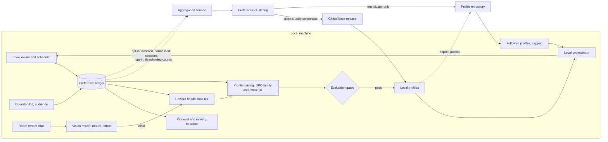

# Native show-control agent: learning loop and community model

Research and proposal for umbrella issue [#821](https://github.com/tolgraven/tolglow/issues/821). Nothing here is implemented. Repository facts were read at `bce22156` (origin/master, 2026-11-28). Thresholds and weights are starting values to tune against data, and are marked as such.

Sibling reports from the parallel lanes, reconciled into one set in the [native agent index](README.md):

- [model.md](model.md): base model, sizes, distillation and training cost.
- [interface.md](interface.md): JSON state and command schemas, the look encoding, the Room render and clip pipeline.
- [orchestration.md](orchestration.md): subagents, arbitration, scheduling, cancellation and the API or cloud backends. Its draft (PR #824) was read while finishing this report, and the dominance, decision-log and flash-guard terms below follow it.

This report owns what feedback is collected, how it becomes a training signal, what stays local, what may move a global model, how profiles are packaged, followed and listed, how a change is evaluated, and who may share what.

## Recommendation

1. **Record first, train later.** Build a local, replayable preference ledger and a retrieval/ranking baseline before any weight update. This is the path [#677](https://github.com/tolgraven/tolglow/issues/677) already asks for. Every later stage reads the same ledger.
2. **Use a reward model as a ranker and judge, and train the policy with direct preference optimisation plus conservative offline RL.** No online policy-gradient RLHF on a live show. A learned reward only ranks candidates that already passed the hard safety and budget limits.
3. **Judge the look in two tiers.** A small model over the compact look encoding runs at decision time. A larger vision model over short Room render clips runs offline, is trained on preference pairs over those clips, and teaches the small one.
4. **Keep per-role reward heads** (operator, DJ, audience) and combine them with settable weights at decision time. Role weights then change without retraining, and the operator's corrections stay authoritative.
5. **Make a profile portable across backends.** A profile is a style card, retrieval exemplars and reward heads, plus an optional LoRA adapter bound to one base model hash. API and cloud backends use everything except the adapter.
6. **Local feedback changes only local profiles. The global base moves only on clustered evidence** from many independent contributors, in both raw and rig-normalised form. Cluster-level agreement that does not generalise becomes a community profile, never a base change.
7. **Start global learning with explicit donation and thresholded aggregate counts.** Federated LoRA with differential privacy needs a population Tolglow will not have for some time. Say so in the product, and do not promise it.
8. **A followed profile is an immutable, attributed proposer** whose share of agent influence is capped at two thirds in total across everything followed. The same cap bounds how much followed-origin data may shape a local profile and how much such feedback counts as independent evidence globally.
9. **Rank the repository by verified quality, relevance and novelty with exposure caps and decay.** Never rank by raw downloads or follower counts.
10. **Gate every adapter on blind preference win rate and a degenerate-policy suite.** A photosensitivity limit for agent-originated output must exist before any learning from audience signals. The repository has none today (see [Observed](#observed-in-the-repository)).

## Observed in the repository

- **Capture and replay exist.** The rehearsal harness replays recorded passages through the real show owner with a seed and writes a review: agent lateness, carry-over and early launches, phrasing, per-phrase novelty, contrast, overwritten gestures and `:human-override` ramps ([rehearsal](../../rehearsal.md), [#670](https://github.com/tolgraven/tolglow/issues/670)). These are measured facts about a take. The review leaves the judgement of musicality to an operator-note column.
- **Ownership transfer is already a typed event.** A performer who edits an auto look takes it over (`:performer-took-over`); a performer grabbing a ramped parameter cancels the ramp (`:human-override`) ([auto show](../../auto-show.md#playing-alongside-it)). These are the implicit signals below, already attributed to a source such as `{:adapter :push-3}`. Refusing a stale agent suggestion is claimed on #670 but was not on master at this revision.
- **The look is already measured.** `tolglow.lighting-activity` scores brightness, coverage, flashing, movement and strobe from the committed frame ([source](../../../src/tolglow/lighting_activity.clj), [energy autopilot](../../energy-autopilot.md)). Its docstring says it is "a relative performance control, not a measurement of electrical power or a safety limit".
- **There is no photosensitivity limit.** A search of `docs/`, `src/` and the issue tracker for photosensitivity, seizure or flash-rate limits found none. The showcase run cue strobes at up to four flashes a beat, which is 12 Hz at 180 BPM ([showcase](../../showcase-show.md)). The lighting budget caps watts and lit sources, not flash rate ([lighting scenes](../../group-lighting-scenes.md)).
- **Personalities are a precedent for a taste package.** They are plain versioned data, blend up to four by weight and already have a package shape with `:provenance` ([personalities](../../personalities.md)).
- **Adapters are planned per base hash.** The model lab prepares rank-8 LoRA recipes, says to bind an adapter to a matching base hash and quantisation build, and excludes private recordings and custom shows from its datasets ([model lab](../../model-lab/README.md), [#323](https://github.com/tolgraven/tolglow/issues/323)).
- **Audience input is consented and aggregated.** Guests join through a signed QR identity, contribute one equally weighted reading each, expire after 2.5 seconds and reach the lighting host only as aggregates and gesture identities ([nearby audience](../../nearby-audience.md), [#300](https://github.com/tolgraven/tolglow/issues/300)).
- **Sharing is an explicit export.** A full local backup is lossless; a sharing export is a deliberate selection with manifest, dependencies, licence and provenance, and never carries secrets, chat history or peer addresses ([expressive performance](../../product/expressive-performance.md#sharing-effects-rigs-shows-and-arrangements), [#270](https://github.com/tolgraven/tolglow/issues/270), root `AGENTS.md`).

## Prior art in lighting

- **Rule-driven products.** rekordbox Lighting mode, SoundSwitch autoscripting and MaestroDMX generate lighting from audio analysis. None documents a loop that learns from the operator's corrections, as far as their public material shows.
- **Learned lighting.** Skip-BART treats lighting as generation: audio in, hue and intensity out, trained on a dataset of professional shows, with a human study against rule-based baselines (Zhao et al. 2025, [arXiv:2506.01482](https://arxiv.org/abs/2506.01482)). SeqLight extends it to several lights with imitation learning (Zhao et al. 2026, [arXiv:2605.03660](https://arxiv.org/abs/2605.03660)). Both learn from recorded lighting data. Neither personalises or learns from preference feedback.
- **The closest analogue is music.** MusicRL fine-tuned a music generator with a reward model fitted to about 300,000 pairwise user preferences, and found that automatic rewards (text adherence, quality) and the user-preference reward each helped and combined best (Cideron et al. 2024, [arXiv:2402.04229](https://arxiv.org/abs/2402.04229)). The same split applies here: automatic look rewards plus a human-preference reward.

## 1. Preference collection

### Signals

Every signal becomes a comparison where possible, because comparisons are more stable than absolute ratings (Christiano et al. 2017, [arXiv:1706.03741](https://arxiv.org/abs/1706.03741)) and because human ratings drift with what the rater has come to expect from the current policy (MacGlashan et al. 2017, [arXiv:1701.06049](https://arxiv.org/abs/1701.06049)).

| Signal | Source | Reads as | Strength | Main ambiguity |
| --- | --- | --- | --- | --- |
| Blind A/B on two clips of the same passage | Review tool, any role | A ≻ B under identical music, rig and seed | Strong | Rater fatigue; clip is not the room |
| Keep (capture the passage, save as cue, pin) | Push capture ([#671](https://github.com/tolgraven/tolglow/issues/671)), Studio, REPL | This decision ≻ unseen alternatives | Strong positive | Says what was good, not what would have been better |
| Later reuse of a kept passage | Any | Repeated positive | Strongest positive ([#677](https://github.com/tolgraven/tolglow/issues/677)) | Rare, arrives late |
| Like / dislike on the last agent change | Push button pair, Studio, REPL | Unpaired good / bad | Medium | Which change did the press mean |
| Reason tag (too busy, too dark, off the beat, wrong colour, repetitive) | Review tool, optional on dislike | Names the look feature at fault | Medium, high information | Optional, so sparse |
| Undo or cancel of an agent change | Any | Previous state ≻ agent change | Strong negative | Timing accident versus taste |
| Override or takeover of a parameter | `:performer-took-over`, `:human-override` | Operator's value ≻ agent's value, with magnitude | Strong, a correction | The performer may be improvising, not correcting |
| Reroll of a generated candidate ([#667](https://github.com/tolgraven/tolglow/issues/667)) | Push, Studio | Accepted candidate ≻ each rejected one | Medium | Rerolling out of curiosity |
| Veto of a proposal, event, source or lane | Orchestrator controls ([orchestration.md](orchestration.md)) | Rejected proposal ≺ what ran instead; trust in that source down | Strong negative | A veto of a whole source says little about one look |
| Kill, blackout or "never again" | Any | Hard negative; ban | Constraint, not a vote | None |
| Survival: an agent look left alone | Derived | Weak positive | Weak | Silence is not approval |
| Dominance slider moved for a followed profile | Studio, Push | Trust in that proposer up or down | Medium, slow | Coarse |
| DJ intent (energy up/down, "drop coming", mood) | Phone page or pad | Goal context; weak preference | Medium | Describes the music, not the light |
| Audience vote (coarse choice, reaction tap) | App Clip, full app | Aggregate preference | Weak, noisy | Self-selected voters |
| Audience motion, steps, pulse | #300 sensors | Context; very weak evidence | Very weak | Driven by the music itself |

Rules that follow from the table:

- **Corrections are data about the reward, and the choice set matters.** An override, an undo and a reroll are each a choice among different alternatives. Reward-rational choice gives one formalism for all of them: model each as a noisily rational pick from its own choice set (Jeon, Milli and Dragan 2020, [arXiv:2002.04833](https://arxiv.org/abs/2002.04833)). Physical correction as reward evidence comes from robotics (Bajcsy et al. 2017, "Learning Robot Objectives from Physical Human Interaction", CoRL).
- **Silence is missing data.** Survival counts only while there is attention evidence: an operator input on any surface within the last few bars. Without it the event is recorded with zero weight. #677 already calls a one-off audition or unrecorded passage ambiguous.
- **A takeover during a concert is not a complaint.** In the Push-led concert mode the performer is expected to take and release parameters. A takeover counts as a correction only when the agent wrote that parameter within the current phrase and the performer's value contradicts it. Otherwise it is a demonstration (see [offline RL](#offline-rl-from-logged-shows)).
- **Feedback binds to a decision, by beat.** A like pressed at bar 33 refers to the most recent agent change still visible, not to the frame. Surfaces should confirm what the press was applied to. A credit window in musical units (starting value: the current and previous bar, extended to the phrase for section-level changes) assigns delayed feedback; the reaction delay is converted through the tempo map, not assumed in milliseconds.
- **Push gestures stay cheap.** One press for like, one for dislike, the existing capture for keep, an encoder nudge on an agent-owned parameter as a correction with magnitude. The mapping belongs in the uniform surface layer ([#706](https://github.com/tolgraven/tolglow/issues/706)), so X-Touch and Studio get the same commands. No hardware qualification is claimed here.

### The preference event

One append-only local ledger, written off the lighting deadline. Each event carries enough to reconstruct the comparison by seeded replay. This is the first acceptance item of #677, widened from mappings to every agent decision.

| Field | Content |
| --- | --- |
| Identity | Event ID, show epoch, command ID, frame revision, cue and instance IDs, definition versions |
| Musical position | Bar, beat, phrase, section kind, tempo; never only milliseconds |
| Decision | The agent's candidates, seeds, the chosen one, and the probability or rank it was chosen with |
| Proposer | Profile ID and version, base model hash, backend, and a reference into the orchestrator's decision log |
| Look reference | Hash of the look encoding before and after; optional render clip reference |
| Context | Music features, declared goal text hash, rig class (raw and normalised descriptors), active personality |
| Actor | Role (operator, DJ, audience aggregate), surface, attention evidence; no personal identity for audience |
| Signal | Type from the table, polarity, magnitude, reason tag, the comparison it implies |
| Scope | Consent tier: local only, counts, donated; licence of any embedded content |

Recording the choice probability is not optional. Feedback exists only for what the policy showed, so learning from it without correcting for selection reproduces the policy's own bias. Clickthrough research established both the bias and the correction: implicit feedback is reliable as a relative judgement and biased as an absolute one (Joachims et al. 2005, "Accurately Interpreting Clickthrough Data as Implicit Feedback", SIGIR), and logged propensities allow unbiased learning (Joachims, Swaminathan and Schnabel 2017, [arXiv:1608.04468](https://arxiv.org/abs/1608.04468); Dudík, Langford and Li 2011, [arXiv:1103.4601](https://arxiv.org/abs/1103.4601)). Seeded rerolls are the exploration that makes propensities non-degenerate. The orchestrator's arbitration is deterministic outside exploration slots, so it logs probability 1 for those picks; in an exploration slot it draws among near-equal candidates with a seeded softmax and logs each probability ([orchestration.md](orchestration.md#determinism-and-replay)).

The ledger is local state. A full local backup includes it in full. A sharing export never includes it. Review and removal of any example is part of the first slice, and removal marks dependent profiles as needing a retrain.

### Noise and bias

| Problem | Handling |
| --- | --- |
| The music makes everything look good at the drop | Compare alternatives on the same passage; subtract a per-section-kind baseline; never use raw audience motion as reward |
| Hidden context: role, venue, crowd size, hour, track | Record it and condition on it. Standard preference learning silently averages over hidden context like a Borda count; modelling a distribution of utilities exposes the disagreement (Siththaranjan, Laidlaw and Hadfield-Menell 2023, [arXiv:2312.08358](https://arxiv.org/abs/2312.08358)) |
| Inconsistent raters | Hidden repeat pairs and transitivity checks give a per-rater reliability weight (Dawid and Skene 1979, "Maximum Likelihood Estimation of Observer Error-Rates Using the EM Algorithm") |
| Flipped or careless labels | Bounded or noise-robust losses: IPO, robust DPO (Chowdhury, Kini and Natarajan 2024, [arXiv:2403.00409](https://arxiv.org/abs/2403.00409)) |
| Drift across a night | Prefer pairs; recency-weight within a profile; keep explicit bans permanent |
| Position bias in A/B | Randomise left/right and order; record it |
| Only the favourite cue ever gets feedback | Seeded exploration slots in rehearsal and review, not on a paid show unless the operator enables it |

### Abuse resistance

- **Audience.** One vote per enrolled participant, using the signed enrollment #300 already has. A participant must be nearby by radio, so remote brigading is not possible through this path. Votes are coarse and rate-limited (starting value: one choice a participant per four phrases). The aggregate is a trimmed mean with a quorum (starting value: at least five participants) and is dropped below it. No individual vote is stored, locally or anywhere else.
- **DJ.** A paired role with its own pairing token held as a credential reference, never in a show document.
- **Global contributions.** Per-install contribution caps, norm clipping and robust aggregation (coordinate-wise median or trimmed mean: Yin et al. 2018, [arXiv:1803.01498](https://arxiv.org/abs/1803.01498); Blanchard et al. 2017, [arXiv:1703.02757](https://arxiv.org/abs/1703.02757)). Federated updates can carry backdoors (Bagdasaryan et al. 2018, [arXiv:1807.00459](https://arxiv.org/abs/1807.00459)), which is one more reason to prefer aggregate counts and reviewed releases at first.
- **Repository ratings.** Fake accounts are cheap (Douceur 2002, "The Sybil Attack") and rating systems are routinely shilled (Lam and Riedl 2004, "Shilling Recommender Systems for Fun and Profit"). Listing quality therefore comes from the repository's own benchmark run and from verified use, never from stars (see [anti-monoculture](#anti-monoculture)).

### Weighting by role

Do not bake role weights into one scalar reward. Train one reward head per role and combine them at decision time:

`r = w_op · r_op + w_dj · r_dj + w_aud · r_aud`, subject to hard constraints.

- Multi-objective alignment work shows that separately trained objectives can be combined afterwards by weight, either on rewards or on adapter weights (Zhou et al. 2023, [arXiv:2310.03708](https://arxiv.org/abs/2310.03708); Ramé et al. 2023, [arXiv:2306.04488](https://arxiv.org/abs/2306.04488); Jang et al. 2023, [arXiv:2310.11564](https://arxiv.org/abs/2310.11564)).
- Aggregating disagreeing people is a social-choice decision and should be stated, not hidden in a loss (Conitzer et al. 2024, [arXiv:2404.10271](https://arxiv.org/abs/2404.10271)). Averaging also lets a majority erase a minority taste (Chakraborty et al. 2024, [arXiv:2402.08925](https://arxiv.org/abs/2402.08925)).

Starting values, a local setting per profile: operator 1.0, DJ 0.5, audience 0.25 for the whole crowd. Order of authority:

1. The flash guard, budgets and output caps. Not learned, not weighted.
2. Operator bans and live overrides. Constraints: no other role outvotes them.
3. The weighted blend of role heads.

Whether the DJ is a separate identity and what the defaults are is an operator decision.

## 2. Learning method

### What each family offers

| Family | How it works | Fit here |
| --- | --- | --- |
| RLHF with a reward model and policy gradient | Fit a reward model to comparisons, then optimise the policy against it with PPO (Christiano et al. 2017; Ouyang et al. 2022, [arXiv:2203.02155](https://arxiv.org/abs/2203.02155)) | Needs many rollouts and a trustworthy reward model. Optimising hard against a learned reward degrades true quality past a point (Gao, Schulman and Hilton 2022, [arXiv:2210.10760](https://arxiv.org/abs/2210.10760)). Rollouts can run in seeded simulation, but audiences cannot be simulated. Not recommended as the main loop |
| Direct preference optimisation | Train the policy directly on (context, preferred output, rejected output) with a frozen reference, no reward model or sampling (DPO: Rafailov et al. 2023, [arXiv:2305.18290](https://arxiv.org/abs/2305.18290)) | Cheap, stable, fits a LoRA and a laptop. Recommended for paired signals |
| IPO | Replaces DPO's unbounded log-sigmoid objective with a bounded regression target, which resists overfitting to near-deterministic preferences (Azar et al. 2023, [arXiv:2310.12036](https://arxiv.org/abs/2310.12036)) | Recommended default for small, noisy local datasets |
| KTO | Learns from unpaired good/bad labels (Ethayarajh et al. 2024, [arXiv:2402.01306](https://arxiv.org/abs/2402.01306)) | Recommended for likes, dislikes, keeps and kills, which have no pair |
| Reference-free and listwise variants | ORPO ([arXiv:2403.07691](https://arxiv.org/abs/2403.07691)), SimPO ([arXiv:2405.14734](https://arxiv.org/abs/2405.14734)), LiPO for ranked lists ([arXiv:2402.01878](https://arxiv.org/abs/2402.01878)) | LiPO fits reroll lists. The reference-free ones drop the anchor to the base, which is the opposite of what a small local dataset needs |
| Offline RL | Learn from logged trajectories without acting (Levine et al. 2020, [arXiv:2005.01643](https://arxiv.org/abs/2005.01643)) | Recommended in its simplest forms, below |

### Recommended stack

Three stages. Each must beat the previous one on held-out data before the next is built, as #677 requires.

**Stage A: retrieval and ranking, no weights.** Retrieve kept decisions from similar contexts (music section, rig class, goal) as in-context exemplars, and rank the policy's candidates with a Bradley-Terry model over ledger comparisons (Bradley and Terry 1952, "Rank Analysis of Incomplete Block Designs"). This works on every backend including API models, and is the baseline #677 asks to compare against seeded generation.

**Stage B: reward heads.** Fit the per-role reward heads on ledger comparisons (see [look in reward modelling](#3-the-look-in-reward-modelling)). Use them three ways, none of which is unconstrained optimisation:

- Rerank N sampled candidates at decision time, inside the safe set.
- Label logged trajectories with dense reward for offline RL.
- Mine extra training pairs from best-of-N, at reduced weight, because these pairs inherit the reward model's errors.

Use an ensemble and act on its lower bound; disagreement among members is the signal that a candidate is out of distribution (Coste et al. 2023, [arXiv:2310.02743](https://arxiv.org/abs/2310.02743)).

**Stage C: per-profile adapters.** Train a LoRA (Hu et al. 2021, [arXiv:2106.09685](https://arxiv.org/abs/2106.09685)) per local profile with a combined objective:

- IPO or DPO on paired signals, with the frozen base as reference so the adapter stays near it.
- KTO on unpaired signals.
- Advantage-weighted behaviour cloning on logged trajectories (next section).

Pair construction for a policy that emits JSON commands:

| Signal | Preferred | Rejected |
| --- | --- | --- |
| Override | The operator's resulting change, rewritten as the equivalent validated command | The agent's command |
| Undo or cancel | No change | The agent's command |
| Reroll | The accepted candidate | Each rejected candidate (listwise) |
| A/B clip vote | The command sequence behind the chosen clip | The other sequence |
| Best-of-N by reward head | Top candidate | Bottom candidate, low weight |

Two practical requirements for [interface.md](interface.md): commands need one canonical serialisation, or the loss compares formatting instead of decisions; and an operator action must be expressible as the same command the agent would have sent, which the shared validated command layer already implies.

### Offline RL from logged shows

A show is an episode. A step is one decision point on the musical grid. The action is the command batch, by the agent or by a human. Reward is the sparse ledger signal plus the dense reward-head estimate.

- **Human performances are demonstrations, and the most valuable data a profile has.** An operator playing a set by hand is a direct statement of local style. Demonstrations and preferences combine well: demonstrations place the policy, preferences refine it (Bıyık et al. 2022, "Learning Reward Functions from Diverse Sources of Human Feedback", IJRR).
- **Use the conservative, supervised end of offline RL.** Advantage-weighted regression weights each logged action's imitation loss by its exponentiated advantage (Peng et al. 2019, [arXiv:1910.00177](https://arxiv.org/abs/1910.00177); AWAC, [arXiv:2006.09359](https://arxiv.org/abs/2006.09359)). Return-conditioned imitation prefixes the context with the outcome to aim for (Decision Transformer, [arXiv:2106.01345](https://arxiv.org/abs/2106.01345); RvS, [arXiv:2112.10751](https://arxiv.org/abs/2112.10751)). Both are a weighted or conditioned fine-tune, which fits the model-lab recipes unchanged.
- **Defer value-based methods.** CQL ([arXiv:2006.04779](https://arxiv.org/abs/2006.04779)), IQL ([arXiv:2110.06169](https://arxiv.org/abs/2110.06169)) and their language-model form ILQL ([arXiv:2206.11871](https://arxiv.org/abs/2206.11871)) need critics and far more data than one venue produces. TD3+BC shows that a behaviour-cloning term alone buys most of the conservatism ([arXiv:2106.06860](https://arxiv.org/abs/2106.06860)).
- **Stay inside the data.** Offline methods fail by valuing actions the log never contained. The KL anchor, the behaviour-cloning term and the ensemble lower bound all address this. Off-policy estimates are a filter, not proof; the proof is a blind comparison (section 5).

### Where and when training runs

- Never during a show. Training, rendering clips and vision scoring are background work after a session, off the lighting deadline.
- On a Mac, a rank-8 adapter over tens of thousands of tokens is within the model-lab budget; [model.md](model.md) owns the numbers. An iPad or phone trains on a paired Mac, or in the Tolglow cloud if the operator opts in. The cloud route moves ledger data off the machine and is a privacy tier of its own.
- With an API model there is no adapter to train. Learning lives in Stage A and B: exemplars, the style card and the reward heads reranking N candidates.
- **A new adapter earns its share.** It first runs in shadow, proposing without output, and its proposals are scored against what was kept. It then enters arbitration at low dominance and rises as its proposals survive. This reuses the follow mechanism in section 6 and gives one rollback path: drop the proposer.

## 3. The look in reward modelling

The agent has many options and no direct sense of what they produce. The simulated look is the only observation that is comparable across rigs, effects and code the model has never seen, so the reward is defined on the look and the music, not on command text. A reward on commands would learn which cue names are popular. A reward on looks can credit a new effect that produces a liked result.

`r(look over a window, music over the same window, goal, rig class, role)`

### Tier 1: look-feature reward (decision time)

- **Input.** The compact look encoding specified in [interface.md](interface.md) before and after the candidate, the existing activity components (brightness, coverage, flashing, movement, strobe), music features on the beat grid and the goal embedding.
- **Model.** A small network, per role, small enough to score every candidate of every decision on the device. It is the student in the distillation below.
- **Prediction, not rendering.** At decision time the look of a candidate is predicted through the same forecast the auto planner uses for emission, or by a short headless evaluation. A candidate whose look cannot be predicted is ranked by the ensemble's lower bound, which penalises it.

### Tier 2: vision reward over Room renders (offline)

The operator pictures the agent judging the look from Room 3D renders, from the client preview or a headless equivalent. That is the right teacher signal: it sees beams, fog, overlap and geometry that a feature vector flattens. It is too slow and too large for the decision loop, so it runs offline or occasionally. [interface.md](interface.md) owns the render and encoding pipeline; [model.md](model.md) owns the sizes.

- **Architecture.** A frozen pretrained image or video encoder with a small trained preference head, and a late fusion with music features. Candidates for the encoder are contrastive image-text models (CLIP, [arXiv:2103.00020](https://arxiv.org/abs/2103.00020); SigLIP, [arXiv:2303.15343](https://arxiv.org/abs/2303.15343)) and self-supervised video models (VideoMAE, [arXiv:2203.12602](https://arxiv.org/abs/2203.12602); V-JEPA, [arXiv:2404.08471](https://arxiv.org/abs/2404.08471)). Only the head is trained, so a profile's taste head is a few megabytes.
- **Precedent.** Preference-trained scorers over generated images and video: ImageReward ([arXiv:2304.05977](https://arxiv.org/abs/2304.05977)), PickScore ([arXiv:2305.01569](https://arxiv.org/abs/2305.01569)), HPS v2 ([arXiv:2306.09341](https://arxiv.org/abs/2306.09341)), VideoScore ([arXiv:2406.15252](https://arxiv.org/abs/2406.15252)). Such scorers have then been used to align generators, by RL (DDPO, [arXiv:2305.13301](https://arxiv.org/abs/2305.13301)) and by DPO (Diffusion-DPO, [arXiv:2311.12908](https://arxiv.org/abs/2311.12908)). In control, vision-language models have served as rewards from rendered frames (VLM-RM, [arXiv:2310.12921](https://arxiv.org/abs/2310.12921); RL-VLM-F, [arXiv:2402.03681](https://arxiv.org/abs/2402.03681); RoboCLIP, [arXiv:2310.07899](https://arxiv.org/abs/2310.07899); VIPER, [arXiv:2305.14343](https://arxiv.org/abs/2305.14343)).
- **Goal adherence for free.** Image-text similarity between a render and the natural-language goal ("deep red, sparse, one spotlight") is an automatic reward term that needs no human labels, as text adherence was for MusicRL-R. It is a separate head with its own weight, because it is the easiest term to game.

### Preference pairs over short clips

Christiano et al. collected human comparisons over clip pairs of one to two seconds. Lighting needs longer, musical clips.

- **Length.** Two to eight bars, cut on bar lines. At 70 to 180 BPM, four bars of 4/4 last from 5.3 to 13.7 seconds.
- **Controlled pair.** Same passage, same audio, same rig, same camera, same seed for everything except the decision under test. The harness in #670 already replays a passage deterministically; a clip pair is two replays that differ in one agent decision or one profile.
- **With sound.** Raters hear the passage. A silent clip measures prettiness, not fit.
- **Cameras.** A fixed set of declared viewpoints (front of house, audience, overhead). The pair uses the same viewpoint; viewpoint is recorded as context.
- **Beat-synchronous frames.** Sample frames at beat subdivisions, not at a fixed frame rate. The model then sees rhythm alignment in a tempo-invariant form. A sampled frame can miss a strobe entirely, so the DMX-derived flashing and strobe components are always fused alongside pixels.
- **Renderer identity.** Record the Room build, quality tier and fog settings. The head must not learn that a higher quality tier looks better.

Sources of labelled pairs:

| Source | Rig in the clip | Leaves the machine |
| --- | --- | --- |
| Operator reviewing two takes of a rehearsal | Own rig | No |
| Live feedback, attached afterwards to a re-render of that moment | Own rig | No |
| Audience aggregate attached to a re-render of that moment | Own rig | No |
| Community blind A/B on profile preview clips | Canonical reference rigs, licence-cleared music | Public by construction |
| Donated pairs | Decision retargeted to a canonical rig | Only with donation consent |

Live feedback is given about the real room, then attached to the simulated render of the same bars. That is deliberate: the head learns which simulated looks people liked in reality, which corrects part of the preview-to-venue gap without a camera.

### Teacher and student

- Replay logged shows headlessly to make unlimited unlabelled clip pairs. The vision teacher scores them; the look-feature student is trained to match its preference margins. Human-labelled pairs train both.
- The student must agree with held-out human pairs at least as well after distillation as before. If it does not, the look encoding is missing something the pixels have, and that is a finding for [interface.md](interface.md).
- **Ship the vision tier only if it earns it.** No public preference model was trained on dark scenes with volumetric beams. The test is plain: on held-out operator pairs, does a head on frozen vision features beat the look-feature model alone? If not, keep the look-feature tier and revisit.

### Local, global and followed

| Scope | Encoder | Head | Trained on |
| --- | --- | --- | --- |
| Local profile | Shared, frozen | Per profile, per role | Own clips and live feedback, own rig |
| Global | Shared, frozen | One global head per role, plus cluster heads | Community A/B on canonical rigs; donated normalised pairs; thresholded counts |
| Followed profile | Shared, frozen | The author's published taste head | The author's data, on their machine |

- The global head is the default critic for a new install and the prior a local head starts from.
- A followed profile brings its **taste head as well as its policy**. The orchestrator can use the author's taste as a critic over local proposals, which is often what "light it like this VJ would" means, and is cheaper than running a second policy. This is the default mode: a followed profile is a ranker first and a proposer only where the generation budget allows, because each adapter needs its own prompt cache ([model.md](model.md#what-profiles-cost-as-adapters), [orchestration.md](orchestration.md#followed-profiles-as-rankers-first)). Critic weight counts toward the same dominance cap as proposals (section 6).
- Clips of a real rig reveal the venue. They stay local. What leaves, at most, is a head's weights in a published profile, or a decision re-rendered on a canonical rig.

## 4. Local and global models

### Local

- Per-profile adapter and reward heads, trained after sessions on the full ledger at full strength. The base is frozen.
- Local learning is deliberately strong: IPO's bounded objective and the anchor to the base are the only brakes. A profile exists to diverge.
- Several profiles per install (by venue, genre or persona), selectable and blendable. Each records its training scope and lineage.

### When the global base may move

The operator's rule: the base moves only when preferences cluster across similar effects, rhythmic approaches and rig geometry or density, normalised and raw. Specified as follows.

**Bucket key.** Each comparison is filed under:

- *Effect family*: the registry family and parameter roles in musical units, not a cue name.
- *Rhythmic approach*: change rate per bar, on-beat fraction, subdivision, phrase alignment, motif period.
- *Rig class, raw*: log-binned fixture count, physical extent, capability mix (movers, washes, strips, pixels), layout dimensionality (line, plane, volume).
- *Rig class, normalised*: positions scaled to the stage bounding box, fixtures as roles, density per unit length or area.
- *Music context*: section kind and tempo band.

**Consensus test.** A bucket supports a base change only when all of these hold (starting values):

| Condition | Starting value | Why |
| --- | --- | --- |
| Independent contributors | At least 30 installs | A handful of venues is not a norm |
| Comparisons | At least 300 | Estimate stability |
| Agreement | Lower Wilson bound of win rate at least 0.6 | Effect size, not just significance |
| Concentration | No contributor above 5% of the weight | No single house style decides |
| Lineage independence | Contributors following the same public profile count once | Herded feedback is not independent |
| Generalisation | Holds in the normalised form and in at least three raw rig classes | "Normalised and raw" |

- **Passes everything:** candidate for the next base release.
- **Holds in one rig class or one cluster of tastes only:** becomes a cluster head or a community profile in the repository. The base does not move.
- **Contested (bimodal):** recorded as a style axis. The base stays neutral on it. This is the case averaging gets wrong.

**Clustering.** Fit a mixture over contributors' preference vectors and rig descriptors; each component is a taste cluster. Clustered federated learning does the same over model updates (Sattler et al. 2019, [arXiv:1910.01991](https://arxiv.org/abs/1910.01991); IFCA, Ghosh et al. 2020, [arXiv:2006.04088](https://arxiv.org/abs/2006.04088)). Personalised federated learning keeps a local model regularised toward a shared one, which is this design's local-profile-over-base shape (Ditto, Li et al. 2020, [arXiv:2012.04221](https://arxiv.org/abs/2012.04221)).

**Releases are versioned and reviewed.** A base release states which buckets moved it, with counts. Local adapters are bound to a base hash, so a new base needs either retraining from the ledger (the ledger is the durable asset, the adapter is a cache) or a tested conversion. The portable parts of a profile survive unchanged.

### Options for getting evidence off the machine

| Option | What leaves | Strength | Weakness |
| --- | --- | --- | --- |
| A. Thresholded aggregate counts | Per-bucket win/loss counts, clipped per install, released only above a contributor threshold | Simple; trains a global reward head; interpretable | Coarse; needs a trusted aggregator or secure aggregation |
| B. Donated sessions | Selected sessions, retargeted to canonical rigs, identifiers stripped, reviewed before sending | Richest data; allows central vision-reward training | Needs explicit action; small volume |
| C. Federated LoRA | Clipped adapter updates | Raw data never leaves | Hard at this scale; see below |

Recommendation: A and B first, C later.

- Federated averaging (McMahan et al. 2017, [arXiv:1602.05629](https://arxiv.org/abs/1602.05629)) and federated instruction tuning of LoRA (Zhang et al. 2023, [arXiv:2305.05644](https://arxiv.org/abs/2305.05644)) are established. LoRA under differential privacy is unstable unless one factor is frozen (FFA-LoRA, Sun et al. 2024, [arXiv:2403.12313](https://arxiv.org/abs/2403.12313)); devices of different sizes need heterogeneous ranks (Cho et al. 2024, [arXiv:2401.06432](https://arxiv.org/abs/2401.06432)).
- Gradients leak training data unless protected (Zhu, Liu and Han 2019, [arXiv:1906.08935](https://arxiv.org/abs/1906.08935)), so federated learning needs secure aggregation (Bonawitz et al. 2016, [arXiv:1611.04482](https://arxiv.org/abs/1611.04482)) and user-level differential privacy (Abadi et al. 2016, [arXiv:1607.00133](https://arxiv.org/abs/1607.00133); McMahan et al. 2018, [arXiv:1710.06963](https://arxiv.org/abs/1710.06963)).
- **Population is the blocker.** Production differentially private federated training reports its guarantees over very large device populations (Xu et al. 2023, [arXiv:2305.18465](https://arxiv.org/abs/2305.18465); Kairouz et al. 2021, [arXiv:2103.00039](https://arxiv.org/abs/2103.00039)). With hundreds of installs, the noise needed for a meaningful guarantee overwhelms the signal. Until the population is large, a contributor threshold on counts plus explicit donation is the honest mechanism, and the product should not claim differential privacy it cannot deliver.
- For counts, randomised response (RAPPOR, [arXiv:1407.6981](https://arxiv.org/abs/1407.6981)) and split-trust aggregation (Prio: Corrigan-Gibbs and Boneh 2017, NSDI) are the prior art to adopt when the aggregator should not be trusted.

### What leaves the machine

| Tier | Default | Leaves | Does not leave |
| --- | --- | --- | --- |
| 0 Local only | On | Nothing | Everything |
| 1 Counts | Off, opt-in | Clipped per-bucket counts with rig class and base version | Ledger events, clips, track identity, goal text, venue, audience data |
| 2 Donation | Off, per session, reviewed | Chosen sessions retargeted to canonical rigs: commands, look encodings, music features, signals | Real rig geometry, track identity, free text, credentials, chat history, peer addresses |
| 3 Publish a profile | Off, explicit per version | The profile package (section 6) | The ledger and anything not selected |
| Cloud training | Off, opt-in | The ledger slice needed to train, to Tolglow's service | Credentials; deleted after training (policy to set) |

- Tiers are independent. Saving, backing up or following never changes a tier.
- Audience data never leaves in any tier except as part of an aggregate that already met its quorum locally.
- Track identity is replaced by musical features before anything leaves. A track list reveals a set.
- Opt-in is per install and revocable. Revocation stops future contributions; what it can undo is stated at opt-in (section 7).

## 5. Evaluation

### Offline benchmark

A frozen suite: passages × rig classes × goals, replayed with seeds through the real show owner with captured output. It extends the #670 passages (groove, breakdown, return, quiet) to canonical rigs of several classes.

| Group | Metric | Source |
| --- | --- | --- |
| Validity | Schema-valid commands, refusals, stale or late changes | Show owner receipts |
| Musical fit (proxies) | Phrase alignment, carry-over, novelty per phrase, repeats, contrast between sections | Rehearsal review |
| Preference | Held-out agreement of reward heads with human pairs; ensemble lower-bound score of the policy | Ledger, held-out split |
| Diversity | Look-embedding spread across passages and seeds; distance from the base and from followed profiles | Benchmark fingerprint |
| Safety | Proposals the flash guard trimmed or dropped, budget hits, dark-section violations | Orchestrator decision log |
| Cost | Time to first accepted action, deadline misses with the visualiser active | Model-lab release gates |

Held-out means held out by passage family and by rig, as the model lab already isolates families. A profile's benchmark output is also its **style fingerprint**, used for listing and duplicate detection in section 6.

### Preference win rate

The deciding metric is a blind A/B between the candidate and a baseline on clip pairs, reported as wins over wins plus losses with a Wilson interval, per role and per context bucket.

- Baselines: the current profile, the unadapted base, and the rule-based auto show ([#217](https://github.com/tolgraven/tolglow/issues/217)).
- Raters who produced the training data do not rate the test set, where there is more than one rater. For a single operator, hold out by passage and date.
- Report ties and sample counts. Small cohorts stay visible, as the model lab requires.

Decisive comparisons needed to detect a true win rate against 50% (two-sided 5%, 80% power, normal approximation):

| True win rate | 55% | 60% | 65% | 70% |
| --- | ---: | ---: | ---: | ---: |
| Comparisons | 783 | 194 | 85 | 47 |

One operator can produce a few dozen careful comparisons in a session. A local adapter can therefore be shown to be clearly better (65% and up) but not marginally better. Small improvements should not ship on local evidence alone.

### Reward hacking

A policy optimised against a proxy finds the proxy's blind spots (Amodei et al. 2016, [arXiv:1606.06565](https://arxiv.org/abs/1606.06565); Skalse et al. 2022, [arXiv:2209.13085](https://arxiv.org/abs/2209.13085); Manheim and Garrabrant 2018, [arXiv:1803.04585](https://arxiv.org/abs/1803.04585)). The predictable failures here: strobe everything, maximise intensity, change constantly to farm novelty, never change to avoid dislikes, replay the last kept look forever, chase audience motion that the music caused.

Defences, in order of strength:

1. **Safety is outside the reward.** The photosensitivity limit, the lighting budget, output caps and intentional-darkness rules are enforced by the show owner on agent-originated commands. The reward model only ranks inside the allowed set and has no term that can be traded against them.
2. **Degenerate-policy suite.** Scripted policies for each failure above run through the benchmark. Each must score below the baseline on every reward head and fail the gates. A reward head that prefers "always strobe" is rejected before any policy is trained on it.
3. **Stop on human win rate, not on reward-model score.** Reward-model score keeps rising after true quality turns down (Gao et al. 2022). Checkpoints are chosen by held-out human pairs.
4. **Conservatism.** Ensemble lower bound, anchor to the base, behaviour-cloning term.
5. **Distribution bands.** The activity histograms the autopilot already keeps (brightness, flashing, strobe share, dark share per section kind) must stay within a band around human-played reference shows. A profile whose strobe share doubles fails, whatever its score.
6. **Audience signals are context.** Motion, steps and pulse enter as inputs and as a weak, baseline-subtracted reward at most. Explicit audience votes are capped by the role weight and cannot override the operator.

### Photosensitivity

- Observed: no flash-rate limit exists in the repository, and the activity score is explicitly not a safety limit.
- Guidance: flashes between about 3 and 30 Hz are the most common seizure triggers, and the UK Health and Safety Executive recommends at most four flashes a second for strobe lighting in clubs and at public performances, as reported by the [Epilepsy Society](https://epilepsysociety.org.uk/understanding-epilepsy/photosensitive-epilepsy) (the HSE document itself was not read for this report). Broadcast and web standards limit flashes to three in any second above an area and contrast threshold ([ITU-R BT.1702](https://www.itu.int/rec/R-REC-BT.1702), [WCAG 2.2 SC 2.3.1](https://www.w3.org/WAI/WCAG22/Understanding/three-flashes-or-below-threshold.html)). Clinical reviews: Fisher et al. 2005, "Photic- and Pattern-induced Seizures", Epilepsia 46(9); Fisher et al. 2022, "Visually Sensitive Seizures", Epilepsia 63(4).
- The flash guard itself is specified in [orchestration.md](orchestration.md) and is that lane's slice: a limit on agent-attributed flashing, applied as a hard filter before scoring. What learning requires of it: it sits outside every learned component, it considers lit area, synchrony across fixtures and saturated red as well as rate, and no profile, followed or local, can raise it. A human performer's own strobe is a separate operator policy.
- The guard is a prerequisite for learning from audience signals, and for the repository: a published profile is benchmarked under the default guard and its listing shows its strobe and brightness distributions.

### Release gates for a profile version

| Gate | Local use | Publish |
| --- | --- | --- |
| Degenerate-policy suite passes for its reward heads | Required | Required, re-run by the repository |
| No proposal trimmed or dropped by the flash guard on the benchmark | Warning | Required |
| Activity distributions inside the band | Warning | Required |
| Not worse than the base on validity and timing | Required | Required |
| Blind win rate over the current profile | Recommended, shown with its interval | Shown on the listing |
| Leak check (section 7) | Not needed | Required |

## 6. Profiles

### Package

One format for local, public and followed profiles. It extends the adapter binding the model lab already requires and the provenance shape personalities already have.

| Part | Portable across backends | Content |
| --- | --- | --- |
| Manifest | Yes | ID, version, schema, author key, licence, content hashes, base requirements, lineage |
| Style card | Yes | Human-readable taste: palette tendencies, rhythm, density, contrast, what it avoids; the prompt-level form of the profile |
| Exemplars | Yes | Kept decisions on canonical rigs, as retrieval examples |
| Reward heads | Yes, given the shared encoder version | Look-feature heads per role; optional vision taste head |
| Policy adapter | No: one base hash and quantisation | LoRA weights in a non-executable tensor format |
| Evaluation report | Yes | Benchmark results, style fingerprint, activity distributions, gate results |
| Training scope | Yes | Counts by role and signal, date range, rig classes, lineage shares. No raw data |

- A profile without an adapter is complete. That is what an API-model or cloud user runs, and what any user runs after a base upgrade until the adapter is retrained.
- Weights load as data only. A package never carries executable code; effects a profile depends on are separate artifacts under #270's rules for trusted source.

### Following: a capped subagent

A followed profile runs as one proposer among several. The local orchestrator arbitrates. [orchestration.md](orchestration.md) owns the arbitration algorithm; this section fixes what learning needs from it.

- **What dominance bounds.** [orchestration.md](orchestration.md) defines it: a source's share of agent-attributed influence, measured in attributed light-beats over a trailing window (its default is four phrases), steered toward a slider weight. Followed sources together may not exceed two thirds. In this report `D` is the operator's total followed setting, `D ≤ 2/3`.
- **Critics count too.** When a followed taste head scores local proposals, its mixing weight in the critic is limited to `D` as well. Otherwise a followed taste could decide everything while proposing nothing. The dominance ledger credits a ranker with its share of each accepted proposal's critic score, so ranking and proposing are counted against one cap (#828).
- **The cap is on the total.** Three followed profiles share the two thirds between them. At least one third always belongs to local proposers: the local profile, or the unadapted base steered by local goals when no local profile exists.
- **The cap is a product constant.** No package, backend or agent command can raise it. The operator sets `D` at or below it, per followed profile and in total.
- **Why a mixture and not a weight merge.** Adapters can be merged (task arithmetic, [arXiv:2212.04089](https://arxiv.org/abs/2212.04089); TIES, [arXiv:2306.01708](https://arxiv.org/abs/2306.01708); LoraHub, [arXiv:2307.13269](https://arxiv.org/abs/2307.13269)). A merge loses attribution, cannot be capped or verified by hash afterwards, and may breach a licence. Separate proposers keep each decision attributable. Merging is offered only for an explicit fork where the licence allows it.
- **Attribution.** The orchestrator's decision log records, for every window, what each source proposed, what was admitted and why, and the dominance ledger holds the shares. Feedback is credited through those records; the preference ledger stores a reference, not a copy.
- **Followed profiles are immutable locally.** Feedback on a followed proposer's decision trains the local profile and the local arbiter's trust in that proposer. It never edits the followed weights. Changing them means forking, which creates a new local profile with lineage.
- **The cap also bounds absorption.** A local profile trained on what the operator kept will absorb a followed style over time. In each training batch, examples that originated from followed proposers are limited to mass `D`. An example a followed profile shaped as a ranker counts with its ledger attribution, the same fractional share the dominance ledger gives it. Lineage shares are recorded in the training scope. Above a threshold (starting value: one third from one lineage), publishing requires attribution and a source licence that permits derivatives.
- **Disagreement is the point.** When the local arbiter rejects a followed proposal, that is recorded as a local preference. Sustained rejection lowers the effective dominance; the setting is a ceiling, not a target.
- **Updates.** A new version of a followed profile is offered, not applied. The old version keeps running until the operator accepts. A revoked version is disabled at the next sync with a visible notice.

### Local profiles and the repository

- Local profiles are listed with their scope, lineage, base binding and gate status. Switching is a validated command available from Studio, Push and the REPL.
- The in-app repository is a view of the #270 catalog filtered to profile artifacts, plus the follow action. Download and follow are separate from publish. Nothing is followed by default, and no profile ships pre-followed.

### Anti-monoculture

Popularity feeds on itself. In a controlled music market, showing download counts made outcomes both more unequal and less predictable from quality (Salganik, Dodds and Watts 2006, "Experimental Study of Inequality and Unpredictability in an Artificial Cultural Market", Science 311). Recommenders trained on their own exposure homogenise what users see without improving utility (Chaney, Stewart and Engelhardt 2018, [arXiv:1710.11214](https://arxiv.org/abs/1710.11214)). The design counters it at four levels.

**Structural limits (already above).**

- Followed influence is capped at two thirds in total. Local work always decides at least a third of what the agent does.
- Followed-origin data is capped in local training.
- The base moves only on consensus across independent lineages and rig classes; a popular style becomes a community profile, not a default.

**Ranking.**

- *Quality from verified evidence.* The repository's own benchmark run and blind community A/B on canonical clips, as a Wilson lower bound. Use-based evidence (kept rate while followed) counts only from installs that ran the profile, through tier 1 counts.
- *No raw popularity.* Follower and download counts are not a sort key. If popularity enters at all it is logarithmic, capped, and decays (starting value: 30-day half-life on active follows).
- *Relevance.* Match to the viewer's rig class and declared genres.
- *Novelty.* Distance between the profile's style fingerprint and what the viewer already has and follows. Calibrated lists keep a viewer's range instead of collapsing to the majority taste (Steck 2018, "Calibrated Recommendations", RecSys).
- *Diversified lists.* Build each page with maximal marginal relevance (Carbonell and Goldstein 1998, SIGIR) or a determinantal point process (Kulesza and Taskar 2012, "Determinantal Point Processes for Machine Learning"), so near-identical styles do not fill it. Personalised re-ranking measurably reduces popularity bias (Abdollahpouri, Burke and Mobasher 2019, [arXiv:1901.07555](https://arxiv.org/abs/1901.07555)).
- *Exploration slots.* A fixed share of every page (starting value: one fifth) goes to new or under-exposed profiles above the quality floor.
- *Exposure caps.* No lineage receives more than a set share of impressions in a week (starting value: 10%). Forks and re-uploads count toward their parent lineage; the fingerprint detects clones that omit it.

**Influence on the global model.**

- A lineage's total weight in global aggregation is capped, whatever its follower count.
- Feedback given while following profile P at dominance `d` counts with weight `1 − d` toward global clustering and is grouped under P's lineage for the independence test. Agreement among followers of one VJ is one data point.

**Decay and measurement.**

- Profiles bound to a retired base lose their adapter and rank on portable parts only, which ages out stale styles naturally.
- The repository publishes its own concentration figures from tier 1 counts: effective number of styles (the exponential of the entropy of dominance-weighted follow shares), the Gini coefficient of exposure, and the top five lineages' share of influence. Starting alarm: top five above half. An alarm tightens exposure caps; it does not delist anyone.

Whether follower counts are shown at all is an operator decision. The research favours hiding them or showing them only on the profile's own page.

## 7. Data and governance

### Boundary with the sharing export (#270)

| Concern | Owner |
| --- | --- |
| Catalog, accounts, authenticated publish and download, manifests, dependency resolution, reviewable import, collision handling, licence metadata | #270 |
| Profile package contents, training scope, evaluation report, gates, style fingerprint | This design |
| Follow semantics, dominance cap, attribution, repository ranking | This design, with orchestration |
| Preference ledger | Local state. In full backups. Never a sharing artifact |
| Donation and counts | A third path, with its own consent. Neither backup nor sharing export |

- A profile is one more artifact type in the #270 catalog. It uses the same manifest, provenance and import review. It adds requirements (base hash, encoder version) and attestations (gates, leak check).
- Publishing is always an explicit per-version action with a review screen showing exactly what the package contains. Saving a show, taking a backup, training a profile or following someone publishes nothing.
- A backup restores the ledger, profiles, follows and consent tiers losslessly. Restoring on another machine does not carry consent to contribute: tiers above 0 are re-confirmed, as output arming is.

### Private data in weights

Fine-tuned weights can memorise and reveal training text (Carlini et al. 2021, [arXiv:2012.07805](https://arxiv.org/abs/2012.07805)). A profile trained on a ledger could leak a venue name, a track list or goal text.

- **Train shareable profiles on shareable inputs.** For a profile meant for publication, training contexts use musical features in place of track identity, rig classes and canonical rigs in place of real geometry, and no free text beyond the style card the author writes. A profile trained on raw local context is marked local-only and cannot be published; the author retrains a shareable variant from the same ledger.
- **Leak check before publish.** Plant canary strings in training, then probe the adapter for them and for strings from the ledger (venue, device and track names). Any hit blocks publication.
- **Differentially private fine-tuning as an option.** DP-SGD on LoRA parameters keeps most utility in language models (Yu et al. 2021, [arXiv:2110.06500](https://arxiv.org/abs/2110.06500)). Whether it does on a ledger this small is unmeasured. Offer it only with a stated budget.
- **Credentials.** Persistence already refuses raw secrets. Profile packages, donation bundles and ledger events inherit that check.
- **Audience.** No individual audience data is ever in a ledger, so none can be in a profile.

### Licensing

This needs legal review before launch; the following is a proposal, not advice.

- **Three layers.** The base model's licence (the model-lab candidates are Apache-2.0; [model.md](model.md) decides the base), the adapter and heads the author trained, and the exemplars and style card the author wrote. The manifest states each.
- **A short fixed menu.** Suggested: CC0, CC BY 4.0, CC BY-SA 4.0, CC BY-NC 4.0, and a follow-only licence that permits running the profile as a proposer but not forking, merging or training on its outputs. A fixed menu keeps lineage rules computable.
- **Whether weights are copyrightable varies by jurisdiction.** Terms of service should bind the same permissions contractually, as responsible-AI licences such as OpenRAIL do.
- **Lineage is enforced by the tool.** Forks and absorbed styles record lineage shares; the publish step refuses a package whose lineage includes a source that forbids derivatives.
- **Benchmark media.** Public preview clips need music cleared for redistribution. A small cleared set is a dependency of the repository.
- **Style imitation.** Training a profile on recordings of another artist's shows without consent is a policy question, not only a copyright one. Recommended rule: a profile named after or presented as a real artist requires that artist's account.

### Provenance

- Content-addressed, immutable versions. The manifest is signed with the author's key; the repository countersigns after re-running the gates.
- Lineage: base hash, parent profiles with shares, tool and schema versions, encoder version.
- Documentation precedent: model cards (Mitchell et al. 2019, [arXiv:1810.03993](https://arxiv.org/abs/1810.03993)) for the evaluation report and intended use; datasheets (Gebru et al. 2018, [arXiv:1803.09010](https://arxiv.org/abs/1803.09010)) for the training scope.
- Import shows provenance, licence, requirements, gate results and distributions before anything is installed, and never runs a profile's proposals on output without the operator selecting it.

### Takedown and withdrawal

- **Notice and action.** A report form with categories: licence or copyright, impersonation, privacy, safety, spam. A stated response time and an appeal. If the repository is offered in the EU, the Digital Services Act's notice-and-action duties and the GDPR's erasure right apply; the hosting entity and jurisdiction are an operator decision.
- **Revocation.** Removal adds the version hash to a signed revocation list that clients sync. A revoked followed profile is disabled with a notice and a reason category. Local copies are not deleted remotely; the operator decides.
- **Downstream forks.** A fork of a revoked profile is flagged by lineage. Whether it is delisted depends on the reason: always for privacy or impersonation, case by case for licence. This policy needs deciding.
- **Withdrawing contributions.** A donor can withdraw donated sessions; the next global release is trained without them. Training in contributor shards makes that affordable (Bourtoule et al. 2019, [arXiv:1912.03817](https://arxiv.org/abs/1912.03817)). Thresholded counts cannot be individually withdrawn once aggregated, and the opt-in must say so.
- **Moderation scope.** Profiles are weights and data, so most content moderation concerns names, descriptions, preview clips and safety distributions. The flash guard and budgets are enforced on the client, so a profile cannot carry an exploit past it; a profile that pushes strobe to the limit is visible in its listing and rankable accordingly.

## Contracts with the other lanes

| Lane | This report needs |
| --- | --- |
| Interface | A canonical command serialisation. Operator actions expressible as the same commands. A look encoding with stable hashing, plus before/after per decision. Headless Room clips cut on bar lines with declared cameras, renderer identity and beat-synchronous frame sampling. Canonical reference rigs per rig class and a retargeting of decisions onto them |
| Orchestration | A decision log the preference ledger can reference by ID, including rejected proposals and choice probabilities. The dominance ledger and the total followed cap as a product constant. Vetoes delivered as feedback events. Shadow arming for new proposers. A slot for a learned critic in scoring (its draft already reserves one), applied after the hard filters and off the lighting deadline. The flash guard |
| Model | A base whose licence permits redistributable adapters. Adapter rank and layers per device. Cost of DPO-family training (two forward passes per pair with a frozen reference). Encoder choice and size for the vision tier. A plan for adapters across base upgrades |

## Implementation slices

Each is a child issue of #821 in "Roadmap later". Order reflects dependencies.

| Slice | Issue |
| --- | --- |
| Preference ledger with provenance, review and removal, and the retrieval/ranking baseline | [#677](https://github.com/tolgraven/tolglow/issues/677), extended |
| Preference signals from Studio, Push and the REPL, with roles, attention evidence and musical credit windows | [#838](https://github.com/tolgraven/tolglow/issues/838) |
| DJ and audience preference input: consented, aggregated, rate-limited | [#839](https://github.com/tolgraven/tolglow/issues/839) |
| Flash guard for agent-attributed output (orchestration lane; a prerequisite here) | [#836](https://github.com/tolgraven/tolglow/issues/836) |
| Blind A/B over paired Room render clips from seeded replay | [#840](https://github.com/tolgraven/tolglow/issues/840) |
| Reward heads on the look: per-role look-feature tier, offline vision tier, distillation | [#841](https://github.com/tolgraven/tolglow/issues/841) |
| Local profile training: DPO-family adapters and offline RL from logged shows, shadow rollout and rollback | [#842](https://github.com/tolgraven/tolglow/issues/842) |
| Evaluation: benchmark, win-rate reporting, degenerate-policy suite, release gates | [#843](https://github.com/tolgraven/tolglow/issues/843) |
| Profile package and local profile manager | [#844](https://github.com/tolgraven/tolglow/issues/844) |
| Follow a public profile: immutability, feedback credit, absorption limits, updates and revocation | [#845](https://github.com/tolgraven/tolglow/issues/845); dominance ledger and cap in [#828](https://github.com/tolgraven/tolglow/issues/828) |
| Repository listing with diversity-aware ranking, exposure caps and concentration metrics | [#846](https://github.com/tolgraven/tolglow/issues/846) |
| Global evidence: consent tiers, thresholded counts, donation, clustering and base-release rules | [#847](https://github.com/tolgraven/tolglow/issues/847) |
| Profile governance: licences, signing, leak check, takedown and revocation | [#848](https://github.com/tolgraven/tolglow/issues/848) |
| Profile as an artifact type in the sharing catalog | [#270](https://github.com/tolgraven/tolglow/issues/270), extended |

A sensible order: ledger and signals first (#677, #838), then clip comparison and evaluation (#840, #843), which need no trained model. Reward heads and local training follow (#841, #842). Packaging and following (#844, #845) can proceed beside them. The repository, global evidence and governance (#846, #847, #848) come last and each needs operator decisions first.

## Decisions for the operator

The consolidated, deduplicated list across the four reports, with the phase each decision blocks, is in the [index](README.md#operator-decisions).

| Topic | Question | Recommendation |
| --- | --- | --- |
| Privacy default | Is anything sent by default? | No. Tier 0 until an explicit opt-in per tier |
| Privacy claims | Promise differential privacy? | Not until the population supports it. Promise thresholds and explicit donation |
| Cloud training | May a ledger slice go to a Tolglow service to train for weaker devices? | Opt-in only; set retention to delete after training |
| Audience data | Store individual votes or readings anywhere? | Never. Aggregates above quorum only |
| Role weights | Defaults for operator, DJ, audience; is the DJ a separate role? | 1.0 / 0.5 / 0.25, operator overrides are constraints |
| Dominance cap | Exactly two thirds, and on the total followed or per profile? | Two thirds on the total |
| Absorption | May a local profile learn a followed style without limit? | No. Cap followed-origin training mass at `D`; record lineage |
| Photosensitivity | Default flash limit for agent-attributed output; may the operator raise it per venue; does it apply to human strobe? Shared with the orchestration report | Default at or below four flashes a second for agent output, operator-set per venue, human strobe a separate policy. No learning from audience signals before the guard exists |
| Consensus thresholds | The numbers in section 4 | Start as listed; revisit with real counts |
| Popularity display | Show follower counts? | Hide in listings; never sort by them |
| Exploration on live shows | May the agent try seeded variants during a paid show to learn? | Off by default; on in rehearsal |
| Licence menu | Which licences; is follow-only offered? | The five listed; legal review first |
| Artist identity | May a profile be named after a real artist by someone else? | No, without that artist's account |
| Moderation | Who reviews reports, in what time, under which jurisdiction? | Undecided; needed before any public repository |
| Fork takedown | Delist forks of a revoked profile? | Always for privacy and impersonation; case by case for licence |
| Benchmark music | Source of redistributable music for public preview clips | Commission or select a small cleared set |

## Not established

- No model was trained, no reward head fitted and no clip rated for this report. Every method claim cites published work in other domains; none has been shown on stage lighting except the imitation results of Skip-BART and SeqLight.
- Whether a frozen general vision encoder separates lighting looks well enough to be a useful teacher is untested.
- Whether one operator's ledger is enough data for a useful adapter is untested; the sample-size table suggests only large improvements will be demonstrable locally.
- The thresholds, weights, window lengths and half-lives are proposals without data behind them.
- The legal status of adapter weights and the applicable platform duties need qualified review.
