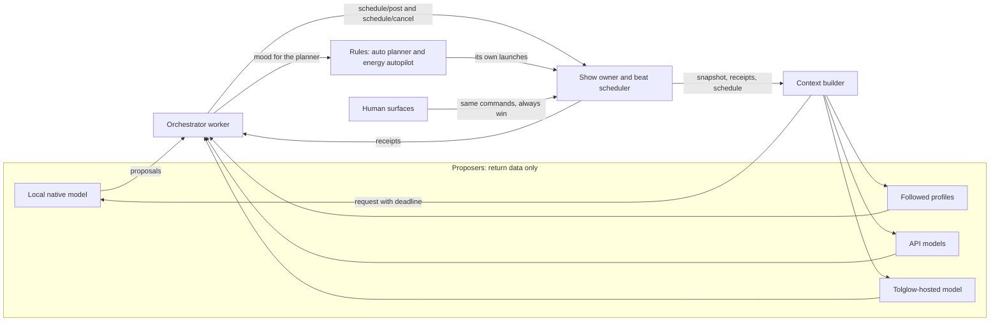

# Native show-control agent: orchestration, arbitration and backends

**Status: research and proposal. Nothing in this document is implemented.**
Umbrella issue [#821](https://github.com/tolgraven/tolglow/issues/821).
Source was read at `origin/master` `bce22156`, plus the unmerged branch
`claude/rehearsal-controls` at `f1a1d82d` (PR #823) where noted.

This is one of four planning documents for #821. The others own their topics
and this one only refers to them:

| Document | Owns |
| --- | --- |
| [model.md](model.md) | Which model, its runtime, training, quantisation and measured speed |
| [interface.md](interface.md) | The JSON the agent reads and writes (observation, action and decision-log schemas), the look description, and what the operator sees |
| [learning.md](learning.md) | Feedback, local and global learning, profiles and their repository |
| This document | How several proposers share one show: runtime, arbitration, command pipeline, backends, safety |

Sections marked **Observed** describe code and documents that exist. Sections
marked **Proposed** are design. Numbers marked **assumed** have not been
measured by anyone on this project.

## Summary

- **Proposers never touch the show.** The local model, followed-VJ profiles,
  API models and a hosted model each answer one question: "given this context,
  what would you schedule in this beat window?" They return data. Only the
  local orchestrator posts commands.
- **The orchestrator posts ordinary commands.** It uses `:schedule/post`,
  `:schedule/cancel` and the `:auto` request that the REPL, Studio and today's
  chat agent already use. The show owner validates every one as it does now.
- **The deterministic auto planner (#217) is the floor.** It runs on the frame
  owner, costs about 1.5 ms on a decision frame and needs no model. Model
  tiers change its mood and add scheduled events. When every model is late or
  gone, the planner keeps the last accepted mood on the grid.
- **Arbitration works on claims.** Each proposed event claims destinations or
  fixtures for a span of beats. Overlapping claims are conflicts. Human holds
  and operator lanes are removed first, then hard limits, then a
  deficit rule picks winners so that each source's share of influence follows
  its dominance slider over a window of phrases.
- **Followed profiles are capped at 2/3 of agent influence** over any trailing
  window (default 4 phrases). The cap is a hard admission test, separate from
  the slider.
- **Three horizons.** Events inside the lock horizon (1 beat) are frozen. Up
  to one phrase ahead is firm and lives in the scheduler. Anything further is
  a tentative plan that stays in the orchestrator, so a change of direction
  cancels little.
- **Every posted event records what it assumed** (section, energy band, tempo
  range, mood). When audio, signals or resource forecasts contradict an
  assumption, the orchestrator cancels the unexecuted events that depended on
  it and asks for a new plan.
- **One backend contract, four adapters.** Rules, a local sidecar on Apple
  Silicon, API models (OpenRouter and direct) and a Tolglow-hosted service all
  take the same request and return the same response. Each request carries a
  deadline in beats. A late answer is dropped, never applied in the wrong
  section.
- **Limits are musical.** Rate limits and budgets are counted per bar and
  phrase so they scale with tempo, with a wall-clock floor.
- **Safety sits in the show, not in a model.** Master, blackout and the output
  sink stay human. A flash guard limits agent-attributed flashing. Movement
  speed is never clamped. Arming the agent does not arm output. The owner
  enforces the flash guard and fixture-safety denials on every agent source.

## What exists today (Observed)

| Fact | Where |
| --- | --- |
| A bounded streaming tool loop turns provider tool calls into validated tool data. A supplied dispatcher runs them. Limits: 8 rounds and 32 tool calls by default. | [`integrations/agent.clj`](../../../src/tolglow/integrations/agent.clj) |
| Adapters for OpenAI, Anthropic, OpenRouter and an OpenAI-compatible self-hosted endpoint. The self-hosted provider needs no credential. No automatic retries. Whole-call timeout 60 s by default. | [`integrations/providers.clj`](../../../src/tolglow/integrations/providers.clj) |
| One provider configuration per show. The credential lives in a runtime-only wrapper and a local store; the show keeps an opaque reference. Two workers and a queue of two. | [`agents.clj`](../../../src/tolglow/agents.clj) |
| `start-tool-job!` already runs a background proposal with a narrow tool set and no chat history. The energy autopilot's `:author` preference uses it: the provider proposes one effect and the show validates it. | [`agents.clj`](../../../src/tolglow/agents.clj), [energy autopilot](../../energy-autopilot.md) |
| Agent tool calls go through `show/dispatch-tool!` into the owner queue with source `{:adapter :agent :session-id <conversation> :run-id <run>}`. | [`show.clj`](../../../src/tolglow/show.clj) |
| The beat scheduler takes atomic batches of up to 64 events, holds at most 256 scheduled events and 256 ramps, and fires due events on the frame that crosses their beat. | [scheduler](../../scheduler.md) |
| An agent cannot schedule master or blackout, and can cancel or move only what its own adapter and session posted. A human write to a ramped destination cancels the ramp with `:human-override`. | [scheduler](../../scheduler.md#who-may-schedule-cancel-and-move) |
| A cancelled ramp holds its current value. A cancel is recorded as `:operator-cancel` unless the request names a `:reason`. A scheduled event keeps an ID, a label and its poster's source, and no other metadata. | [scheduler](../../scheduler.md#ramp-semantics), [`event_subscribers.clj`](../../../src/tolglow/event_subscribers.clj) |
| The auto planner is deterministic and seeded. It owns only what it launched and hands an instance to a performer who touches it. A due frame's owner tick took a median 1.41–1.58 ms on the red show. | [auto show](../../auto-show.md), [`automation/policy.clj`](../../../src/tolglow/automation/policy.clj) |
| A mood change sent with `:at` lands on its line. One that arrives less than a bar late applies at once, marked late. A bar or more late is refused. | [auto show](../../auto-show.md#on-a-musical-line) |
| Rehearsal measured lateness: an agent that hears of a section line one bar ahead lands on the line when its reply takes one beat, and 1–1.5 beats late when its reply takes five beats. | [rehearsal](../../rehearsal.md#what-the-first-rehearsal-found) |
| Effect programs compile ahead on a worker, about 0.45 ms each on the mixed 2,048-pixel/64-head rig. The warm tier holds every registered effect, each cue's fixture or group selection and each quantized launch from the moment it is scheduled. A launch whose program is not ready compiles it in the frame. | PR #789, [`show/programs.clj`](../../../src/tolglow/show/programs.clj), [benchmarks](../../benchmarks/README.md) |
| A published definition is checked on the worker. Messages that depend on it wait at most one owner cycle (25 ms). Held messages count against the owner queue's 256 slots. | PR #809, [fault isolation](../../effect-fault-isolation.md) |
| A beat that starts 64 per-head launches takes about 11.4 ms p50 and 17.5 ms p99 on the mixed rig. #810 aims for under 8 ms. | [#810](https://github.com/tolgraven/tolglow/issues/810) |
| Shows with GPU expression groups, and auditions, still compile on the owner. | PR #789 |
| Physical output is chosen when the process starts (`--output ola`, `--artnet-host`, or `show/start!` options). Preview is the default. Loading a show never arms output. | [outputs](../../outputs.md) |
| The visual-activity meter reports flashing and strobe as a relative performance control. Its docstring says it is not a safety limit. | [`lighting_activity.clj`](../../../src/tolglow/lighting_activity.clj) |
| `POST /api/command` trusts the caller's own `:source`, so agent ownership rules hold only for callers that go through the tool loop. | [#645](https://github.com/tolgraven/tolglow/issues/645) |
| Unmerged, on `claude/rehearsal-controls`: a suggestion can name its basis (auto session, show revision) and an `:until` position, and the owner refuses it as `:stale-suggestion` on arrival and again when due. A disconnected agent is simulated in rehearsal. | `src/tolglow/automation/suggestion.clj` on that branch |

Two gaps follow from this table. There is one provider and one agent session
at a time, with no notion of several proposers. And nothing limits how often
an agent may change the show beyond the per-run tool-call limit.

## Runtime shape (Proposed)



### Sources

| Source | What it is | Where it runs | Typical horizon |
| --- | --- | --- | --- |
| Rules | The #217 planner with the operator's own config, and the energy autopilot | Frame owner, deterministic | This beat to this bar |
| Local model | The native model with the operator's own profile | Local sidecar | Next bar to next phrase |
| Followed profile | Another VJ's profile. By default its taste head ranks other sources' candidates; its adapter on the same local or hosted model proposes where the budget allows ([below](#followed-profiles-as-rankers-first)) | Local sidecar or hosted | Next phrase |
| API model | A general model given the same request, answering through the provider's structured-output mode | Remote | Next phrase to next section |
| Hosted model | The native model run by Tolglow for machines that cannot run it | Remote | Next phrase |

Each source has an ID, a kind, a dominance slider and a health record.
Followed profiles are marked as such, because the cap applies to them.

### Who does what

- **Context builder.** Once per planning tick it freezes one committed
  snapshot and builds the observation that [interface.md](interface.md)
  defines: rig, running instances, schedule, clock, signals, look, goals. Every
  proposer asked in that tick gets the same context, so their answers are
  comparable. It also records the basis: show epoch, auto session, a digest
  of the agent's own pending events.
- **Proposers.** Take a request, return proposals before the deadline. They
  hold no show handle and no dispatcher.
- **Orchestrator worker.** One owned thread, off the frame owner, like the
  programs worker. It collects proposals until the deadline, arbitrates
  against a fresh snapshot and submits the accepted events as ordinary
  commands. It keeps the dominance ledger, the rate-limit buckets and the
  decision log.
- **Show owner.** Unchanged in principle. It validates, schedules, fires and
  renders. It gains nothing that waits on a model.

The arbitration itself is a pure function: proposals, snapshot, ledger, seed
and limits in; accepted events, cancellations, new ledger and a decision
record out. It belongs under `tolglow.automation`, whose rules already require
explicit seeds, clocks and snapshots. The worker shell around it owns the
threads and the backend calls.

**One agent session owns every agent event.** The orchestrator posts with one
source, `{:adapter :agent :session-id <orchestrator session>}`, and records
the proposer on each event. The scheduler's rule that an agent may cancel only
what its own adapter and session posted then lets the orchestrator withdraw
any proposer's events, and keeps it away from a human's.

## The proposal contract (Proposed)

One request and one response shape for every backend. The examples below are
illustrative. [interface.md](interface.md) owns the wire schemas, and its
drafts (`tolglow-agent-obs/1`, `tolglow-agent-act/1`, `tolglow-agent-log/1`)
were read in that lane's worktree before they were published. The mapping:

| Here | Interface lane's draft |
| --- | --- |
| `context` in a request | An observation, snapshot or delta |
| A proposal | One action decision |
| A proposal's `events` | The decision's `post` groups, whose members succeed or fail together (`on_failure`) |
| `assumes` | A group's `intent` tags, `guard` predicates, `until` expiry and `check` mode |
| `basis` | The decision's basis: observation token, revision, auto session |
| Posting with cancellations | `schedule/replace` |
| `window`, `deadline`, `open`, `limits`, `confidence`, `usage` | Envelope fields this document adds around the observation and the decision |

```json
{
  "contract": 1,
  "request-id": "w-00412/local",
  "source": "local",
  "window": {"from": {"bar": 64}, "to": {"bar": 68}},
  "deadline": {"beat": 255.0},
  "basis": {"epoch": 3, "auto-session": "auto/3/17", "pending-digest": "9f2c"},
  "open": {"lanes": ["colour", "intensity", "movement"], "max-events": 12},
  "limits": {"flash-hz": 4.0, "launches-per-line": 8},
  "goals": {"text": "warm and slow until the drop", "palette": "slow-sunset"},
  "context": {"...": "the observation, see interface.md"}
}
```

```json
{
  "contract": 1,
  "request-id": "w-00412/local",
  "proposals": [
    {
      "id": "p1",
      "confidence": 0.7,
      "assumes": {"section": "breakdown", "energy": [0.2, 0.5], "bpm": [120, 132]},
      "events": [
        {"id": "p1-wash", "op": "cue/launch", "cue-id": "wash", "at": {"bar": 64}},
        {"id": "p1-swell", "op": "param/ramp", "cue-id": "wash", "param": "level",
         "to": 0.8, "over": {"bars": 4}, "curve": "ease-in-out", "at": {"bar": 64}}
      ]
    }
  ],
  "usage": {"input-tokens": 2900, "output-tokens": 180, "ms": 640}
}
```

Rules of the contract:

- **Events use the scheduler's vocabulary** ([actions](../../scheduler.md#actions)),
  plus a mood change (`auto/configure`) and a definition to publish. No new
  command language.
- **A proposal is atomic.** Its events make sense together (a launch and its
  ramp). The orchestrator accepts or drops it whole, unless the proposer marks
  events `"optional": true`, which may be trimmed.
- **`assumes` is what the proposal depends on.** It is copied to each posted
  event and drives [cancellation](#cancellation-when-direction-changes).
- **`deadline` is a transport beat.** The orchestrator converts it to a
  wall-clock timeout through the tempo map when it sends the request, and
  checks it again in beats when the answer arrives. A stopped transport holds
  the deadline.
- **`basis` generalises the suggestion basis** from `claude/rehearsal-controls`.
  An answer whose epoch or auto session no longer matches is dropped.
- **The response is untrusted data** from every backend, including a local
  one. It is checked against the JSON schema, then every event is validated by
  the show as today.
- **No credential, device address or file path appears in a request.**

Chat models do not speak this contract natively. Their adapter sends the
request as the user message and constrains the reply to the response schema
with the provider's structured-output mode: `output_config.format` on the
Anthropic API, `response_format` of type `json_schema` on OpenAI-compatible
endpoints and OpenRouter (routed only to upstreams that honour it). Where a
provider has no such mode, the adapter declares one `propose` tool with
`strict: true` and `tool_choice` `auto`, and the prompt names it; a reply
without a `propose` call is an empty answer, not an error. A forced tool
choice is not used: current Claude models (Opus 5.5, Sonnet 5.5, Fable 5.1
and 5.2) return a 400 for `tool_choice` of type `any` or `tool`, and reject
non-default `temperature`, `top_p` and `top_k` (Anthropic API reference,
cached 2026-11-03; [model.md](model.md#one-schema-subset-for-every-backend)).
Candidate diversity therefore comes from asking for up to three alternative
proposals in one reply, which the response schema already allows, not from
sampling settings. The response schema sent to the provider is the lowered
wire form ([`action.wire.schema.json`](schemas/action.wire.schema.json)):
every object closed, no `$ref`, `const`, `pattern` or bounds, so both Claude
structured output and `integrations/agent.clj` `validate-arguments` accept
it. The reply is checked against that schema with `max-rounds` 1, lowered
to the domain form, and its bounds and per-op rules are enforced by the
owner. A conformance test against both is a P1 gate on #863. The native model reads and writes
the JSON directly, with its decoder constrained to the schema
([model.md](model.md)).

The examples above are illustrative. On the wire a proposal is one
[`tolglow-agent-act/1`](schemas/action.schema.json) decision with the
interface's snake_case keys, plus the envelope fields named in the mapping
table. A proposal's `assumes` is carried by its groups' `intent`, `guard`,
`until` and `check`, and an event the proposer marks optional is a group with
`optional: true`, which arbitration may drop without dropping the rest of the
proposal.

## Arbitration (Proposed)

### Claims

Every event, proposed or already scheduled, is reduced to claims. A claim is a
resource and a span of transport beats.

| Resource | Comes from | Span |
| --- | --- | --- |
| Exact destination: a parameter of an instance or cue, an opacity, a variable | `param/set`, `param/ramp`, `variable/set` | Due beat to the ramp's end |
| Fixture head and attribute class | A cue or effect launch, resolved through the effect's outputs and targets | Launch to its end (duration, or the window's end for a persistent look) |
| Mood | `auto/configure` | From its line until the next mood change |
| Palette | A personality or palette change, or a mood that sets one | From its line |
| Definition | A published effect revision | The window |
| Line | Any event due on a beat line | That frame (for the resource forecast) |

Attribute classes are the categories the planner already derives from a cue's
outputs: `:color`, `:intensity`, `:movement`, `:beam-shape`, `:strobe`,
`:atmosphere`, `:modulation`. Resolving a launch to heads uses the same
compile and target resolution as the planner's emission forecast
([`automation/prediction.clj`](../../../src/tolglow/automation/prediction.clj)).
This is planning work and runs on the orchestrator worker.

### Conflicts

| Kind | Detected when | Outcome |
| --- | --- | --- |
| Same destination | Two events claim one exact destination over overlapping beats | One wins. Without this the scheduler would let the later one supersede the earlier, which is how thrash starts |
| Shadowed fixtures | Two launches claim the same attribute class on the same heads, and the lower-priority one would have at least half its claimed heads hidden | One wins, or the lower one is retargeted to the free heads if its proposer marked targets as flexible |
| Clashing palettes | A proposal's predicted colours fall outside the active palette by more than a hue tolerance (default 30 degrees in OKLCH), or two concurrent proposals bring palettes that differ by more than that | A penalty in scoring. A hard conflict when the operator has locked the palette |
| Mood | Two mood changes on one line | One wins |
| Definition | Two revisions of one effect ID in one window | One wins |
| Missing light | Movement or beam claims with no emission on those heads and no `:darkness` intent | A companion is attached, as the planner does, or the proposal is dropped |
| Over a limit | Lit-fixture limit, personality concurrency, flash guard, line budget | The proposal is trimmed or dropped by the [hard filters](#order-of-decisions) |

Predicted colours come from the proposal's own parameter values and the
effect's constant outputs. A colour produced by an expression that cannot be
predicted cheaply counts as unknown and is neither penalised nor trusted for a
locked palette: with a locked palette, unknown colours are refused.

### Order of decisions

For each planning window the orchestrator applies these in order. Each step
records a reason code in the decision log.

1. **Drop what is not allowed at all.** Schema errors, unknown IDs, a late or
   stale answer (`:late`, `:stale-basis`), a muted or vetoed source, anything
   aimed at master, blackout, output or a denied fixture function.
2. **Remove claims on human-held resources.** A destination under a held
   gesture, an instance a performer took over, a lane the operator kept
   (see [lanes](#human-overrides-and-lanes)). A proposal that loses a required
   event here is dropped whole (`:human-held`).
3. **Apply hard limits.** Flash guard, fixture safety, lit limit, rate limits,
   the pending-event ceiling and the resource forecast for each line. Optional
   events are trimmed first (`:trimmed`), then whole proposals drop. The flash
   guard and the fixture-safety denials here are an early filter that saves a
   refused post; the show owner enforces both again for every agent-attributed
   command ([safety](#photosensitivity)).
4. **Protect incumbents.** Events already scheduled keep their claims unless a
   newcomer beats them by the hysteresis margin, and never inside the lock
   horizon ([below](#against-what-is-already-scheduled)).
5. **Score what remains.** A local, deterministic critic gives each proposal a
   score in [0, 1] from features the show can already compute: fit to the
   brightness and activity targets (the autopilot's meter and the planner's
   forecast), fit to the palette and goals, novelty against the last phrases
   (the Jaccard measure the rehearsal review uses), continuity of a kept
   motif, the proposer's own confidence, and resource cost. Proposals under a
   floor (default 0.25) are dropped (`:below-floor`). A learned preference
   critic can replace or join this one later ([learning.md](learning.md)). It
   runs after the hard filters, on the orchestrator worker, and returns a
   number and a list of reasons like the built-in one.
6. **Resolve each conflict group.** Group proposals whose claims conflict.
   Within a group pick the winner by [dominance deficit](#dominance), then by
   score, then by a seeded tie-break. Remove the losers, repeat until the
   group has no conflict.
7. **Check the followed cap.** If admitting a followed profile's proposal
   would take followed share over the cap in the trailing window, trim or drop
   it (`:dominance-cap`).
8. **Merge.** Everything left has disjoint claims. It becomes one
   `:schedule/post` batch, plus the cancellations step 4 decided.

Proposals with no conflict pass steps 6 and 7 untouched, so sources that
propose in different lanes all get in. Dominance only decides contested
ground.

### Against what is already scheduled

The scheduler's `:upcoming` list and running ramps are incumbents.

- **A human's or a subscriber's event is never displaced.** The orchestrator
  cannot cancel it and does not try. A proposal that conflicts with one is
  dropped (`:human-scheduled`).
- **The agent's own earlier events can be replaced**, but only when the
  newcomer's score exceeds the incumbent's by a margin (default 0.2), or the
  incumbent's assumptions no longer hold. Otherwise the incumbent stays
  (`:incumbent`). This is what stops two proposers from taking turns
  overwriting each other every bar.
- **Nothing inside the lock horizon is replaced**, except by a human or a
  safety limit.
- **Replacing costs rate-limit tokens** ([rate limits](#rate-limits)).

The submit is optimistic. Between arbitration and the owner applying the
batch, a human may have grabbed a destination. The owner already refuses such
an event when it falls due and cancels a ramp on a human write. The
orchestrator reads the receipts and outcomes, drops the rest of that
proposal's events so half a gesture is not left running, and records
`:human-override`.

### Human overrides and lanes

Humans are not part of arbitration. They win before it starts.

- **Overrides** are the existing rules: a gesture or write cancels an agent
  ramp, a touched auto look is handed over, a running performer cue is not
  stacked.
- **Lanes** are a standing version of the same thing. The operator assigns a
  category, a fixture group or a cue page to *me*, *agent* or *nobody*. For
  example: colour is mine, movement is the agent's, strobe is nobody's. A lane
  is a filter on claims in step 2 and costs nothing at run time. An instance
  can belong to several categories, so overlapping lanes need a rule: the most
  restrictive lane wins for any claim that touches the instance (*nobody*
  over *me* over *agent*). A wash cue tagged both colour and intensity, with
  colour kept by the operator, is closed to the agent. Lanes are the
  simplest tool for an operator who wants to play with the agent rather than
  beside it, and they are how the planner's scope and the model's direct
  events are kept apart.
- **A hold** is a temporary lane: touching a control holds its destination for
  the agent until the performer lets go plus a grace period. The grace ends on
  the first bar line at least one bar after the release, so the agent comes
  back on the grid; a write with no gesture (a button, a typed value, a REPL
  command) releases at once. This default is shared with the show-side check
  in [interface.md](interface.md#priorities-and-conflicts) (#854) and is an
  operator decision ([index](README.md#operator-decisions)).

### Dominance

**What a slider means.** Each armed source has a dominance weight. Weights are
normalised to sum to 1. A source's *share* is its part of the agent-attributed
influence over the trailing window. The orchestrator steers shares toward
weights. It does not give a source that fraction of decisions, and it does not
make a source win any particular conflict. A weight is not a quota: a source
whose proposals keep failing the critic's floor stays under its weight, which
is what [learning.md](learning.md) means by the setting being a ceiling.

A proposer may rank its own alternatives (the action schema has a `rank` on a
group). That orders one source's own groups: when two groups from the same
source fall into one conflict group, the higher rank is tried first. It never
decides between sources, or a followed profile could simply declare the
highest rank. [interface.md](interface.md#priorities-and-conflicts) follows
this rule.

**Influence** is measured in attributed light-beats: for every claim that came
from an accepted proposal and is live, the number of fixture-attribute slots
it holds, times the beats it holds them, times a salience weight for the
attribute class (proposed: intensity and colour 1.0, strobe 1.5, movement 0.7,
beam shape 0.4). A look that keeps running keeps counting for the source that
proposed it. Launches the planner makes under a mood count for the source that
proposed the mood. Human-played light is outside the measure: an operator who
plays more shrinks the agent's ground but does not change the ratios.

**The window** is counted in played beats, so it scales with tempo, holds
while the transport is stopped, and is not reset by a loop or seek. Default 4
phrases (16 bars in 4/4), settable from 2 to 16 phrases. Shares are evaluated
at each bar line.

**Steering by deficit.** In a conflict group, the eligible proposal whose
source has the largest deficit (weight minus current share) wins. A source
that has had more than its weight recently loses contested ground to one that
has had less. Over a few windows shares converge to the sliders, as in
deficit round-robin scheduling, while each single decision still goes to a
proposal that passed the critic's floor.

**The cap on followed profiles.** The sum of followed shares may not exceed
2/3 over the trailing window. The cap is hard: there is no tolerance above
it. This is tested before admitting any followed proposal, contested or not,
by projecting the window forward to the proposal's end, and a proposal whose
projection exceeds 2/3 is trimmed or refused. If rehearsal shows admission
flapping at the cap, a band may be added below it, never above: after a
refusal, followed proposals are admitted again only once the share falls
under 2/3 − 0.05. The
cap is a product constant the operator can lower, not raise, and no package,
backend or agent command can change it. Within one phrase a followed profile
may take everything, for a signature moment, as long as the window stays
inside the cap.

**Critics count toward the cap.** [learning.md](learning.md) lets a followed
profile bring a taste head that scores other sources' proposals. Its mixing
weight in the critic is limited to the followed total as well, so a followed
taste cannot decide everything while proposing nothing.

The local third is always fillable, because the rules source is local and
always has a plan. If the operator switches the planner off and the local
model is silent, nothing fills it: the stage keeps its current looks, the
followed share decays as the window moves, and followed proposals are admitted
again when it falls under the cap. Whether that is the right behaviour is an
[operator decision](#decisions-for-the-operator).

### Followed profiles as rankers first

A profile adapter needs its own prompt cache on the local runtime, and
llama.cpp does not batch requests with different adapters, so three followed
profiles answering one tick cost three sequential generations
([model.md](model.md#what-profiles-cost-as-adapters)). An API or hosted
backend may not load an adapter at all. So a followed profile runs in one of
two modes:

- **Ranker** (the default). Its published taste head scores the candidates
  the other sources proposed, inside the critic of step 5. It costs no
  generation and works on every backend.
- **Proposer.** Its adapter generates proposals, when the measured budget for
  the tick allows (at most one followed adapter per phrase tick until #833
  measures more) or when it runs on the hosted service.

The dominance ledger counts both modes against the same cap. A proposer's
influence is the light-beats of its accepted proposals, as above. A ranker's
influence is fractional: each accepted proposal it scored credits the
followed source with its share of that proposal's critic score (its mixing
weight times its score, over the total), and the proposing source keeps the
rest. Deficit steering applies to proposer-mode sources; a ranker's slider
sets its critic mixing weight, and the sum of followed critic weights may not
exceed the followed total `D`. The decision log records each ranker's weight
and score per proposal, so the attribution replays exactly (#828, #845).

**Dominance never ends a running look.** It gates admission. A look admitted
earlier plays out. Cutting a look mid-phrase to satisfy a ledger would be
audible as a mistake.

**Why a followed profile does not always get its way**, in the order the
orchestrator applies them:

1. A human holds the destination or kept the lane.
2. The operator vetoed or muted the source.
3. The proposal breaks a hard limit: a fixture this rig does not have, the
   flash guard, the lit limit, the line budget, a rate limit.
4. The answer was late or its basis was stale.
5. An event already scheduled holds the ground and the proposal is not better
   by the margin.
6. The critic scores it under the floor for this music and palette.
7. Its source is over its share, so a contested decision goes elsewhere.
8. Followed sources together are at the cap.
9. It is accepted in part: optional events trimmed, targets narrowed.

**Worked example.** Sliders: followed profile 0.6, local model 0.3, rules 0.1.
Window 4 phrases. In phrases 1 and 2 the profile wins the contested wash and
strobe moments; its share reaches 0.64 while the local model, at 0.26, holds
movement only. In phrase 3 the profile's deficit is negative (0.6 − 0.64) and
the local model's is positive (0.3 − 0.26), so the local model's wash wins
the contested bar. The cap check also refuses the profile's uncontested
full-rig colour change, because it would take followed share to 0.71, past
the 2/3 cap. The profile's small accent proposal, which projects to 0.66, is
admitted, since 0.66 is under 0.667. By phrase 5 the window holds roughly 0.6,
0.3 and 0.1, and no window in the passage holds more than 2/3 followed.

### Determinism and replay

Given the same proposals, snapshot, ledger, limits and seed, arbitration
returns the same result. Ties break with a seed derived from the window, as
the planner derives sub-streams. The decision log keeps every proposal that
arrived in time. A replay feeds the logged proposals back instead of calling
models, so a rehearsal of an orchestrated passage reproduces every accepted
action and output hash, as `rehearsal/replay-signature` does today. Proposal
arrival is the only non-deterministic input, and the log records it in beats.

Off-policy learning needs the probability each candidate was chosen with
([learning.md](learning.md#the-preference-event)). Outside exploration,
selection is deterministic: the log records probability 1 for the winner and
0 for the losers, with each proposal's score, its source's deficit and the
winning margin. In an exploration slot, candidates whose score is within a
margin of the winner (starting value 0.05) are drawn by a seeded softmax and
their probabilities are logged. Every window in rehearsal and review is an
exploration slot. On a live show the proposed default is a small seeded rate
(starting value one window in twenty), always after holds, lanes and hard
limits, so only near-equal candidates that passed everything can swap; the
operator can turn it off (D28). The draw comes from the window seed, so
replay still reproduces it. With live exploration off, every live pick has
probability 1, and feedback from the operator, DJ and audience on a live
show cannot be corrected for the policy's own selection, so it only refines
what the policy already prefers.

## Command pipeline (Proposed)

### Horizons

| Horizon | Length | What lives there | Can change? |
| --- | --- | --- | --- |
| Lock | 1 beat, and never less than 2 frames | Events about to fire | Only by a human or a safety limit |
| Firm | From the lock horizon to 1 phrase ahead | Accepted events, posted to the beat scheduler | Replaced or cancelled under the rules above |
| Tentative | 1 to 4 phrases ahead | A plan kept in the orchestrator, not posted | Freely. It is promoted to firm one phrase before its line |
| Arc | A section or the whole set | Goals, palette progression, mood sequence | By the operator, or by a slow model proposing a new arc |

Only firm events reach the scheduler. That keeps the agent well inside the
scheduler's 256-event ceiling and makes a change of direction cheap: most of
what it invalidates was never posted. Ramps may run past the firm horizon,
since a ramp is one event.

Lengths in seconds, 4/4 with 4-bar phrases, over the 70–180 BPM range the
operator asked to design for:

| | 70 BPM | 128 BPM | 180 BPM |
| --- | ---: | ---: | ---: |
| 1 beat (lock) | 0.86 s | 0.47 s | 0.33 s |
| 1 bar | 3.43 s | 1.88 s | 1.33 s |
| 1 phrase (firm) | 13.7 s | 7.5 s | 5.3 s |
| 4 phrases (tentative, dominance window) | 54.9 s | 30.0 s | 21.3 s |

### Planning ticks

The orchestrator plans on musical lines, not on a timer.

- **Each phrase line:** ask the phrase-level sources for the phrase after
  next's tentative plan, and promote the next phrase from tentative to firm
  through arbitration.
- **Each bar line:** ask the bar-level sources (the local model, if it is fast
  enough) for adjustments inside the firm horizon. Evaluate shares, health and
  triggers.
- **Each frame:** nothing model-related. The rules source decides on the owner
  as it does today.
- **On a trigger** (below): cancel, then plan again at once for the affected
  span.

### Posting

An accepted window becomes one atomic `:schedule/post` batch of at most 64
events, at most one batch per owner cycle. Each event carries the proposer,
the proposal ID and its assumptions. The scheduler needs a small extension to
keep that metadata on an event and show it in the projection. A cancel can
already name its reason; the orchestrator adds the trigger.

A proposal that needs a new definition publishes it first, at least one bar
before its first use. The programs worker then has it warm, and a publication
that is refused takes its proposal with it before anything was scheduled.

### Cancellation when direction changes

Assumptions are checked in two places, and they should not be built twice.

- **Guards on the show.** The interface lane's action draft lets a group
  carry predicates on show variables and events, an expiry and a check mode
  (when due, or continuously). The show evaluates those and cancels a group
  whose guard fails. That covers "energy fell below 0.6" or "past bar 40".
  Guards run on the owner tick, so their worst-case cost (256 pending events,
  four predicates each, continuous check) is measured and counted in the
  agent's 5 ms share of a tick before they are adopted (#645 extension, #829,
  #830). If the measurement does not fit, continuous checks move to the
  orchestrator's triggers and the show keeps only due-time checks.
- **Triggers in the orchestrator.** Some reasons to change direction are not a
  predicate on one variable: the section map moved, a line's cost forecast is
  over budget, a source failed or was vetoed, a human took part of a
  proposal. The orchestrator watches for these, cancels by event ID, and plans
  again. It also plans again after a guard cancels something.

| Trigger | How it is known | What is cancelled |
| --- | --- | --- |
| The section is not the one assumed, or its line moved | Section map from Live locators, AbleSet or section patterns (#514); later an audio novelty detector | Unexecuted events that assumed the old section |
| Energy left the assumed band | The audio energy variable and the autopilot's rolling statistics | Events that assumed the band. A running ramp is superseded with a new target rather than cancelled |
| Tempo left the assumed range, or the clock source changed | Transport | Events whose safety or feel depended on tempo, such as a beat-division flash that now exceeds the flash guard |
| Seek or loop | The scheduler already reports absolute events as missed and re-quantises grid events | The tentative plan is discarded and rebuilt |
| A human took a destination or a lane | `:human-override` outcomes, takeover reasons | The rest of that proposal's events |
| A line's forecast exceeds its budget | Resource forecast | The lowest-scoring optional events on that line, most expensive first |
| A source was vetoed, muted or failed its health check | Orchestrator | That source's pending events |
| The agent was paused or stopped | Operator | Nothing on pause; every pending agent event on stop |
| New show epoch | Owner | The scheduler already clears its runs |

Rules for cancelling:

- Only events outside the lock horizon, except on a human or safety trigger.
- A cancelled ramp holds its value, as now. The orchestrator may post a short
  ramp to a sensible value in the same batch so the hold is not a visible
  stall.
- The outcome records `:direction-changed` and the trigger, so the review and
  the timeline can show why.
- Cancelling for direction is not free: it draws on the cancellation budget,
  except for human, safety and section triggers.

### Resource budgets

The frame deadline is 25 ms at 40 frames per second. The agent must not be the
reason a frame misses it.

| Budget | Proposed default | Basis |
| --- | --- | --- |
| Agent share of an owner tick | 5 ms forecast on any frame | A fifth of the frame. The planner's decision frame already takes about 1.5 ms |
| Launches on one line from agent sources | 8 | 64 per-head launches cost about 11 ms p50 on the mixed rig. Prefer one selector cue over many per-head launches |
| New programs waiting to compile | 32 | About 14 ms of worker time at 0.45 ms each |
| Publications | 2 per phrase, each at least 1 bar before use | A publication check that misses its cycle runs on the owner, 0.1–0.4 ms |
| Definitions with GPU expression groups | None from agent sources while the transport plays | They still compile on the owner |
| Model inference on this machine | One request at a time; back off when frame p95 or Room frame rate degrades | Unified memory and the GPU are shared with Room and Metal work. Not measured |

**Forecast.** For each beat line in the firm horizon the orchestrator sums the
expected cost of what is due there: launches, sets, mood changes, the planner
decision, plus the running cost of active ramps and instances. Unit costs
start from the measured figures above and are corrected by a running average
from frame status, which needs the owner to report time by stage. A proposal
that would push a line over budget is trimmed. An event on a downbeat is never
moved off its beat to save time: it is kept or dropped.

GPU cost for shader and video cues (#673) has no cost model yet. Until one
exists the orchestrator treats launching a GPU-backed cue as a fixed number of
line slots and leaves the question open
([open questions](#open-questions-and-not-verified)).

### Rate limits

Token buckets counted in bars and phrases, so they follow tempo. All are
operator settings. Human commands are never limited by them.

| Limit | Proposed default |
| --- | --- |
| Accepted agent events | 16 per bar in total, 8 per bar per source |
| Looks launched (not one-shots) | 4 per bar |
| Minimum dwell | A look lives at least 1 bar before an agent may end or replace it. One-shots and cuts on a section line are exempt |
| Retargeting one destination | 2 new ramps or sets per bar; a third freezes it until the next bar line |
| Cancelling its own pending events | 8 per phrase, not counting human, safety and section triggers |
| Mood changes | 1 per bar line, 2 per phrase |
| Palette changes | 1 per phrase |
| Pending events | At most 128 of the scheduler's 256, and 128 of its 256 ramps |
| Batches | 1 per owner cycle, and no more than 10 per second at any tempo |

A throttled proposal is recorded with `:rate-limited`, and the counters are in
the projection so the operator can see a source being held back. A source that
is throttled in most windows is a tuning problem, and the review should say
so.

## Backends (Proposed)

### One contract, four adapters

| Backend | Transport | Auth | Reads and writes |
| --- | --- | --- | --- |
| Rules | In process | None | Planner config and state. It does not use the JSON contract; its launches are attributed and counted |
| Local native | Loopback HTTP or a Unix socket to an owned sidecar process | None, loopback only | The contract JSON directly |
| API | HTTPS through the existing provider adapters | Credential from the local store | The contract through structured output, or one strict `propose` tool with `auto` |
| Tolglow-hosted | HTTPS, streaming | Account token from the local store | The contract JSON directly |

A backend is a value with an ID, a kind, public configuration, and one
operation that takes a request and a cancellation token and delivers a
response or an error. Nothing else in the orchestrator knows which kind it is.

### Local model on Apple Silicon

- **A sidecar process, owned by the show's connections.** The JVM does not
  load model weights. MLX runs from Python or Swift, and `mlx_lm.server` and
  llama.cpp's server both expose an OpenAI-compatible endpoint, which the
  existing `:self-hosted` provider already talks to. That is enough for a
  first measurement. The lasting adapter should speak the contract directly
  and constrain decoding to the schema ([model.md](model.md) decides the
  runtime).
- **Lifecycle.** Started on arm, not on show load. Health-checked. Restarted
  with back-off after a crash. Stopped when the show stops. Bound to loopback.
- **Profiles as adapters.** A followed profile's adapter is weights on the
  same base, with its own prompt cache. By default a followed profile ranks
  instead of generating ([above](#followed-profiles-as-rankers-first)). The
  orchestrator assumes at most 3 model calls per phrase tick on one machine,
  at most one of them through a followed adapter, and staggers their
  deadlines until #833 and #323 measure swap cost and memory.
- **Coexistence.** Inference shares unified memory and the GPU with Room and
  any Metal work. The sidecar runs one request at a time, at a lower
  scheduling priority, and the orchestrator backs off to a slower cadence
  when lighting frame p95 or Room frame rate degrade, or the machine reports
  thermal pressure.

### API models

- OpenRouter and direct OpenAI and Anthropic endpoints already have request
  and streaming adapters. The contract adapter adds the provider's
  structured-output mode (or a strict `propose` tool with `auto`) and a
  one-round limit. It sends no sampling parameters to models that reject them.
- **Timeouts come from the deadline**, not the 60-second default. A request is
  cancelled when its deadline passes.
- **Fallback inside the provider.** OpenRouter can try a list of models in
  order and can sort providers by latency or throughput. That helps
  availability inside one request. It does not replace the orchestrator's own
  ladder, because a fallback that answers after the deadline is still late.
- **Prompt shape for cost.** The rig, the registry summary and the tool
  declaration change rarely and go first, so a provider that caches prompt
  prefixes charges less for them. The clock, signals and schedule go last.
- API models are slow relative to a bar. They are best used at the tentative
  and arc horizons: mood, palette progression, a plan for the next section.

### Tolglow-hosted

For people without a machine that can run the model.

- **Same contract, same client code path as local**, over HTTPS with a
  streamed response so the first proposal can be used before the last
  arrives.
- **It only proposes.** The hosted service never holds a control connection to
  a show. If the network drops, the show loses a proposer and nothing else.
- **Profiles run where the model runs.** A followed profile on a hosted
  session is resolved by ID on the service; no weights are downloaded.
- **What leaves the machine** is the compact context. That includes rig
  geometry and names the operator wrote. It needs an explicit opt-in per show,
  and a minimised form (IDs kept, free-text names removed) as the default.
- **Metering** is per request. The client shows the session's spend and stops
  asking when a cap is reached.
- Whether the hosted service also proxies third-party API models with a
  managed key, so a user needs only one account, is an
  [operator decision](#decisions-for-the-operator).

### Latency against the musical horizon

A request sent `n` beats before its window must be answered `n` beats minus
the commit margin later. The commit margin is the lock horizon (1 beat) plus
arbitration and one owner cycle, taken as 50 ms.

| Request sent | Budget at 70 BPM | at 128 BPM | at 180 BPM | Who can meet it |
| --- | ---: | ---: | ---: | --- |
| 2 beats ahead | 0.81 s | 0.42 s | 0.28 s | Rules only |
| 1 bar ahead | 2.52 s | 1.36 s | 0.95 s | A small local model, if measured under 0.9 s at p95 |
| 1 phrase ahead | 12.8 s | 6.98 s | 4.95 s | Local model, followed profiles, hosted, fast API models |
| 2 phrases ahead | 26.5 s | 14.5 s | 10.3 s | Any API model |

The one-bar row agrees with the rehearsal measurement: with a bar's notice, a
one-beat reply lands on the line and a five-beat reply does not.

The budget fixes how much a model may say. With a generation rate of `r`
tokens per second and a prompt evaluation time `t`, the reply can hold at most
`r × (budget − t)` tokens. One third-party report gives about 60 tokens per
second for an 8B model at 4-bit on an M4 Pro; [model.md](model.md#latency-against-the-musical-horizon)
uses 50 for 7 to 9B from two other published runs, and the difference is
within build and run variation. With the conservative 50 and an **assumed**
0.8 s prompt evaluation, a phrase-ahead request at 180 BPM leaves about 200
tokens, which is roughly ten terse events. A bar-ahead request
at 180 BPM leaves under 10. So on this evidence a model of that size plans
phrases, not bars, and bar-level adjustment needs a much smaller model or
stays with the rules. None of this has been measured here; #323 and
[model.md](model.md) own the measurement.

The orchestrator does not hard-code these tiers. It measures each backend's
latency and assigns it the shortest horizon whose budget its p95 meets, with a
margin. A backend that slows down moves to a longer horizon before it starts
missing.

### Failover

The show must keep playing sensibly when a backend is slow or gone.

**The ladder**, per planning window:

1. Proposals that arrived in time, arbitrated as above.
2. If a source missed: the other sources' proposals. A missing source simply
   has no entry; its share decays.
3. If no model answered: the rules source with the last accepted mood, which
   is what the planner does anyway.
4. If the last accepted mood is older than a limit (default 8 phrases): the
   operator's own default plan, so a mood chosen for a breakdown does not
   play for an hour.
5. If the planner is off: hold. Scheduled events fire, running looks run,
   nothing new is added.

**Health**, per backend: a running average and p95 of latency, the error
rate, and consecutive misses. Three consecutive misses or errors open a
circuit breaker for 2 phrases. Then one probe request, whose answer is used
for health only. Success closes the breaker.

**Late answers** are dropped with `:late`, counted, and never applied. This is
the rule `:stale-suggestion` enforces on the rehearsal branch, moved up to the
orchestrator so the owner sees fewer refusals.

**No retries inside a window.** A retry would arrive after the deadline. The
next window is the retry.

**Frame timing is untouched by any of this.** Backend calls are on the agents
executor, arbitration on the orchestrator worker, and the owner sees only
ordinary commands. Agent turnaround is recorded apart from frame timing, as
the rehearsal artefact's `:agent-wall-ms` already is.

### Costs

**API.** One phrase-ahead request per phrase is `3.75 × BPM` requests an hour:
262 at 70 BPM, 480 at 128, 675 at 180. With **assumed** 3,000 input and 300
output tokens per request, an hour at 128 BPM is 1.44 million input tokens and
0.144 million output tokens. In dollars that is `1.44 × p_in + 0.144 × p_out`
for prices per million tokens:

| Price class (input / output per million tokens) | Per hour at 128 BPM | Six-hour night | Six-hour night at arc cadence (one request per 4 phrases) |
| --- | ---: | ---: | ---: |
| $0.15 / $0.60 | $0.30 | $1.80 | $0.45 |
| $1 / $5 | $2.16 | $13 | $3.20 |
| $3 / $15 | $6.48 | $39 | $9.70 |

The classes are illustrative, not quotes for named models. Prefix caching,
where a provider offers it, lowers the input term. The orchestrator takes a
spend cap per session and per hour for each paid backend, and drops that
backend to a slower cadence, then off, when the cap is reached. The default
for API models should be arc cadence.

**Local.** No marginal cost. The price is memory, heat and battery, and the
risk to Room frame rate, all unmeasured.

**Hosted.** Cost per show-hour is requests per hour, times GPU-seconds per
request, times the price of a GPU-second, divided by how many sessions share
a GPU. Rental prices are in the [model-lab hardware notes](../../model-lab/hardware.md).
GPU-seconds per request is not measured.

### Secrets and what leaves the machine

- **Credentials stay where they are today.** Supplied only through
  `configure!`, held in a runtime-only wrapper, persisted in the local store
  under an opaque reference scoped to provider and endpoint. Show documents,
  snapshots, browser state and logs carry the reference at most.
- **Several backends mean several references**, one per backend entry. The
  show document keeps each backend's public configuration and reference. The
  hosted account token is one more entry in the same store.
- **Requests never contain credentials.** The existing redaction of the
  credential value from retained events applies to the decision log too.
- **Profiles are data.** A downloaded profile is weights and metadata with a
  content hash, stored outside the show document, which refers to it by ID,
  version and hash. A profile package cannot carry code or tool definitions
  ([learning.md](learning.md) owns the package format).
- **Sharing exports** leave out backend configuration, references and the
  decision log unless the operator selects them. Full local backups keep
  everything except secret values, as now.
- **Remote backends see the context.** That is unavoidable for API and hosted
  use. The operator opts in per show, and can choose the minimised context.

## Integration (Proposed)

### The auto planner (#217)

The planner stays what it is: deterministic, on the owner, launching through
ordinary commands, yielding to performers. Three changes connect it:

- **It is the rules source.** Its launches are attributed to whoever proposed
  the current mood (the operator's own config counts as local) and counted in
  the dominance ledger.
- **It respects lanes.** A lane kept by the operator or given to nobody is
  removed from its scope, alongside its existing category filters.
- **Model tiers steer it with moods.** A mood is a `configure_auto` request
  with `:at` a line, which exists. The orchestrator is the one sender.

The energy autopilot stays an independent conductor under its hard budget. Its
`:author` preference, which already asks a provider for one effect through
`start-tool-job!`, becomes one more request through the backend contract.

Event subscribers are the operator's authored reactions. They are not
arbitrated. Their pending steps appear as incumbents the agent cannot
displace.

### Rehearsal (#670)

The rehearsal harness plays one recorded agent today. For the orchestrator it
needs:

- **A recorded proposer per source.** A script, as `agent-script` is, that
  returns proposals for each window with a chosen latency and failure
  pattern. No model and no network.
- **Review measures per source:** share of influence per window against its
  slider, the followed share against the cap, conflicts and who won with what
  reason, cancellations by trigger, throttled proposals, late answers, and
  the existing lateness, carry-over, novelty and contrast measures.
- **Failure passages:** a slow backend, a refusing one, a hanging one, all
  backends gone, a backend that returns after its breaker opened.
- **Shadow comparison:** the same passage with the agent in shadow and armed,
  to see what it would have changed.

Seeded replay holds because arbitration is deterministic and proposals are
logged.

### REPL and Studio parity

Every control is one validated request on the show owner, sent the same way
from both sides. Names are a proposal; [interface.md](interface.md) owns the
Studio side.

| Operation | REPL | Studio | Feedback both read |
| --- | --- | --- | --- |
| Arm, shadow, disarm | `(show/submit! runtime :agent {:op :arm :mode :shadow})` | Agent panel | `[:agent :state]` |
| Pause, resume, stop | `{:op :pause}`, `{:op :resume}`, `{:op :stop}` | Same panel, and mappable to a pad | `[:agent :state]`, withdrawn event IDs in the receipt |
| Veto | `{:op :veto :proposal-id …}`, or `:event-ids`, `:source`, `:lane`, with `:for {:phrases 2}` | On an event in the timeline or schedule list, on a source | Decision log, schedule outcomes |
| Dominance | `{:op :dominance :weights {"local" 0.3 "profile/…" 0.6}}` | Sliders | `[:agent :sources]` with weight and measured share |
| Lanes | `{:op :lanes :assign {:movement :agent :color :human :strobe :nobody}}` | Lane switches | `[:agent :lanes]` |
| Limits | `{:op :limits …}` | Settings | `[:agent :limits]` and throttle counters |
| Backends | `{:op :backend …}` with public config; credentials through the existing configure path | Connections | `[:agent :sources]` health, latency, spend |
| Review | `(show/agent-review runtime)` | Review view, timeline | `[:agent :decisions]`, the schedule projection |

Controller surfaces send the same requests through the uniform surface layer
(#706). The existing tool loop and chat keep working as a single-proposer
special case: a chat run is a source whose proposals are its tool calls.

### Operator controls

- **Arm** has three states. *Off*: no requests are sent. *Shadow*: the whole
  pipeline runs and nothing is posted, so the decision log shows what the
  agent would have done. *Armed*: accepted events are posted. One source can
  also be in shadow while the rest are armed, which is how a new profile or
  adapter is tried before it gets any dominance. Arming belongs
  to the show session. A saved show remembers that the agent was armed and
  shows it, but starts off, as sensors do with armed intent.
- **Pause** stops accepting proposals. What is already scheduled plays out.
  **Stop** also withdraws every pending agent event, as Stop auto withdraws
  pending auto changes; ramps hold.
- **Veto** removes one thing: a proposal (its pending events are cancelled
  and looks it launched that the agent still owns are released), a source
  for a while, a lane. **Undo last** vetoes the most recently accepted
  proposal. Each veto is recorded for [learning.md](learning.md) as feedback.
- **Dominance sliders** set weights. A change applies to the ledger at the
  next bar line. The followed total cannot be set above the cap.
- **Review** is the decision log: for each window, what each source proposed,
  what was accepted, trimmed or refused and why, what was cancelled later and
  on which trigger, and the shares. Each posted event carries its proposer,
  so the schedule list and the timeline (#646) can colour and filter by
  source. The log is a bounded ring in the show, with the full log written to
  a file for rehearsal and learning. Each decision is one record in the
  interface lane's log schema (`tolglow-agent-log/1`, #856). The
  orchestrator adds one record per window (`tolglow-agent-window/1`, #835):
  the proposals considered, their reason codes, scores, deficits, ranker
  weights and the shares. Both record kinds go in one JSON Lines file, and
  each decision record names its window.

Reason codes the log uses: `:accepted`, `:trimmed`, `:late`, `:stale-basis`,
`:invalid`, `:vetoed`, `:human-held`, `:human-scheduled`, `:human-override`,
`:incumbent`, `:below-floor`, `:lost-conflict`, `:dominance-cap`,
`:rate-limited`, `:over-budget`, `:flash-guard`, `:fixture-safety`,
`:direction-changed`, `:backend-down`.

## Safety (Proposed)

### Authority that stays human

- Master and blackout cannot be scheduled by an agent. This exists and stays.
- A human write wins over any agent ramp or look. This exists and stays.
- The server assigns the agent source. The gap where `POST /api/command`
  trusts a caller's `:source` must be closed before a remote component could
  ever post, and the design avoids needing that: remote backends only return
  proposals.
- Today's `set_lighting_budget` tool lets an agent set the budget freely. For
  orchestrated sources the proposal is that an agent may tighten the budget
  but not loosen it past the operator's setting.

### Photosensitivity

Published guidance, for orientation:

- The UK Health and Safety Executive's figure, as cited by the Epilepsy
  Society, is that strobe lighting at public performances and in clubs should
  flash at 4 Hz or less.
- ITU-R BT.1702 for broadcast and WCAG 2.3.1 for web content both draw the
  line at three flashes per second for flashes above a brightness and area
  threshold, with a separate, stricter treatment of saturated red.
- Epilepsy organisations give 3 to 60 Hz as the range that can trigger a
  seizure.

Beat-synchronised flashing reaches these rates easily. A full-rig one-shot on
every quarter note is 3 Hz at 180 BPM. Eighth notes are 4.3 Hz at 128 BPM and
6 Hz at 180. Sixteenths are 12 Hz at 180.

**The flash guard** is a show-level limit, applied to agent-attributed light
by default. It sits outside every model and critic. No profile, backend or
agent command can raise it. **The show owner is the enforcement point**: it
checks every command whose source is `:adapter :agent`, whether it came from
the orchestrator, from a second agent session posting directly, or from the
Studio chat. The orchestrator runs the same check in arbitration step 3 as an
early filter only (#836).

- **Predicted, at admission.** For each proposal compute its flash rate at the
  highest tempo in its window: the strobe channel's rate (fixture definitions
  map it to Hz), the repetition rate of one-shots on a beat division, and any
  dimmer or colour modulation deep enough to count as a flash. If the rate
  exceeds the limit and the flashing light is more than the area threshold of
  the rig's visible output, the owner trims the event to a slower division
  or refuses it with `:flash-guard`, when it is posted and again when it falls
  due. Small-area flicker, such as a pixel chase,
  passes. Fixtures flashing out of step with each other add up: the rate is
  taken over the combined light, not per fixture.
- **Measured, on delivered output.** A monitor counts large luminance
  transitions per second in the committed output attributable to agent-owned
  instances. The existing activity meter is explicitly not a safety limit, so
  this is a separate, simple counter on the same decoded output. Over the
  limit for more than a beat, the owner releases the agent-owned flashing
  looks, refuses agent writes to the strobe category for a phrase, records it
  and reports it to the orchestrator, which also stops proposing strobe for
  that phrase.
- **Tempo changes re-check.** A rise in tempo re-validates pending events that
  flash on a beat division.
- **Proposed defaults:** 4 Hz for general flashing from agent sources, 3 Hz
  for saturated red, area threshold a quarter of the rig's visible output.
  Faster strobe from an agent only when the operator has granted it, with a
  maximum burst length. Human-launched strobe is not limited unless the
  operator turns the guard on for the whole show.

This is a mitigation. It does not certify a show as safe. Fog, mirrors,
unsynchronised fixtures and the venue's own warnings remain the operator's
responsibility, and the document should not be read as a compliance claim.

### Motors and fixture safety

- **Movement speed is never clamped or refused.** The operator's rule is that
  overdriving heads is a valid effect, and that synchronised moves stretch
  rather than refuse. The orchestrator has no motor-rate filter, and the
  critic must not score a fast move as invalid.
- **What is refused for agent sources** is the small set of fixture functions
  that can damage a fixture or surprise a venue, by default:
  - control-channel functions such as reset and lamp on or off;
  - anything that strikes a discharge lamp repeatedly;
  - fog and haze outside the existing fog policy, whose duty limits are
    physical time;
  - fixtures the rig marks as hazardous or operator-only (lasers, anything
    pyrotechnic);
  - aim outside a keep-out zone, where the rig declares one. No such
    declaration exists in the rig schema today.
- These are denied by fixture function and rig marking, not by speed. Like the
  flash guard, the denial is enforced by the show owner for every
  agent-attributed command, including direct posts and the Studio chat; the
  orchestrator's check is an early filter (#836).

### Output

- **Arming the agent does not arm output.** The agent has no tool that selects
  or opens an output sink, and none is proposed. In a preview session an armed
  agent drives Room only.
- **A second confirmation on physical output.** When the session's sink is
  physical, arming the agent (as opposed to shadow) needs an explicit
  confirmation for that session. The default after a restart is off.
- Rehearsals and tests use captured output, as now.

### Untrusted proposals

- Every proposal is validated twice: schema, then the show's own validation.
- Text in the context (cue names, goals) is data. API models can be steered by
  it; the validation is what protects the show, not the prompt.
- #821 wants agents to create effects in the DSL and in code. A DSL definition
  is data and goes through publication checks. **Code is a separate
  capability.** It is never available to followed profiles. For every other
  source, local or remote, it is off by default and needs an operator grant
  per session, and the source always runs in the local sandbox; code is never
  sent out to run. This matches [interface.md](interface.md#safety-model) and
  lets [model.md](model.md)'s API author model write tier-3 source when
  granted.
  [model.md](model.md) and [interface.md](interface.md) cover how code would
  be written and shown; this document only says who may be allowed.

## Implementation slices

Each slice is a child issue of #821 in milestone "Roadmap later".

| Slice | Issue |
| --- | --- |
| Proposal contract and backend interface | #826 |
| Arbitration core: claims, conflicts, scoring, merge, replay | #827 |
| Dominance ledger and the followed-profile cap | #828 |
| Horizons, assumption-tagged events and cancellation on direction change | #829 |
| Resource forecast and admission budgets | #830 |
| Musical rate limits against thrash | #831 |
| Backend health, deadlines in beats and failover | #832 |
| Local sidecar backend on Apple Silicon | #833 |
| Tolglow-hosted backend | #834 |
| Operator controls, lanes and the decision log, from REPL and Studio | #835 |
| Flash guard, fixture-safety denials and the output interlock | #836 |
| Rehearse the orchestrator with recorded proposers | #837 |

Existing issues extended rather than duplicated: #230 (several configured
backends, per-backend credentials, the structured-output proposal adapter, spend caps),
#323 (latency under a running show, adapter swap cost, memory with several
profiles), #217 (the planner as the rules source, attribution, lanes). The
learning lane lists the flash guard and the dominance ledger as these slices
and does not file them again.

A sensible order: contract, arbitration and dominance first, all pure and
testable with recorded proposers. Then the pipeline and limits against the
real owner with captured output. Then failover and the rehearsal passages.
Backends and safety can proceed beside these. The hosted backend comes last
and needs a product decision first.

## Decisions for the operator

The consolidated, deduplicated list across the four reports, with the phase each decision blocks, is in the [index](README.md#operator-decisions).

1. **Is the 2/3 cap absolute?** Proposed: yes. Followed profiles together get
   at most 2/3 of agent influence over the window even when nothing local is
   proposing, and the local planner on your own config fills the rest. The
   alternative is a cap relative to what local sources offer, which lets a
   followed profile run a whole show when you arm nothing else.
2. **Is the cap per profile or across all followed profiles?** Proposed:
   across all, so following three VJs does not leave local work with nothing.
3. **Window length.** Proposed default 4 phrases, settable 2 to 16.
4. **Does the flash guard cover only the agent, or the whole show?** Proposed:
   the agent by default, with a switch for the whole show. And which default
   limit: 4 Hz (the club figure) or 3 Hz (broadcast and web).
5. **May an agent strobe faster than the guard at all?** Proposed: only with
   your grant and a maximum burst length.
6. **Physical-output confirmation.** Proposed: arming the agent on a physical
   sink needs a confirmation each session.
7. **Code from agents.** Proposed: never for followed profiles; for local
   and remote sources, off by default with a per-session grant, always run in
   the local sandbox.
8. **What an agent may do to the lighting budget.** Proposed: tighten only.
9. **Hosted service scope.** Only the native model, or also a managed proxy
   to third-party API models so a user needs one account. And whether the
   minimised context is the only form the hosted service accepts.
10. **Defaults for rate limits and budgets.** The tables above are starting
    points to tune in rehearsal, not measured optima.
11. **Whether the planner and autopilot should eventually be arbitrated like
    any proposer.** Proposed: no for now. They stay independent actors that
    the orchestrator steers and accounts for, because they are the floor the
    show stands on when models fail.

## Open questions and not verified

- **No latency has been measured.** Local generation speed, prompt evaluation
  time, adapter swap cost and the effect of inference on Room and lighting
  frame times are all unknown on this machine. The horizon assignment is
  built to follow measurement, but the defaults are guesses until #323 runs.
- **Influence in light-beats is a proposal.** It may over-count large dim
  washes against small bright accents. An alternative weights by delivered
  brightness from the calibrated meter. Rehearsal should compare them against
  what an operator perceives as "whose show this is".
- **Palette prediction** covers constant colours and parameter values. Effects
  that compute colour need either sampling through the planner's forecast or
  an "unknown" result.
- **No GPU cost model** exists for shader and video cues.
- **The stage-cost breakdown** the forecast needs from the owner is not
  reported today.
- **Section change ahead of the downbeat** is known only when Live or AbleSet
  supplies a map. A club agent that only listens has no such notice; the
  rehearsal notes already record this.
- **The scheduler's event-metadata extension** is small but touches a
  projection the timeline consumes, so it needs coordinating. Whether a
  launch posted with `:at` or `:in` joins the warm tier the way a quantized
  launch does was not checked; a cue's own selection is warm either way.
- **`claude/rehearsal-controls` (PR #823) is unmerged.** The basis and
  disconnected-agent work this design builds on may change before it lands.
- **Photosensitivity figures** come from the sources below, not from a review
  of the primary HSE text or legal advice for any venue.
- **Sibling documents.** The four reports were reconciled in the
  [index](README.md#reconciliation-record): the API adapter, the rank rule,
  the hold default, followed profiles as rankers and the decision-log split
  above come from that pass. Whether guards are evaluated by the show still
  needs the cost check against the frame budget named in
  [cancellation](#cancellation-when-direction-changes) before the pipeline
  slice starts.

## Sources

- Epilepsy Society, photosensitive epilepsy factsheet (cites the HSE 4 Hz
  figure for strobes at public performances and clubs):
  <https://epilepsysociety.org.uk/sites/default/files/2025-04/PhotosensitiveepilepsyApril2025.pdf>
- ITU-R BT.1702, guidance for the reduction of photosensitive epileptic
  seizures caused by television:
  <https://www.itu.int/dms_pubrec/itu-r/rec/bt/R-REC-BT.1702-0-200502-I!!PDF-E.pdf>
- WCAG 2.3.1, three flashes or below threshold:
  <https://www.w3.org/WAI/WCAG21/Understanding/three-flashes-or-below-threshold.html>
- OpenRouter model fallbacks and provider routing:
  <https://openrouter.ai/docs/guides/routing/model-fallbacks>,
  <https://openrouter.ai/docs/guides/routing/provider-routing>
- `mlx_lm.server` and llama-server on Apple Silicon, with the 8B figure quoted
  above (third party, loosely described method):
  <https://contracollective.com/blog/mlx-lm-server-vs-llama-server-apple-silicon-2026>
- MLX-LM HTTP server reference: <https://deepwiki.com/ml-explore/mlx-lm/3.3-http-server>
