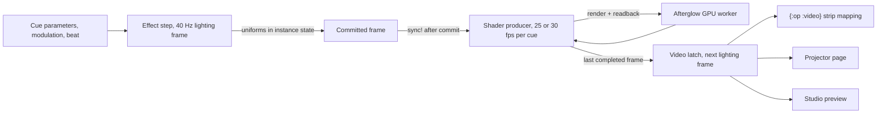

# Shader cues

A shader cue is an ordinary cue whose effect runs a GLSL fragment shader. Its parameters drive the shader's uniforms. Studio shows the live picture, and the frames go to a strip mapping, a borderless projector page, or any other consumer of a video feed. [Issue #673](https://github.com/tolgraven/tolglow/issues/673) · [Video on LED strips](video-strips.md)

## What runs where



- The effect step evaluates each uniform once per lighting frame and keeps the values in its instance state. Uniforms freeze when the instance is paused or the transport is stopped, just as every other effect does. They also travel with a saved show.
- After each commit, the show hands the running shader instances to the **producer**. The producer never runs inside the lighting frame. Each instance has its own cadence, set by `:fps`. At each slot the producer renders the newest committed uniforms on Afterglow's GPU worker, reads the pixels back, and publishes the frame.
- If the previous render is still running when a slot comes round, that slot is **dropped** and counted. It is never caught up.
- A frame that takes longer than the slot is willing to wait (5 s) is **late**, not a failure. The job keeps running, the slots that pass are dropped, and the frame is published when it lands. The GPU context is replaced only when Afterglow reports it closed (its own 1 s fence timeout or a lost driver), and the old one is closed on its own thread.
- All cues share one GPU worker, and a draw cannot be interrupted. A cue whose frame takes longer than its own period on that worker (draw plus readback) waits three times that long before its next frame. So one heavy cue uses at most about a quarter of the worker, and the other cues keep most of their rate. Status counts these as `:throttled`.
- If a slot's program, uniforms and target are unchanged, the published frame is re-used and nothing is rendered. A frozen or static shader therefore costs nothing.
- The next lighting frame latches the last completed frame. The strip, the projector page and Studio all read that same latch.

GLSL compilation, GPU dispatch and readback belong to Afterglow (`afterglow.render.gpu.shader-frames`, [Afterglow doc](https://github.com/tolgraven/afterglow/blob/master/doc/architecture/shader-frames.md)). Tolglow owns the cue definition, its scheduling, the feeds and Studio.

## Authoring

```clojure
{:id :plasma :version 1
 :params {:level {:type :number :default 1.0 :bounds [0 1]}
          :speed {:type :number :default 1.0 :bounds [0 4]}}
 :shader {:glsl "void main() {
                   vec2 uv = (gl_FragCoord.xy - u_origin) / u_resolution;
                   float v = sin(uv.x * 10.0 + u_beats * u_speed);
                   fragColor = vec4(vec3(0.5 + 0.5 * v) * u_level, 1.0);
                 }"
          :size [640 360]          ; render target in pixels
          :fps 30                  ; video rate, 1–60, independent of the 40 Hz lighting rate
          :viewport [0 0 640 360]  ; optional: [x y w h] top-down inside the target; the rest is black
          :kind :2d                ; or :3d; a label for Studio
          :feed :shader/plasma     ; optional, in the shader namespace; the default is :shader/<effect id>
          :uniforms {:u_level {:type :float :value {:op :param :key :level}}
                     :u_speed {:type :float :value {:op :param :key :speed}}}}
 :outputs {:color {:op :video :mapping :plasma-strip}}}   ; optional
```

- **Source.** `:glsl` is a GLSL ES 3.00 fragment body. It writes `fragColor` with display (sRGB) values in [0, 1], just as a video frame holds them. Do not declare uniforms; Tolglow declares them.
- **Built-in uniforms.** Every shader also receives:
  - `u_time`: seconds since launch. This is a deliberate physical clock at the render boundary.
  - `u_beats`: beats since launch.
  - `u_resolution`: the viewport size in pixels.
  - `u_origin`: the viewport's lower-left corner in window pixels.

  `(gl_FragCoord.xy - u_origin) / u_resolution` runs from 0 to 1 across the viewport.
- **Uniform types.** A uniform is `:float`, `:int`, `:bool`, `:vec2`, `:vec3` or `:vec4`. Its `:value` is an ordinary numeric expression. It can use parameters, `{:op :bar}` and other musical clocks, constants and arithmetic. The expression type must match the uniform: `:float`, `:int` and `:bool` take numbers, an `:int` rounds and a `:bool` is true from 0.5. A `:color` parameter feeds a `:vec3`. A uniform cannot read fixture position, because it has one value per frame.
- **Validation.** A definition is checked like any effect when it is published. Errors carry paths such as `[:shader :uniforms :u_level :value]`. GLSL errors appear only when the GPU compiles the source.
- **Memory.** Each frame is a fresh immutable byte array, kept until the latch moves on. Afterglow reads into it directly and keeps no direct buffer per target. One 4096 × 2160 frame is 35 MB.
- **Limits.**
  - Render target: sides of 1–4096 pixels, 4096 × 2160 pixels in all.
  - At most 32 uniforms and 64 KiB of source.
  - The newest launches render: at most 8 instances, and at most 4096 × 2160 × 30 pixels per second summed over them (about 1 GB/s of frame arrays). Older instances stop rendering and are listed as refused, in status and in Studio. A feed only resolves to an instance that renders.
  - `:feed` ids live in the `shader` namespace, and hub sources may not use it, so a shader never replaces a camera or Syphon source.
- **Outputs.** A shader effect may have no outputs and drive only a direct output such as the projector page. With `{:op :video :mapping …}` it also writes fixtures. That output composes by priority and blend, follows opacity and envelopes, and freezes on transport stop, as #672 describes.

### Feed references

The latch's `:frames` map is keyed by source id. It holds the hub sources from #672 and every running shader feed. A feed id resolves to the frame of the newest-launched running instance on that feed. Each instance's own frame is also kept under `:instance-frames`, and a shader cue's own `{:op :video}` output reads that frame first. So two instances of the same cue with different parameters each drive their own strip. Other consumers read the feed id: other cues, Room surfaces (#674) and the projector page. A paused instance keeps its frame. A stopped transport holds every frame.

### Frame lifetime

A frame is an immutable BGRA8 array, top-down, owned by its instance. The readback buffer stays private to the GPU worker; each frame is a fresh copy. When an instance ends, the producer:

- stops its cadence;
- drops its frame from the feed, so a strip that sampled it writes nothing and the projector page holds its last picture;
- releases the GL program once no other instance renders it.

Afterglow also bounds its resident programs (16) and render targets (8) as least-recently-used caches. Show stop closes the producer and the GL context.

## A 200 × 1 target on a strip

Render at the strip's pixel count and sample with `:nearest` along the full width:

```clojure
(require '[tolglow.video.shader-examples :as ex])

{:id :shader-strip :source :shader/shader-plasma-strip
 :strips [{:id :strip :layout :strip-200 :points [[0.0 0.5] [1.0 0.5]] :height 1.0 :filter :nearest}]}
;; or (ex/strip-mapping {:source :shader/shader-plasma-strip :layout :strip-200})
```

Each footprint centre falls on a texel centre, so strip pixel *n* reads texel *n*. The colour is converted from sRGB to linear for the effect stack. `tolglow.video-shader-test` checks all 200 pixels in captured DMX, across the universe boundary. No 3D mapping is involved.

## The projector output

Open `/studio/video-output.html?source=:shader/plasma` on the projector's screen, in a full-screen or kiosk browser window. For example, use Chrome with `--app=<url> --start-fullscreen`. The page shows only the feed: one canvas, black around the picture, no cursor and no controls.

**A projector is a light in the room.** By default the page follows the show's blackout (including a blackout pause look) and the grand master. The light is scaled in linear light, like a dimmer. Add `&master=ignore` to the page URL for an output that should show the raw feed, such as a monitoring screen. Cue opacity does not apply, and nothing composites several feeds.

The page pulls frames from `GET /api/video/next?source=…&after=<sequence>&gain=<gain>`:
- The call waits up to a second, on the show's per-commit signal (no polling), for a latched frame other than the one the page shows, or for a different blackout/master gain. It then sends BGRA8 pixels scaled by that gain, with `X-Frame-Gain`.
- 204 means nothing changed, and the page keeps its picture.
- A source the show does not have answers 404 at once.
- At most 8 pages wait at the same time; another gets 503. With 60 clients asking at once, `GET /api/video/shaders` stays responsive (see below).
- Raw BGRA suits a browser on the show's own machine. A 1080p feed at 30 fps is about 250 MB/s, too much for a projector machine on a network.

The browser QA checked it only in headless Chrome:

- a 640 × 360 feed arrived at 29.7 fps from a 30 fps source;
- a frozen 200 × 1 feed on the page matched the latched frame in all 200 pixels.

No real projector or foreground window was used.

## Studio

**Rig & space → Shader cues** lists every effect with a `:shader` block. Each card has:

- a live preview, refreshed up to eight times a second from the latched frame;
- the feed id, version and kind;
- the producer's rate, frames rendered, frames dropped and render time;
- **Launch** and **Stop**;
- **Enlarge**, which opens a large live view;
- **Projector output**, which opens the page above;
- **Edit GLSL**.

In the editor:

- **Audition compile** compiles the text on the show's GPU worker and publishes nothing. A failure shows the driver log, with line numbers counted from your source.
- **Save version** publishes the next version through the definition command. The examples in **Add an example** (the 2D plasma and the 3D scene) are created with cues whose `:reload-policy` is `:preserve-state`. Their running instances pick up the new version. A pinned instance keeps its version.
- A saved version that does not compile leaves the instance rendering its last working program. That program gets the new values of the uniforms it shares, and the card says so. A running strip mapping on a shader feed also appears in **Video strips** as a source.

## REPL

The REPL uses the same operations as Studio:

```clojure
(require '[tolglow.show :as show] '[tolglow.video.shader-examples :as ex])

@(show/submit! runtime :definition {:kind :effects :definition (ex/scene {:viewport [80 45 480 270]})})
@(show/submit! runtime :definition {:kind :cues :definition {:id :shader-scene :effect-id :shader-scene
                                                             :reload-policy :preserve-state}})
(def id (:instance-id @(show/submit! runtime {:op :cue/launch :cue-id :shader-scene})))
@(show/submit! runtime {:op :param/set :instance-id id :param :orbit :value 1.2})

(show/video-action! runtime :shaders {})                                  ; producer status
(show/video-action! runtime :audition {:effect-id :shader-scene :glsl "…"})  ; compile only
@(show/video-action! runtime :save-glsl {:effect-id :shader-scene :glsl "…"}) ; next version
(show/video-action! runtime :frame {:source :shader/shader-scene})       ; the latched frame
```

Studio uses `GET /api/video/shaders`, `POST /api/video/shader/audition`, `POST /api/video/shader/save`, `GET /api/video/frame` and `GET /api/video/next`. An agent proposes a shader cue with the ordinary `publish_effect` and `put_cue` tools. Their JSON enum strings (`"float"`, `"param"`, `"2d"`) normalize as they do for any effect.

## Running it

Shader cues need Afterglow's JOGL renderer. Start the show with the `+native-gpu` profile:

```sh
lein with-profile +native-gpu run --config venue.edn
```

Without it, the producer reports `:shader/no-gpu-renderer` in status and Studio. The rest of the show runs normally, and an opening attempt is retried every 2 s. The packaged Studio app does not include JOGL yet.

## Decision: an ordinary effect around a scheduled producer

An ordinary effect wrapping an independently scheduled producer is enough for the strip and projector destinations. No dedicated video layer is needed.

- **What the effect provides for free.** Uniforms come from the same parameters, modulation, musical clocks and pause/transport rules as every other effect. The strip output composes by priority, blend, opacity and envelope. Save and reload, reload policies and the definition command work unchanged.
- **What stays off the deadline.** The producer owns the video cadence, compilation, GPU work and readback. The lighting frame only latches a reference. The measurements below show no change in lighting jitter from 0 to 8 cues.
- **Where a video layer would be needed.** A video layer belongs to compositing several feeds into one picture: crossfades, blend modes, or master and opacity applied to the projector image. It would also be needed for feedback shaders that read their previous frame. None of these is part of this issue. A video layer should consume the same feed references when it comes.

## Measurements

`lein with-profile +native-gpu run -m tolglow.bench-shader-cues 8 docs/benchmarks/2026-11-26-shader-cues.edn` ([raw report](benchmarks/2026-11-26-shader-cues.edn)).

**Setup**
- A scheduled 40 Hz show with a capture sink, so no physical output.
- The GPU was Apple M4 Pro, through Apple's GL 4.1 over Metal driver.
- The machine was Java 27, 14 cores, and other agents kept its load average at 4–5.
- Each run lasted 8 s after a 2 s warm-up.
- Cue 1 renders the plasma at 200 × 1 onto a 200-pixel strip. The others alternate a ray-marched 3D scene and a 2D plasma at 640 × 360.
- Every uniform changes every frame, so every slot needs a render.

| Video rate | Cues | Lighting interval p50 / p95 / max (ms) | Video slots rendered / dropped | Render p95, worst cue (ms) | GPU draw time (ms per s) | Process CPU (share of 14 cores) |
| --- | ---: | --- | --- | ---: | ---: | ---: |
| 25 fps | 0 | 24.84 / 27.94 / 29.18 | — | — | 0 | 0.00 |
| 25 fps | 1 | 24.91 / 27.95 / 32.12 | 200 / 0 | 2.71 | 19.8 | 0.01 |
| 25 fps | 2 | 24.85 / 28.04 / 30.51 | 400 / 0 | 2.42 | 37.1 | 0.01 |
| 25 fps | 4 | 24.93 / 28.10 / 30.89 | 802 / 0 | 4.37 | 81.2 | 0.02 |
| 25 fps | 8 | 24.86 / 28.32 / 29.85 | 1602 / 0 | 3.42 | 144.5 | 0.03 |
| 30 fps | 0 | 24.92 / 27.55 / 29.30 | — | — | 0 | 0.01 |
| 30 fps | 1 | 24.90 / 27.62 / 30.22 | 236 / 0 | 1.32 | 19.9 | 0.01 |
| 30 fps | 2 | 24.96 / 27.94 / 29.10 | 480 / 0 | 3.57 | 51.2 | 0.01 |
| 30 fps | 4 | 24.95 / 27.55 / 28.85 | 959 / 0 | 3.40 | 91.5 | 0.02 |
| 30 fps | 8 | 24.99 / 27.95 / 29.05 | 1910 / 0 | 3.90 | 150.2 | 0.03 |

**Results**
- No video slot was dropped.
- The lighting interval stayed within 25 ± 3 ms at p95, with or without shader cues. With no cues the owner frame took 0.25–0.47 ms at p50; with cues it took 0.72–1.09 ms.
- A few 30 fps slots re-used an unchanged frame (236 of 240) when no new lighting commit had arrived in time.
- "Render" is the producer's wall time per frame: queueing, draw and readback.
- "GPU draw time" sums the time from the first GL call to the signalled fence, per second, over all cues. It bounds GPU execution. At 8 cues it was 15 % of one second.
- Apple's timer query returned negative values on this driver, so no driver-timed GPU figure is reported.

**Not covered**
- Studio clients, preview JPEGs, the projector page's transfer, network and physical output.
- Software WebGL was not used.
- No 1080p feed and no more than 8 cues were measured.
