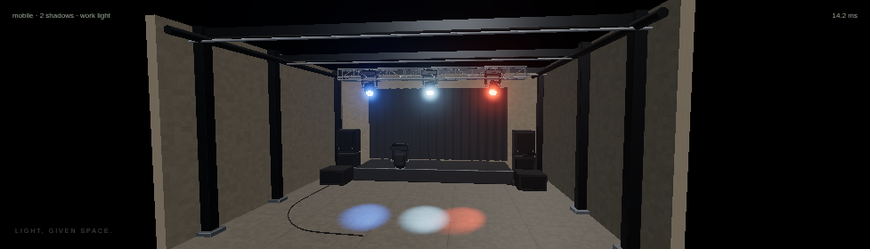
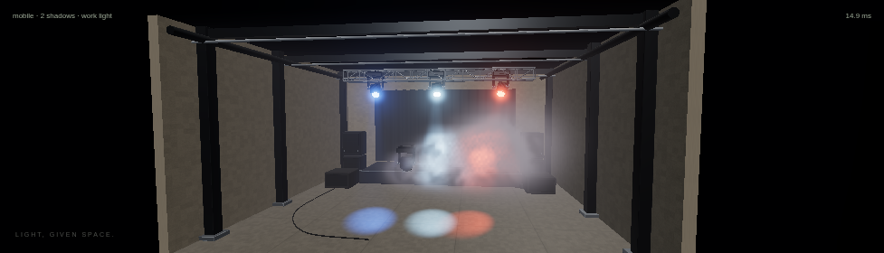
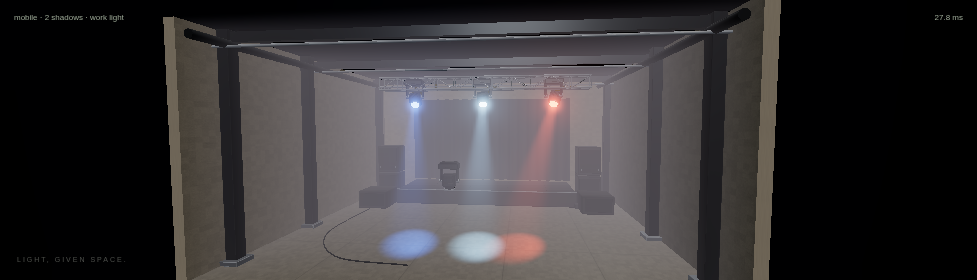

# Fog machine and venue controls

In **Rig → Fixture library**, create or edit a type and give its output channel the
attribute `:fog`. Under **Fog machine**, enable **Model fog output** and enter
the rated flow in cubic metres per minute. The off and full fields describe the
coarse DMX byte at each end of the output range. A fixture whose output increases
as its DMX value falls can use 255 for off and 0 for full.

Set the plume mixing time in seconds and the nozzle direction in world-space
X, Y, Z. Y points up. For example, `[1 0 0]` points along positive X. The
renderer normalizes direction. The default nozzle is `[0 0 1]`, mixing time
is 8 seconds and DMX endpoints are 0 and 255. **Validate & publish type** saves
the profile with its fixture definition. **Add fixture to rig** patches an
instance. Removing its fog channel removes the profile.

Under **Rig → Room & fixtures → Room atmosphere**, enter the venue’s air changes
per hour and the fog half-life in seconds, then **Save rig**. Leave a field
empty to use the model’s default of zero air changes per hour or a 180-second
half-life. Room dimensions remain in metres. The model combines the natural
decay and the air exchange, and derives emission from delivered fog DMX.

## Reading the room preview

The three captures show the same three fixtures, aim, light levels, camera and work light in an 8 × 4 × 7 m room. The test show ran a 360 m³/min fog machine at full DMX for two seconds, then stopped its pump. The mixing time was six seconds and the measured clearance half-life was 300 seconds. The preview used the room's extinction coefficient of 2 m⁻¹ and a 7 m reference sightline.

| Show time | Delivered pump DMX | Fog near the nozzle | Fog mixed into the room | Light lost along the reference sightline from mixed fog |
| --- | ---: | ---: | ---: | ---: |
| Before the cue | 0 | 0 m³ | 0 m³ | 0% |
| End of the 2 s burst | 255 | 10.18 m³ | 1.79 m³ | 10.6% |
| 28 s after the pump stopped | 0 | 0.09 m³ | 11.13 m³ | 50.1% |

The volumes are cubic metres at the machine's rated output density. The sightline percentage measures the mixed background. A nozzle plume can block much more light locally.

**Before the cue.** The lenses and the spots on the floor are visible in clear air.

**At two seconds.** A dense, shaped plume catches the light near the nozzle. From this camera, the floor and outer walls are still readily visible.

**At thirty seconds.** Fog has reached the rest of the room. The beams are visible through the air, and even the wall between them loses contrast.

These captures came from the production Studio in Chromium using the mobile rendering preset and SwiftShader. The show drove its preview DMX buffer, and the browser received the atmosphere over the Studio Transit WebSocket. The same nozzle volumes, mixed volumes and sightline percentages reached the offscreen renderer as appeared in the Ring snapshot.
